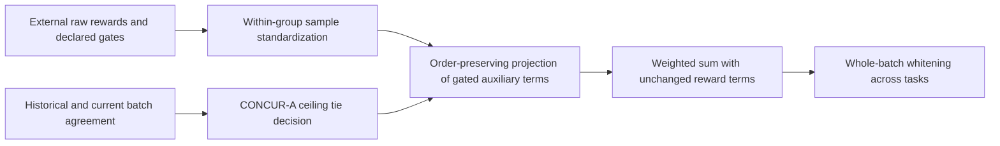
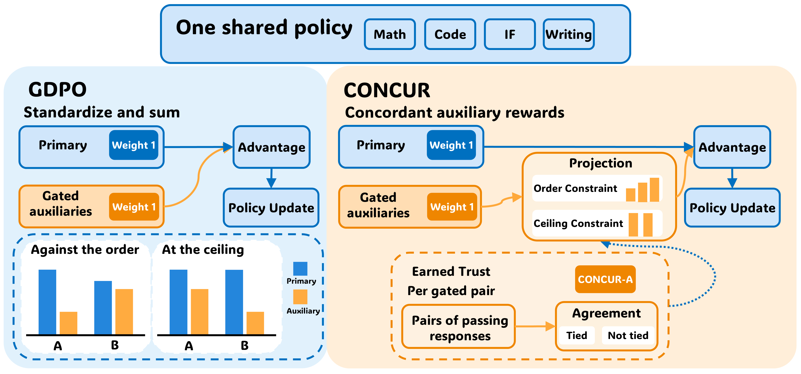

# CONCUR: Aligning gated auxiliary advantages with the primary reward

<!-- source-sha256: e811ed06ea3b661df16afeb6c0ee2dd6859f63a1b6bc343ad0102b18361c92d1 -->

[简体中文](README.md)

> Local status: **L1 numerical reward and advantage component; diagnostic only**. The complete multi-model, multi-task RL experiment is **not reproduced due to cost (review complete)**. No download, trial or automatic retry is scheduled.

## Paper information

| Field | Details |
| --- | --- |
| Paper | [CONCUR: Concordant Auxiliary Rewards for Multi-Task, Multi-Reward Reinforcement Learning](https://arxiv.org/abs/2610.36437v1); [reviewed v1 full text](https://arxiv.org/html/2610.36437v1) |
| Affiliations | First author Jixuan Leng: CMU. The work was done during a Google internship; collaborators include Google and Google DeepMind. |
| First public release | 2026-10-27 00:36:59 UTC, arXiv v1; backfilled from the October 28 announcement. |
| Author code | No author repository for CONCUR was found in this review. A training framework or baseline repository is not CONCUR source. |
| Local key | `concur`; standalone CPU component, not an LLM training adapter |
| Local code | `src/auto_research/post_training/concur.py` |
| Validation | [Three-seed CPU mechanism metrics](metrics/component-cpu-seeds42-44.json) |

## What the paper changes

In multi-reward RL, a primary reward can gate an auxiliary reward, but independently standardizing each component can undo that priority. The resulting auxiliary advantage may reverse the primary ordering, and when all responses are correct it can drive the update based only on a slight length difference. CONCUR projects gated auxiliary advantages onto the closest scores compatible with the primary reward within each prompt group, rather than redesigning rewards or reducing all their weights.

CONCUR-T always ties auxiliary scores at the primary-reward ceiling. CONCUR-A relaxes that tie once cumulative agreement meets a threshold. Neither variant alters ungated rewards, so the constraint does not guarantee that every weighted reward mixture will preserve order.

### Data flow



### Original paper figure



Unredrawn Figure 1 from the [original paper](https://arxiv.org/html/2610.36437v1#S1.F1), copyright the original authors. See [figure provenance](assets/provenance.json). The policy update shown in the figure is not implemented as local LLM training.

### Core equations

A response passes at \(p_i\ge 1/2\). For a gated raw auxiliary score \(s_{ik}\), use \(r_{ik}=\min(s_{ik},p_i)\) when it fails and \(r_{ik}=s_{ik}\) when it passes. Standardize within the group as \(z_{ik}=(r_{ik}-\bar r_k)/d_k\), using the sample standard deviation \(d_k\) and zero for a constant group. The projection is

$$
\hat z_k=\arg\min_{v\in C}\|v-z_k\|_2^2,\qquad
C_{\le}(p)=\{v:p_i>p_j\Rightarrow v_i\ge v_j\}.
$$

The ceiling-tie variant additionally requires \(p_i=p_j=1\Rightarrow v_i=v_j\); the implementation follows the appendix's \(p\ge1-10^{-6}\) tolerance. Average the ceiling scores when that constraint applies, then sort by `(primary, score)` and apply the pool-adjacent-violators algorithm (PAVA). Equal primary scores below the ceiling are **not** all averaged. Combine projected and unchanged terms using declared weights and whiten across the entire batch.

CONCUR-A counts only pairs of passing responses with unequal primary scores. Each reading is the number of agreements minus reversals divided by the number of eligible pairs; groups with no eligible pair produce no reading. For each task and auxiliary reward, the cumulative evidence includes the current batch. Relax the tie at \(n\ge61\) and \(\bar a>2\,\mathrm{se}\). This is a fixed decision threshold, not an i.i.d. significance guarantee, and later observations can restore the constraint.

### Results reported by the authors

The authors compare Qwen3-4B/8B and OLMo-3-7B on math, code, instruction following and writing. Tables 1 and 6 and the ablations report average advantages across tasks for the variants, with trade-offs between retaining and discarding auxiliary reward signals. Improvements are not guaranteed for every individual result. The local component has not produced these benchmark results. The paper reports **no production A/B test**.

## Local reproduction and limits

The input is a reward matrix with a declared primary column, gated columns and weights, not generated answers. `concur_batch` collects agreement evidence from the entire current batch before projecting any group, so iteration order cannot change the tie policy within that batch. Equation 2 does not fix the standard-deviation correction for batch whitening; the caller explicitly chooses `batch_std_correction=0` or `1` rather than treating one as a verified upstream default.

`standardized` implements Equation 1, `projected_scores` follows Section 4.1/Appendix B.2, `agreement` and `EarnedTrust` follow Equations 4 and 7, and `concur_batch` maps to Algorithm 1. There is no LLM, rollout, judge/reward model, reward-design dataset or clipped policy training. The component is not used for Evolve capability selection.

```bash
PYTHONPATH=src python -c 'from auto_research.post_training.concur import diagnostic; print(diagnostic(42))'
PYTHONPATH=src python -m pytest tests/test_oct30_post_agent.py -q
```

Tests compare PAVA against independent constrained quadratic optimization, and check the mean and energy decomposition, permutation equivariance, no erroneous merging below the ceiling, a near-zero all-pass group under the relevant fixture, the 61-reading threshold and consistent trust decisions for the current batch. The three-seed artifacts are mechanism results, not an LLM learning curve.

### Full experiment: not reproduced

Appendix D.2 reports four nodes with eight RTX PRO 6000 GPUs each per run. The full matrix uses 4B/8B policies, a 26B judge, an 8B reward model, 300 updates, long rollouts and multiple baselines. This exceeds the single A100/A30 or Mac budget. Review is complete, and the local component passing its tests does not establish the full paper's capabilities.
