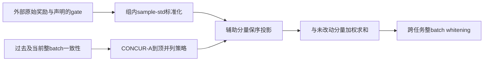
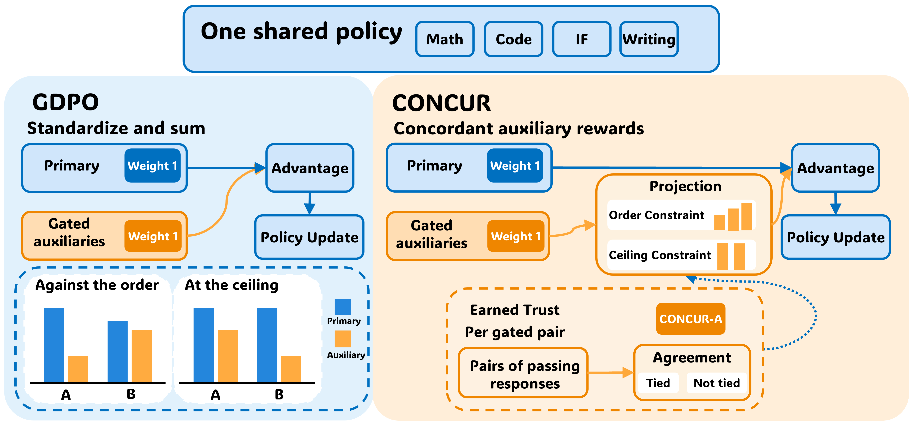

# CONCUR：让门控辅助优势服从主奖励

## 论文信息

| 字段 | 内容 |
| --- | --- |
| 论文链接 | [CONCUR](https://arxiv.org/abs/2610.36437v1)，固定[v1全文](https://arxiv.org/html/2610.36437v1) |
| 公司/机构 | 一作Jixuan Leng：CMU；工作在Google实习期间完成，合作者包括Google / Google DeepMind |
| 首次公开日期 | 2026-10-27 00:36:59 UTC，arXiv v1；本批属于10/28同公告补漏 |
| 原文开源代码 | 本轮未找到作者CONCUR实现仓库；不能把训练框架或基线仓库当成本论文源码 |
| 本地 Adapter | `concur`为独立CPU组件键，不是LLM训练adapter |
| 本地复现代码 | `src/auto_research/post_training/concur.py` |

> 仅L1奖励/优势数值组件。完整32GPU、多模型多任务RL实验**成本过高，不复现（审查 DONE）**；不下载、不探测、不自动重试。

## 原始论文总结

### 背景与主要改动

多奖励RL常让主奖励决定辅助奖励是否生效，但逐分量标准化会破坏原先优先级：辅助分量可能反转主奖励的排序；所有响应都已正确时，微小长度差异也可能独自决定更新。CONCUR不重写奖励或调低全局权重，而是在每个prompt组内把门控辅助优势投影到与主奖励相容的最近分数。

CONCUR-T始终合并主奖励到顶的辅助分数；CONCUR-A仅在累计一致性达到固定条件时放开这项约束。未门控的奖励保持原样，因此不能宣称所有多奖励组合都绝不反转排序。

### 架构与数据流

<!-- paper-figure:start -->
### 原论文关键图

图片来自[原论文](https://arxiv.org/html/2610.36437v1#S1.F1)，保持原图未重绘；版权归原作者所有。来源、图号与SHA256见`assets/provenance.json`。图中的策略更新不代表本地已经训练LLM。
<!-- paper-figure:end -->

### 核心公式

通过门槛为 $p_i\ge1/2$。门控辅助原始值为失败时 $r_{ik}=\min(s_{ik},p_i)$，通过时 $r_{ik}=s_{ik}$。按样本标准差计算 $z_{ik}=(r_{ik}-\bar r_k)/d_k$，常数组为零。

$$
\hat z_k=\arg\min_{v\in C}\|v-z_k\|_2^2,\quad
C_{\le}(p)=\{v:p_i>p_j\Rightarrow v_i\ge v_j\}.
$$

到顶并列再加 $p_i=p_j=1\Rightarrow v_i=v_j$；实现按附录以 $p\ge1-10^{-6}$ 判到顶。先平均到顶分数，再按`(primary, score)`排序做PAVA。**到顶以下的相同primary不能一律平均**。最终按声明权重求和，再跨整个batch白化。

CONCUR-A只统计passing且primary不同的响应对：一致数减反转数后除有效对数；无有效对就不产生读数。每个`task/auxiliary`累计所有历史及当前batch读数，$n\ge61$且 $\bar a>2\,\mathrm{se}$ 时放开到顶并列。它是固定决策阈值，不是独立同分布下的显著性保证；后来也可重新收紧。

### 论文离线与线上效果

作者在Qwen3-4B/8B及OLMo-3-7B上比较数学、代码、指令跟随和写作，报告两变体的跨任务平均优势，并展示保留/去掉辅助奖励各有取舍。不是每个单项都必然提高；Tables1/6与消融属于作者实验。本地没有这些benchmark结果；未报告生产线上A/B。

## 本地复现

### 数据协议与实现边界

输入是外部奖励矩阵及声明的主分量、门控列和权重；不是模型生成的答案。`concur_batch`先汇总整batch信任证据，再对任何组做投影，避免顺序改变同一batch的策略。Eq2未说明白化标准差的实现口径，因此调用者必须明确传`batch_std_correction=0/1`，不暗称其中一种是作者代码默认。

仅保留公式和估计器；不包含LLM、rollout、judge/RM、奖励设计数据或clipped策略训练，不接入evolve能力选择。

### 本地结果与负控

`tests/test_oct30_post_agent.py`将PAVA与独立约束二次优化对照，检查均值与能量分解、置换等变、到顶以下不误合并、全通过组近零、61条门槛和当前batch统一信任。三种子机制结果由本批统一运行器单独保存；不是LLM学习曲线。

### 代码映射

`standardized`对应Eq1，`projected_scores`对应Sec4.1/AppendixB.2；`agreement`与`EarnedTrust`对应Eq4/7；`concur_batch`对应Algorithm1。纯CPU，可从`diagnostic(42)`复查小数组合同。

### 高成本完整实验

AppendixD.2每次run使用4节点×8张RTX PRO6000；还包括4B/8B策略、26B judge、8B RM、300更新及长rollout/多基线。相对单A100/A30或Mac预算，完整实验**成本过高，不复现（审查 DONE）**，组件通过不升级为完整论文能力。
