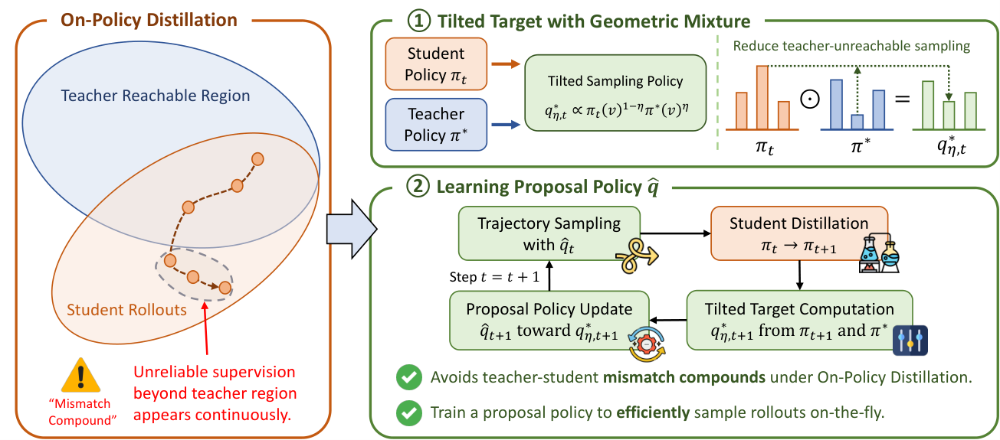

# MPOPD: Learning a geometric-mixture proposal for on-policy distillation

<!-- source-sha256: d0449fdb3b1d63ecef157d1fa8bb1b7f2e2ddd6ce25378481dd8cba142ad90e2 -->

[简体中文](README.md)

> **Local scope: L1 tensor diagnostic.** No language model is loaded. The full multi-model, long-rollout experiments were reviewed and not reproduced because of cost. The small-tensor CUDA validation does not reproduce the paper's benchmark results.

## Paper information

| Field | Details |
| --- | --- |
| Paper | [Proposing Better Rollouts for On-Policy Distillation](https://arxiv.org/abs/2610.36477v2) |
| Reviewed version | [arXiv v2 full text](https://arxiv.org/html/2610.36477v2), released 2026-10-28 22:30:09 UTC |
| First author and affiliation | Sirui Chen, University of Illinois Urbana-Champaign; includes Stanford collaborators |
| First public release | 2026-10-27 01:33:51 UTC, arXiv v1; v2 is a revision of the same paper |
| Author code | The [pinned author repository](https://github.com/csr16/MPOPD/tree/ac0971a1808d2719167be21c67501b66bed5a482) contains a README and assets, but no training source or LICENSE. It is not a runnable open-source implementation. |
| Local key | <code>mpopd</code>; tensor component, not a full distillation adapter |
| Local implementation | <code>src/auto_research/post_training/mpopd.py</code> |

## What the paper proposes

Conventional on-policy distillation samples from the student. The teacher may rarely visit those prefixes, and subsequent student updates can widen the gap between the regions visited by the two policies. MPOPD optimizes the rollout policy itself: a separate proposal learns to approximate a geometric mixture of student and teacher probabilities. Only the proposal is run to generate rollouts.

The mixture is **not** a replacement for the teacher in the student loss. The student still minimizes reverse KL to the teacher. The mixture is the target for the next proposal, and the student update accounts for the discrepancy between its own sampling distribution and the proposal's.

### Original paper figure

The figure is unmodified from the [reviewed paper](https://arxiv.org/html/2610.36477v2#S1.F2), licensed CC BY 4.0. See [figure provenance](assets/provenance.json) and the [upstream repository check](assets/upstream.json).

### Core equations

For history $h$, the ideal proposal is the normalized geometric mixture

$$
q^*_{\eta,t}(v\mid h)\propto
\pi_t(v\mid h)^{1-\eta}\pi^*(v\mid h)^\eta,\qquad 0\leq\eta\leq1.
$$

This is not an arithmetic mean of probabilities. A globally fixed $\eta$ also does not imply a fixed effective KL radius at every prefix. Appendix A.2 restricts the student KL and target construction to the teacher's top-$k$ support, renormalized there (default $k=16$).

$$
w_{t,j}=\operatorname{clip}\!\left(
\frac{\pi_t(y_j\mid h_j)}{\hat q_t(y_j\mid h_j)},1/C,C
\right),\qquad w_{t,0}=1,
$$

$$
\mathcal L_s=\mathbb E\sum_j w_{t,j-1}
\operatorname{KL}(\pi_\theta(\cdot\mid h_j)\|\pi^*(\cdot\mid h_j)),
\qquad
\mathcal L_q=\mathbb E\sum_j
\operatorname{KL}(\hat q_\phi(\cdot\mid h_j)\|q^*_{\eta,t+1}(\cdot\mid h_j)).
$$

The student loss uses the **previous token's one-step ratio**, not the current token's ratio or a cumulative product. The ratio comes from frozen old student and proposal snapshots. The target is rebuilt from the updated student. Each round initializes the proposal from the updated student before the inner optimization; continuing to optimize the old proposal would not follow the paper's configuration.

### What the paper reports

Across 16 math, knowledge, and medical tasks, the authors report a 6.91-point gain in average math accuracy and a 41% reduction in mean generation length for the 4B setting relative to OPD. Version 2 examines matched decoding budgets and redundancy after the answer separately; shorter outputs do not necessarily mean less reasoning. The local diagnostic does not measure either accuracy or generation length, and the paper does not report a production A/B test.

## Local reproduction and validation

The interface accepts aligned logits, sampled token IDs, and a contiguous response mask; it does not receive gold answers. <code>freeze_rollout_weights</code> computes frozen ratios from full-vocabulary sampling probabilities (Eqs. 7–8). <code>tilted_log_target</code> implements Eqs. 5 and 9. The student and proposal losses sum tokens within each trajectory and then average trajectories (Eqs. 7 and 10). Teacher, old proposal, and updated-student target tensors are detached, and padding is cleared before nonlinear operations. Defaults $C=5$ and $k=16$ come from Appendix A.2.

The caller must supply the tokenizer, rollouts, teacher queries, model copying, and optimizer orchestration. Logits alone cannot prove that a rollout came from the current proposal or that the proposal was reinitialized correctly. The local optimizer step is a mechanism check, not a reported training hyperparameter.

From the repository root:

~~~bash
PYTHONPATH=src python -c 'from auto_research.post_training.mpopd import diagnostic; print(diagnostic(42))'
PYTHONPATH=src python -m pytest tests/test_oct30_post_agent.py -q
~~~

Checks include independent gradient checks for both objectives, actual student and proposal updates, no teacher or padding gradients, the $\eta$ endpoints, geometric versus arithmetic mixing, lagged versus current or cumulative ratios, and rejection of malformed masks, supports, and snapshots. See the [three-seed CUDA metrics](metrics/component-cuda-seeds42-44.json) and [A100 receipt](../../gpu-validations/mpopd-a100-20261030.json).

### Full experiment: reviewed, not reproduced

The study uses two GPUs with tensor parallelism of two, 1.7B/4B/8B students, a separate proposal, 4B/30B-A3B teachers, 4K-token training rollouts, evaluation with up to 16K tokens and 32 samples per question, and several baselines. The full configuration exceeded the project's budget. It was not downloaded, probed, or automatically retried.
