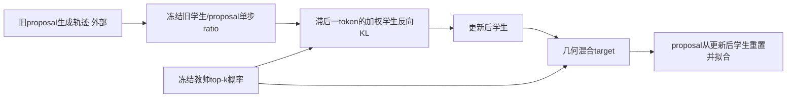
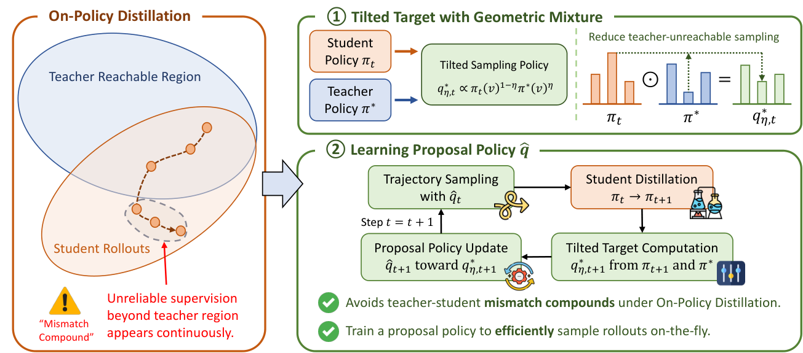

# MPOPD：学习几何混合提案的OPD张量组件

## 论文信息

| 字段 | 内容 |
| --- | --- |
| 论文链接 | [Proposing Better Rollouts for On-Policy Distillation](https://arxiv.org/abs/2610.36477v2)，固定[v2全文](https://arxiv.org/html/2610.36477v2) |
| 公司/机构 | 一作Sirui Chen：University of Illinois Urbana-Champaign；含Stanford合作者 |
| 首次公开日期 | arXiv v1：2026-10-27 01:33:51 UTC；本轮审查v2：2026-10-28 22:30:09 UTC，版本更新不另算新论文 |
| 原文开源代码 | [作者MPOPD仓库](https://github.com/csr16/MPOPD/tree/ac0971a1808d2719167be21c67501b66bed5a482)，固定`ac0971a1808d2719167be21c67501b66bed5a482`；当前仅README/assets，没有训练源码或LICENSE，不能标为可运行开源实现 |
| 本地 Adapter | `mpopd`为L1张量组件键，不是完整蒸馏adapter |
| 本地复现代码 | `src/auto_research/post_training/mpopd.py` |

> 不加载任何LM。完整多模型/长rollout实验**成本过高，不复现（审查 DONE）**；CUDA小张量验收只以本批独立A100/A30回执为准，不等于复现论文benchmark。

## 原始论文总结

### 背景与主要改动

普通OPD从学生采样，教师却可能很少走到这些前缀，师生可达区域差距会被后续学生更新放大。MPOPD把采样策略本身作为优化对象：理想提案是学生与教师概率的几何混合，实际训练一个独立proposal近似它，从而生成时只运行proposal。

这不等于把几何混合直接当学生蒸馏target：学生仍向教师做反向KL；几何target用于下一轮proposal，并需要处理proposal与学生的采样差距。

### 架构与数据流

<!-- paper-figure:start -->
### 原论文关键图

图片来自[原论文](https://arxiv.org/html/2610.36477v2#S1.F2)，未重绘或裁切，版权归原作者所有（论文CC BY4.0）；来源哈希见`assets/provenance.json`，作者仓库核对见`assets/upstream.json`。
<!-- paper-figure:end -->

### 核心公式

$$
q^*_{\eta,t}(v|h)\propto \pi_t(v|h)^{1-\eta}\pi^*(v|h)^\eta,
\qquad 0\le\eta\le1.
$$

这是归一化几何混合，不是概率的算术平均。全局固定 $\eta$ 不表示每个prefix都有相同的有效KL半径。按AppendixA.2，学生KL和target构造使用教师top-k（默认16）并在该支持上重新归一化。

$$
w_{t,j}=\operatorname{clip}\left(\frac{\pi_t(y_j|h_j)}{\hat q_t(y_j|h_j)},1/C,C\right),\quad w_{t,0}=1,
$$
$$
\mathcal L_s=\mathbb E\sum_j w_{t,j-1}\,\mathrm{KL}(\pi_\theta(\cdot|h_j)\|\pi^*(\cdot|h_j)),\quad
\mathcal L_q=\mathbb E\sum_j\mathrm{KL}(\hat q_\phi(\cdot|h_j)\|q^*_{\eta,t+1}(\cdot|h_j)).
$$

关键是**前一token的单步ratio**，不是当前token，也不是累积乘积。ratio来自冻结old-policy快照；学生更新后重新构造target。每轮proposal从更新后学生初始化，再做内层优化；不能持续优化旧proposal却说完全遵循作者配置。

### 论文离线与线上效果

作者在16套数学、知识和医学任务评测，报告4B数学平均准确率相对OPD增加6.91点、平均生成长度减少41%。v2对匹配解码预算及答案后冗余另作分析，不能把缩短长度一概解释为少推理。本地没有这些准确率或生成长度测量；未报告生产线上A/B。

## 本地复现

### 数据协议与实现边界

只读外部对齐logits、采样token ID和连续response mask，不接收问题标准答案。`freeze_rollout_weights`以完整词表采样概率构造冻结ratio；`student_loss`与`proposal_loss`使用明确的教师支持，按每轨迹token求和、再平均轨迹。teacher、old proposal和构造target的更新后学生不收梯度；padding在非线性计算前清理。

当前不实现tokenizer、轨迹生成、教师查询、LM参数复制或optimizer编排；logits接口无法证明轨迹真的来自当前proposal。proposal重置与真实on-policy provenance是调用者外部前提，不把小数组当真实推荐/推理模型。

### 本地结果与负控

独立测试包含双目标gradcheck、学生/proposal真实小步更新、teacher无梯度、padding梯度零、eta端点、几何/算术混合差异，以及ratio滞后/非累积、非法mask/支持/快照拒绝。CPU与CUDA三种子产物由统一运行器分别保存，完整A100/A30回执是CUDA交付门槛。

### 代码映射

`tilted_log_target`对应Eq5/9；`freeze_rollout_weights`对应Eq7/8；两个loss对应Eq7/10。默认C=5、top-k=16来自AppendixA.2；小tensor优化步长仅为本地机制检查，不是论文训练超参数。

### 高成本完整实验

原配置使用2GPU及TP=2，1.7B/4B/8B学生、独立proposal与4B/30B教师，4K训练rollout、至多16K/32采样评测及多基线。因此完整实验**成本过高，不复现（审查 DONE）**，不下载、不启动试跑或自动扩大预算。
