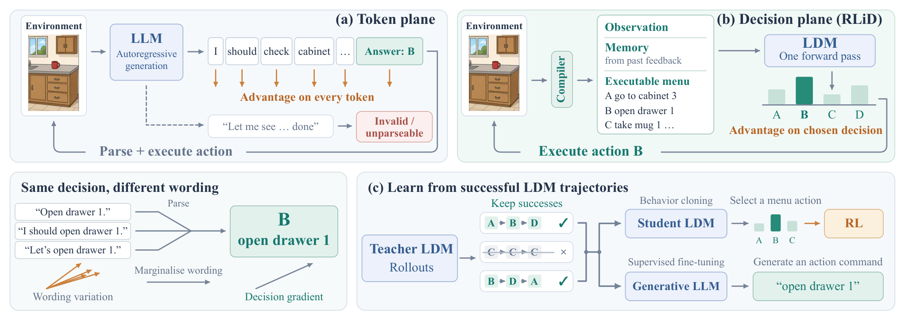
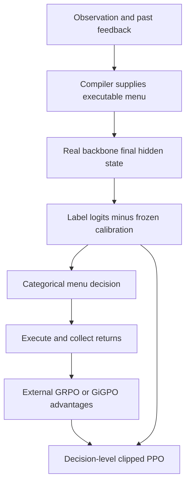

# RLiD: assign gradients directly to executable decisions

<!-- source-sha256: 2968f36a0c7cc21f327588b91c4b61361ae5c2953cd25a9245e524d33b110bec -->

[简体中文](README.md)

> **L1 decision probability / PPO / variance-identity components, diagnostic only**. Full multi-environment training, distillation, and capability evaluation are **not reproduced because of excessive cost (review DONE)**. `evolve_integrated=false`; a small-array identity is not agent success evidence.

## Paper information

| Field | Value |
|---|---|
| Paper | [RLiD: Reinforcement Learning in the Decision Plane for Language Agents and LLMs](https://arxiv.org/abs/2611.02455v1); [full text](https://arxiv.org/html/2611.02455v1) |
| Company / institution | First author **Ziyi Chen, University of Illinois Urbana-Champaign**; collaborators also list NUS, Zhejiang University, University of Pennsylvania, and University of Rochester |
| Original publication | arXiv v1: **2026-11-02 03:17:51 UTC**; announced **2026-11-03** |
| Original author code | **No verified public repository found** as of 2026-11-04. The official abs/HTML has no author repository URL. `ldmrl/` and `llmdistill/raw/` are artifact paths, not verified open-source links; exact-title/ID search did not establish one |
| Upstream license / revision | Not applicable without a verified repository; independently implemented here. Paper and original figure: **CC BY 4.0** |
| Local adapter / key | `rlid`; numerical component, not an ALFWorld agent; automatic promotion disabled |
| Local code | `src/auto_research/post_training/rlid.py` |
| Entry points | `menu_log_probabilities`, `decision_ppo_loss`, `marginal_label_penalty`, `credit_variance_audit`, `diagnostic(seed=42, device='cpu')` |
| Validation | [Three-seed component metrics](metrics/component-cuda-seeds42-44.json) and [CUDA receipt](../../gpu-validations/rlid-a100-20261104.json) are integrated with this batch. Unexecuted results must not be recorded as passed |

## Original method

### Motivation and change

RLiD compiles observations, feedback-derived memory, and executable menus, then chooses labels in one forward pass. Decision-level RL avoids assigning action credit to every wording/format token. Menus, afterstates, and memory change the task interface and must be matched in comparisons. Neither temporal-credit noise nor the benefit of reasoning computation disappears automatically.

<!-- paper-figure:start -->
### Original paper figure



Unmodified PNG from [Figure 1](https://arxiv.org/html/2611.02455v1#S1.F1), visually checked for generation/parsing, single-pass menus, wording marginalization, and both distillation branches. The environment, LDM, memory compiler, and distillation system are not implemented locally. Attribution, CC BY 4.0, and SHA-256 are in `assets/provenance.json`.
<!-- paper-figure:end -->



### Equations

$$
\pi_\theta(j\mid x)=\operatorname{softmax}_{j\le k}\left(W_{\ell_j}^{\top}h_\theta(x)-\beta_{k,j}\right),\quad
\rho_t=\frac{\pi_\theta(j_t\mid x_t)}{\pi_{old}(j_t\mid x_t)},
$$

$$
\ell_t=-\min\!\left(\rho_t\hat A_t,
\operatorname{clip}(\rho_t,1-\epsilon,1+\epsilon)\hat A_t\right).
$$

Label calibration or microbatch marginal $\mathrm{KL}(u\Vert\bar\pi_k)$ addresses label bias; the latter is not per-decision entropy. Menu shuffling, episode balancing, GiGPO anchors, and sampled evaluation are separate requirements.

Proposition 1 applies **within one text policy**, with $a=g(y)$:

$$
\nabla\log p_\theta(y\mid x)=\nabla\log\pi_\theta(a\mid x)+\nabla\log p_\theta(y\mid x,a),
$$

$$
\operatorname{tr}\operatorname{Cov}(\hat A\nabla\log p_\theta(y\mid x))-
\operatorname{tr}\operatorname{Cov}(\hat A\nabla\log\pi_\theta(a\mid x))
=\mathbb E[\hat A^2\|\nabla\log p_\theta(y\mid x,a)\|^2]\ge0.
$$

Advantages must be conditionally independent of wording given the action. This is not a performance theorem comparing differently parameterized models; temporal advantage estimation remains noisy.

### Reported outcomes, not local results

The full ALFWorld route reports **99.3% / 12.7 H100 GPU-hours**, versus **86.6% / 17.3 GPU-hours** for same-LLM token RL. It is not universally better: Qwen3.5-2B ARC yields **84.0%** versus token GRPO's **85.8%**; Countdown-after does not significantly beat the rationale+decision hybrid. The paper discloses periodic test-curve logging during development and possible adaptive peeking. Local work does not adopt that practice or report task scores. No production online A/B is reported.

## Local implementation

### Inputs and code mapping

`menu_log_probabilities` accepts aligned single-label logits, an executable-menu mask, and external frozen calibration. The caller remains responsible for real single-token tokenizer labels, admissible-action provenance, and observation-only memory. No such sources, gold plans, or answers are obtained by this component.

`decision_ppo_loss` consumes and freezes external old-policy sampled-action log-probabilities and advantages. It implements two-sided clipping with an explicit local decision-mean reduction. Optional frozen $\bar T/T^{(i)}$ weights support episode balancing without another division by their sum. It does not compute GRPO/GiGPO, returns, or training order. `marginal_label_penalty` groups identical menu supports, computes mean label probabilities, then uniform-to-marginal KL. Support groups are equally weighted by local convention; no author coefficient or update schedule is claimed.

`credit_variance_audit` enumerates a finite categorical text policy and its text-to-action partition, computing scores in full softmax-logit coordinates, expected updates, and covariance traces. It audits an identity, not an SAE, real LM, or environment capability.

```bash
PYTHONPATH=src python -m pytest tests/post_training/test_nov04_specopd_rlid.py -q
PYTHONPATH=src python -c 'from auto_research.post_training.rlid import diagnostic; print(diagnostic(42, device="cpu"))'
```

### Checks, negative controls, and limits

Seeded random logits undergo actual backward propagation and a small update. Checks cover zero mass/gradient outside menus, unit row mass, frozen old-policy/advantage/calibration, both clipping signs, episode weighting, and the variance identity. Two decisions favoring opposite labels can have a uniform batch marginal and zero penalty despite low individual entropy: this negative control catches an incorrect per-row entropy implementation. Logsumexp stabilizes extreme finite logits.

There is no LM backbone, environment compiler, menu shuffling, memory, online calibration update, GiGPO, LoRA, successful-trajectory collection, or distillation. Diagnostics do not output answer accuracy/plan success, compare actual policies, or support evolve promotion. CPU/CUDA three-seed results remain L1 numerical evidence.

### Full-experiment cost decision

The study uses rank-16 LoRA on Qwen2.5 **0.5B/1.5B/3B/7B** and Qwen3.5 **2B/4B/9B**, multiple environments/seeds, and ALFWorld groups of **eight** episodes with up to **50 steps** each. The measured full route already costs **12.7 H100 GPU-hours**, not a promised A100 runtime. The matrix is **not reproduced because of excessive cost (review DONE)** on one A100/A30 or the Mac: no weight/data downloads, full training, or automatic retry. The paper and exact local formulas remain useful without claiming unvalidated capability.
