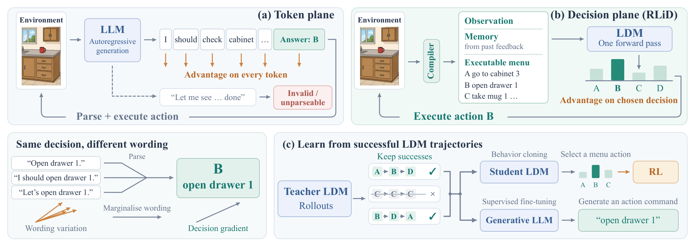
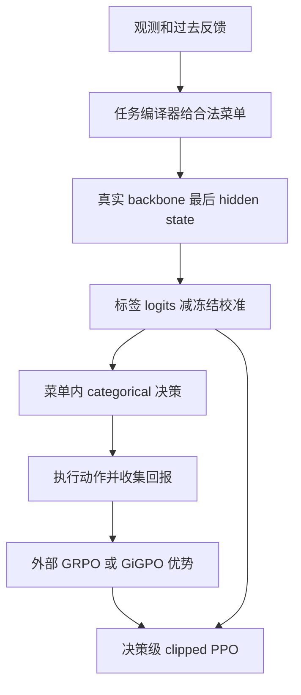

# RLiD：直接给可执行决策分配梯度

> **L1 决策概率 / PPO / 方差恒等式组件，diagnostic only**。完整多环境训练、蒸馏与能力评测：**成本过高，不复现（审查 DONE）**。`evolve_integrated=false`，不把小数组恒等式当作 Agent 成功率。

## 论文信息

| 字段 | 内容 |
|---|---|
| 论文 | [RLiD: Reinforcement Learning in the Decision Plane for Language Agents and LLMs](https://arxiv.org/abs/2611.02455v1)；[正文](https://arxiv.org/html/2611.02455v1) |
| 公司 / 作者机构 | 一作 **Ziyi Chen，University of Illinois Urbana-Champaign**；合作机构还列 NUS、Zhejiang University、University of Pennsylvania、University of Rochester |
| 原始发布日期 | **2026-11-02 03:17:51 UTC**，arXiv v1；2026-11-03 公告 |
| 原作者代码 | **未找到已核实公开仓库**：截至 2026-11-04，官方 abs/HTML 没有作者仓库 URL；正文 `ldmrl/`、`llmdistill/raw/` 是内部产物路径，不冒充开源链接；精确题名/编号检索未核实作者仓库 |
| 原作者代码许可 / 版本 | 无核实仓库，许可与固定 SHA 不适用；本地据公式独立实现。论文及原图许可 **CC BY 4.0** |
| 本地 Adapter / key | `rlid`；数值组件，非 ALFWorld Agent；不允许自动晋级 |
| 本地代码 | `src/auto_research/post_training/rlid.py` |
| 本地入口 | `menu_log_probabilities`、`decision_ppo_loss`、`marginal_label_penalty`、`credit_variance_audit`、`diagnostic(seed=42, device='cpu')` |
| 结果与验收 | [三种子组件指标](metrics/component-cuda-seeds42-44.json)、[CUDA 收据](../../gpu-validations/rlid-a100-20261104.json)，由本批统一验收；不得预填未执行结果 |

## 原始论文总结

### 背景与主要改动

文本策略会把一次动作的优势赋给推理、格式和命令 token。RLiD 将观测、过去反馈形成的记忆和合法菜单编译成输入，单次前向仅在标签之间选动作，再做决策级 RL。菜单、afterstate 和记忆本身会改变问题，比较必须对齐接口。它不消除跨时间信用估计，也不证明无推理 token 总优于有推理 token。

<!-- paper-figure:start -->
### 原论文关键图



图片来自[原论文](https://arxiv.org/html/2611.02455v1#S1.F1) Figure 1 的 PNG，未裁剪/未重绘；已目视核对生成与解析、合法菜单单前向、同动作措辞边缘化及蒸馏两支。图中环境、LDM、记忆编译器和蒸馏器不代表本地已实现。版权归原作者所有，CC BY 4.0 与 SHA-256 见 `assets/provenance.json`。
<!-- paper-figure:end -->



### 核心公式

Sec. 2 Eq. 1–2：

$$
\pi_\theta(j\mid x)=\operatorname{softmax}_{j\le k}\left(W_{\ell_j}^{\top}h_\theta(x)-\beta_{k,j}\right),\quad
\rho_t=\frac{\pi_\theta(j_t\mid x_t)}{\pi_{old}(j_t\mid x_t)},
$$

$$
\ell_t=-\min\!\left(\rho_t\hat A_t,
\operatorname{clip}(\rho_t,1-\epsilon,1+\epsilon)\hat A_t\right).
$$

标签偏置可用冻结校准 $\beta_k$，或微批次菜单标签边际上的 $\mathrm{KL}(u\Vert\bar\pi_k)$；不是逐动作 entropy。原文还讨论菜单 shuffle、episode 长度平衡、GiGPO anchor 和 sampled evaluation，这些不因实现 PPO 自动具备。

Proposition 1 只比较**同一文本策略**：令 $a=g(y)$，则

$$
\nabla\log p_\theta(y\mid x)=\nabla\log\pi_\theta(a\mid x)+\nabla\log p_\theta(y\mid x,a),
$$

$$
\operatorname{tr}\operatorname{Cov}(\hat A\nabla\log p_\theta(y\mid x))-
\operatorname{tr}\operatorname{Cov}(\hat A\nabla\log\pi_\theta(a\mid x))
=\mathbb E[\hat A^2\|\nabla\log p_\theta(y\mid x,a)\|^2]\ge0.
$$

前提是优势在给定动作后不依赖具体措辞。这不是不同参数化模型之间的性能定理；跨时间优势估计仍有噪声。

### 论文离线与线上效果

ALFWorld 完整训练—蒸馏路线报告 **99.3% / 12.7 H100 GPU-hours**，同 LLM token-RL 对照 **86.6% / 17.3 GPU-hours**。不是处处领先：ARC 的 Qwen3.5-2B 决策路线 **84.0%**，token GRPO **85.8%**；Countdown-after 与 rationale+decision hybrid 没有显著性能差异。正文还披露开发中周期记录 test 曲线，存在 adaptive peeking 可能。本地不沿用该做法，且未报告任何真实任务分数。原文未报告互联网生产线上 A/B。

## 本地复现

### 数据协议与代码映射

`menu_log_probabilities` 接收对齐的单标签 logits、合法菜单 mask 和外部冻结校准。调用方负责真正 tokenizer 的 single-token 标签、合法动作来源和 observation-only 记忆；本地不获取这些信息，更不接收 gold plan/answer。

`decision_ppo_loss` 接收外部旧策略 sampled-action logp 与优势并冻结；实现双向 clipping，默认显式选择 decision-mean。可传入冻结的 $\bar T/T^{(i)}$ 权重实现长度平衡，不再除以权重和。它不计算 GRPO/GiGPO、回报或训练时序。`marginal_label_penalty` 按相同菜单支持分组取 mean policy，再算 uniform-to-marginal KL；本地约定各组等权，无原文系数/更新时序的冒充。

`credit_variance_audit` 在同一个有限 categorical 文本策略里枚举文本到动作的划分，计算完整 softmax-logit 坐标下的 score、期望更新和方差。它是恒等式审计，不是 SAE、真实 LM 或环境能力实验。

```bash
PYTHONPATH=src python -m pytest tests/post_training/test_nov04_specopd_rlid.py -q
PYTHONPATH=src python -c 'from auto_research.post_training.rlid import diagnostic; print(diagnostic(42, device="cpu"))'
```

### 结果、负控与边界

seeded 随机 logits 真正 backward 后做一次小更新；检查菜单外质量/梯度为零、每行归一化、old/优势/校准冻结、正负优势 clipping、episode 权重与方差恒等式。对两个标签各自偏向相反的两条决策，均值边际可均匀，penalty 为零，尽管每条决策的 entropy 很低；该负控防止误写成逐行 entropy。极端有限 logits 用 logsumexp 维持数值稳定。

没有 LM backbone、环境 compiler、菜单 shuffle、记忆、在线校准更新、GiGPO、LoRA、成功轨迹收集或蒸馏。诊断不输出 answer accuracy/plan success，不比较两个真实策略，不晋级 evolve。CPU/CUDA 三 seed 仍只有 L1 数值证据。

### 高成本完整实验

论文使用 Qwen2.5 **0.5B/1.5B/3B/7B** 与 Qwen3.5 **2B/4B/9B** 的 rank-16 LoRA、多环境/多 seed；ALFWorld 每 episode 最多 **50 步**、组内 **8 条**。完整路线作者实测已需 **12.7 H100 GPU-hours**，不能换算成单卡 A100 的保证时间。单张 A100/A30 或 Mac 不执行这一矩阵：**成本过高，不复现（审查 DONE）**；不下载权重/数据、不完整训练、不自动重试。保留论文价值与局部公式，不把未验收能力写成完成。
