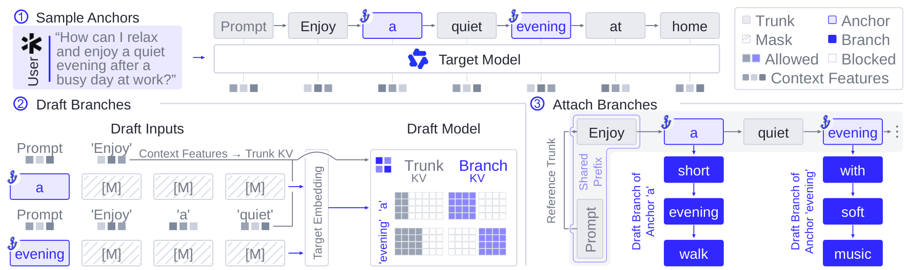
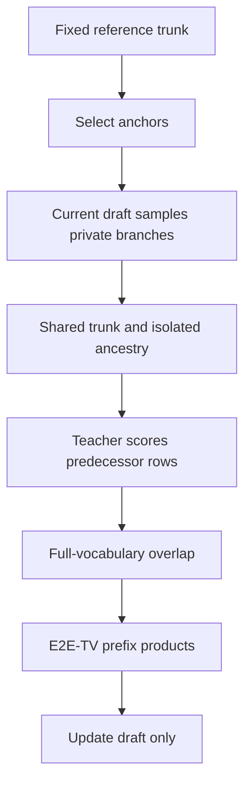

# SpecOPD: independent supervision branches and acceptance-prefix optimization

<!-- source-sha256: 932961849d1006c4840c5fad45e2a4d9d31aaf9aaec265b96898d2259fba7a03 -->

[简体中文](README.md)

> **L1 numerical components, diagnostic only**. Full training and serving experiments are **not reproduced because of excessive cost (review DONE)**. Tensor checks are not speculative-decoding speed measurements; `evolve_integrated=false`.

## Paper information

| Field | Value |
|---|---|
| Paper | [SpecOPD: Branch-Parallel On-Policy Distillation for Speculative Decoding](https://arxiv.org/abs/2611.02846v1); [full text](https://arxiv.org/html/2611.02846v1) |
| Company / institution | First author **Tianyu Liu** lists **Qwen Business Unit of Alibaba / University of Science and Technology of China** |
| Original publication | arXiv v1: **2026-11-02 09:47:06 UTC**; announced **2026-11-03**, not a November 4 first release |
| Original author code | **No verified repository found** as of 2026-11-04 in the official abs/HTML or exact-title/GitHub search. Referenced DFlash/Draft-OPD repositories do not establish a SpecOPD code release |
| Upstream license / revision | Not applicable without a verified repository; independently implemented here. Paper and original figure: **CC BY 4.0** |
| Local adapter / key | `specopd`; standalone numerical component, not a task-capability adapter; automatic promotion disabled |
| Local code | `src/auto_research/post_training/specopd.py` |
| Entry points | `proposal_tree`, `prediction_logits`, `e2e_tv_loss`, `diagnostic(seed=42, device='cpu')` |
| Validation | [Three-seed component metrics](metrics/component-cuda-seeds42-44.json) and [CUDA receipt](../../gpu-validations/specopd-a100-20261104.json) are integrated with this batch. An unexecuted check must not be recorded as passed |

## Original method

### Motivation and change

SpecOPD samples fresh draft continuations at fixed reference anchors, shares their trunk, and scores private histories in parallel. This is not unrestricted on-policy response generation. Sparse indexers and recurrent targets additionally need branch-consistent grouping and state replay; a mask alone is insufficient.

<!-- paper-figure:start -->
### Original paper figure



Uncropped, unmodified PNG from [Figure 2](https://arxiv.org/html/2611.02846v1#S2.F2), visually checked against its three stages and private branches. The depicted models, sampler, and production kernels are not local implementations. Author attribution, CC BY 4.0, and SHA-256 are recorded in `assets/provenance.json`.
<!-- paper-figure:end -->



### Equations

$$
h_{b,i}=(x_{\le a_b},y_{b,<i}),\qquad y_{b,i}\sim q_\theta(\cdot\mid h_{b,i}).
$$

Only the reference prefix through the anchor and that branch's predecessors are visible. The anchor row predicts the first sample; predecessor rows predict later samples. Own-row readout leaks the answer. Semantic positions $a_b+i$ differ from packed offsets.

$$
\alpha_{b,i}=\sum_v\min\{q_\theta(v\mid h_{b,i}),p(v\mid h_{b,i})\},\qquad
L=1-\frac1{BW}\sum_{b=1}^B\sum_{j=1}^W\prod_{i=1}^j\alpha_{b,i}.
$$

Samples and teacher distributions are fixed during differentiation. Preserve teacher mass outside draft support; do not renormalize it away. For history-dependent proposals, prefix products are a surrogate, not an unbiased serving-acceptance estimate.

### Reported outcomes, not local results

Reported maxima are **+41.45%** mean acceptance length, **16.09×** supervised-token throughput under native configurations, and **3.56×** generation speed over AR. These are different protocols. Appendix A.8 reports only **2.83% / 2.20% / 1.21%** geometric-mean throughput improvements over original DFlash V2 at concurrency 1/8/32; SWE at 32 is **4.46% slower**. No production online A/B is reported. None of these scores is reproduced locally.

## Local implementation

### Inputs and code mapping

`proposal_tree` takes only reference length, zero-based anchors, and branch width. It constructs parents, positions, attention visibility, and prediction rows; no reference text or answers are consumed. `prediction_logits` reads supplied hidden states and a supplied head. It is not a teacher checkpoint. `e2e_tv_loss` consumes same-history aligned logits, detaches the teacher, retains its full probability mass, and evaluates the prefix objective. FP16/BF16 probability computations and reductions promote to FP32. Inactive draft support may contain NaN padding, but the entire teacher vocabulary must remain finite.

The seeded diagnostic performs real backward propagation and a small update on random tensors. Packed full-attention scoring is compared against each branch's independent causal scoring. These are numerical/teaching checks, not a public dataset, LM rollout, or sampling-capability comparison. More seeds do not change their L1 status. No answer accuracy, task success, or gold-dependent capability score is produced.

```bash
PYTHONPATH=src python -m pytest tests/post_training/test_nov04_specopd_rlid.py -q
PYTHONPATH=src python -c 'from auto_research.post_training.specopd import diagnostic; print(diagnostic(42, device="cpu"))'
```

### Checks, negative controls, and limits

Tests cover future/sibling isolation, predecessor readout, duplicate anchors, one-token branches, independent causal equivalence, finite gradients, frozen teachers, outside-support teacher mass, the greater prefix cost of early mismatch, gradcheck, and low-precision promotion. The teaching distributions `[.5,.5,0]` versus `[.4,.4,.2]` must yield loss `.2`; renormalizing the teacher incorrectly makes it zero.

There is no actual drafter sampling, frozen target checkpoint, KV-reuse kernel, sparse indexer, GDN replay, distributed normalization, or serving runner. This cannot be promoted as an executable evolve operator, a training speedup, or a complete SpecOPD reproduction.

### Full-experiment cost decision

The study spans **8B/27B/125B** targets, three drafters, and multiple tasks. The 27B training-throughput comparison uses **eight high-performance GPUs**; an 8B continuation reaches **10,000 steps**, and the main selected 27B checkpoint is **step 36,000**. Appendix B still leaves retained Open-PerfectBlend subsets and exact checkpoint identifiers incompletely documented. This matrix is not run on one A100/A30 or the Mac: **not reproduced because of excessive cost (review DONE)**. No weights/data are downloaded, no costly probe is launched, and no automatic retry is scheduled. This is a source-based assessment, not a local runtime measurement.
