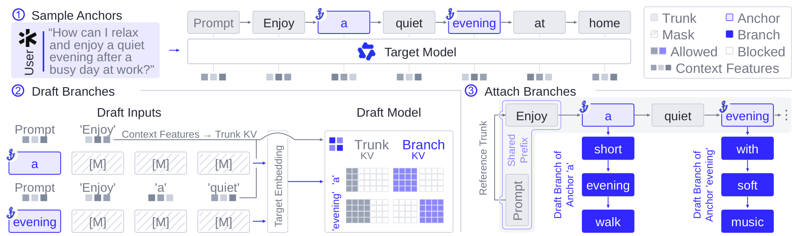
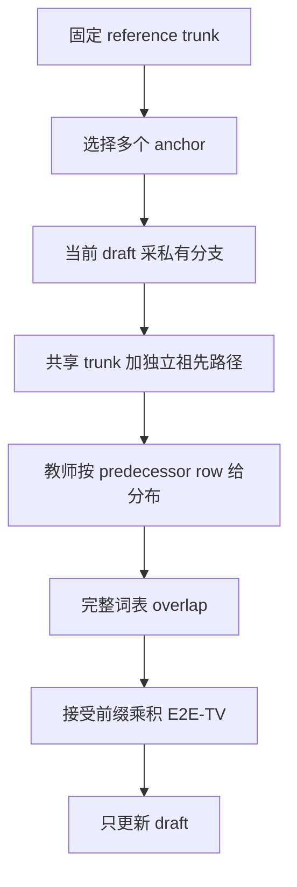

# SpecOPD：以独立分支收集监督，直接优化接受前缀

> **L1 数值组件，diagnostic only**。完整训练与 serving 实验：**成本过高，不复现（审查 DONE）**。本地张量验证不等于真实推测解码加速；`evolve_integrated=false`。

## 论文信息

| 字段 | 内容 |
|---|---|
| 论文 | [SpecOPD: Branch-Parallel On-Policy Distillation for Speculative Decoding](https://arxiv.org/abs/2611.02846v1)；[正文](https://arxiv.org/html/2611.02846v1) |
| 公司 / 作者机构 | 一作 **Tianyu Liu** 列 **Qwen Business Unit of Alibaba / University of Science and Technology of China** |
| 原始发布日期 | **2026-11-02 09:47:06 UTC**，arXiv v1；2026-11-03 公告，不混成 11 月 4 日新首发 |
| 原作者代码 | **未找到已核实作者仓库**：截至 2026-11-04，官方 abs/HTML 没有 SpecOPD 实现链接，题名/GitHub 检索没有核实作者实现；引用的 DFlash 和 Draft-OPD 不等于本论文开源 |
| 原作者代码许可 / 版本 | 未核实仓库，许可与固定 SHA 不适用；本地独立实现。论文及原图为 **CC BY 4.0** |
| 本地 Adapter / key | `specopd`；独立组件，非任务能力 adapter；禁止自动晋级 |
| 本地代码 | `src/auto_research/post_training/specopd.py` |
| 本地入口 | `proposal_tree`、`prediction_logits`、`e2e_tv_loss`、`diagnostic(seed=42, device='cpu')` |
| 结果与验收 | [三种子组件指标](metrics/component-cuda-seeds42-44.json)、[CUDA 收据](../../gpu-validations/specopd-a100-20261104.json)，随本批统一验收。未执行的结果不得预填为通过 |

## 原始论文总结

### 背景与主要改动

普通 OPD 要逐轮 draft-and-verify 才能继续收集上下文。SpecOPD 在已有 reference 的多个 anchor 上重新采当前 draft 的私有续写，合并成共享 trunk 的 proposal tree，再并行给教师打分。这里 on-policy 指固定外层上下文上的新 draft 采样，不是无限制完整响应 rollout。混合模型还分别需要 sparse indexer 一致性和 recurrent state replay，单靠 attention mask 不够。

<!-- paper-figure:start -->
### 原论文关键图



图片来自[原论文](https://arxiv.org/html/2611.02846v1#S2.F2) Figure 2 的原始 PNG，未裁剪、未重绘；已目视核对三个阶段与私有分支。模型、采样器和生产 kernel 不代表本地已实现。版权归原作者所有，CC BY 4.0 许可与 SHA-256 见 `assets/provenance.json`。
<!-- paper-figure:end -->



### 核心公式

Sec. 2 的每个分支使用自己的采样历史：

$$
h_{b,i}=(x_{\le a_b},y_{b,<i}),\qquad y_{b,i}\sim q_\theta(\cdot\mid h_{b,i}).
$$

教师 mask 只允许读取 anchor 之前的 reference 与当前分支祖先，不允许未来 reference、其他分支。首 token 的预测行是 anchor，后续 token 读前一个采样 token 的 hidden row，不能读自身，否则泄漏答案。语义位置为 $a_b+i$，不等于 packed offset。

$$
\alpha_{b,i}=\sum_v\min\{q_\theta(v\mid h_{b,i}),p(v\mid h_{b,i})\},\qquad
L=1-\frac1{BW}\sum_{b=1}^B\sum_{j=1}^W\prod_{i=1}^j\alpha_{b,i}.
$$

采样 token 和教师分布冻结，只对 draft 概率及 prefix product 求导。若 draft 只有支持集 $S$，教师仍在完整词表归一化，不能重新归一到 $S$。对有历史依赖的 proposal，该乘积是训练 surrogate，不是 serving 接受长度的无偏估计。

### 论文离线与线上效果

原文报告最高 mean acceptance length **+41.45%**、native 配置监督 token 吞吐 **16.09×**、相对 AR 生成 **3.56×**。这是不同协议的上限，不能拼成一项统一性能。Appendix A.8 的 27B serving 中，相对原始 DFlash V2，五负载几何均值吞吐仅改善 **2.83% / 2.20% / 1.21%**（并发 1/8/32）；SWE 并发 32 反而慢 **4.46%**。未报告互联网生产线上 A/B。本地没有复现这些分数。

## 本地复现

### 数据协议与代码映射

`proposal_tree` 仅接收 reference 长度、zero-based anchor 和分支宽度，生成 parent、语义位置、attention 可见性与预测行；不接触参考文本内容或答案。`prediction_logits` 在调用方提供的 hidden/head 上执行前驱行读出，不伪装成教师 checkpoint。`e2e_tv_loss` 接收同历史对齐 logits，冻结教师、保留完整教师质量并计算 prefix 目标；FP16/BF16 概率与归约提升为 FP32。支持集外 draft padding 可为 NaN，但教师全词表必须有限。

`diagnostic` 用 seeded 小随机张量做一次真实 backward/更新，并将 packed 全注意力结果与每个分支独立 causal scoring 对照。这是教学/数值检查，不是公开数据集、LM rollout 或采样能力比较；多 seed 不改变 L1 层级。不输出 answer accuracy 或任务成功率，不使用 gold。

```bash
PYTHONPATH=src python -m pytest tests/post_training/test_nov04_specopd_rlid.py -q
PYTHONPATH=src python -c 'from auto_research.post_training.specopd import diagnostic; print(diagnostic(42, device="cpu"))'
```

### 结果、负控与边界

检查覆盖未来/兄弟可见性、predecessor readout、duplicate anchors、单 token 分支、独立 causal 一致、有限梯度、教师冻结、完整教师支持质量、早期 mismatch 的更大 prefix 代价、gradcheck 和低精度 promotion。测试中的 `[.5,.5,0]` 对 `[.4,.4,.2]` 损失必须为 `.2`，重归一化教师会错误变成零。

没有真实 drafter 采样、冻结 target 权重、KV reuse kernel、sparse indexer、GDN replay、分布式归一化或 serving runner。当前不能作为可执行 evolve operator、训练加速或完整 SpecOPD 复现证据。

### 高成本完整实验

原文涵盖 **8B/27B/125B** target、三种 drafter 和多任务；27B 训练吞吐对照使用 **8 张高性能 GPU**，8B 延续训练有 **10,000 步**，27B 主选择 checkpoint 为 **36,000 步**。Open-PerfectBlend 的保留子集和准确 checkpoint 标识在 Appendix B 仍有未完整记录项。单卡 A100/A30 或 Mac 不执行该矩阵：**成本过高，不复现（审查 DONE）**，不下载权重/数据、不试跑证明昂贵、不自动重试。上述是来源配置判断，不是本地耗时实测。
