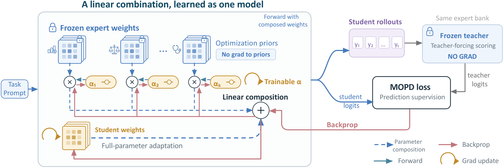
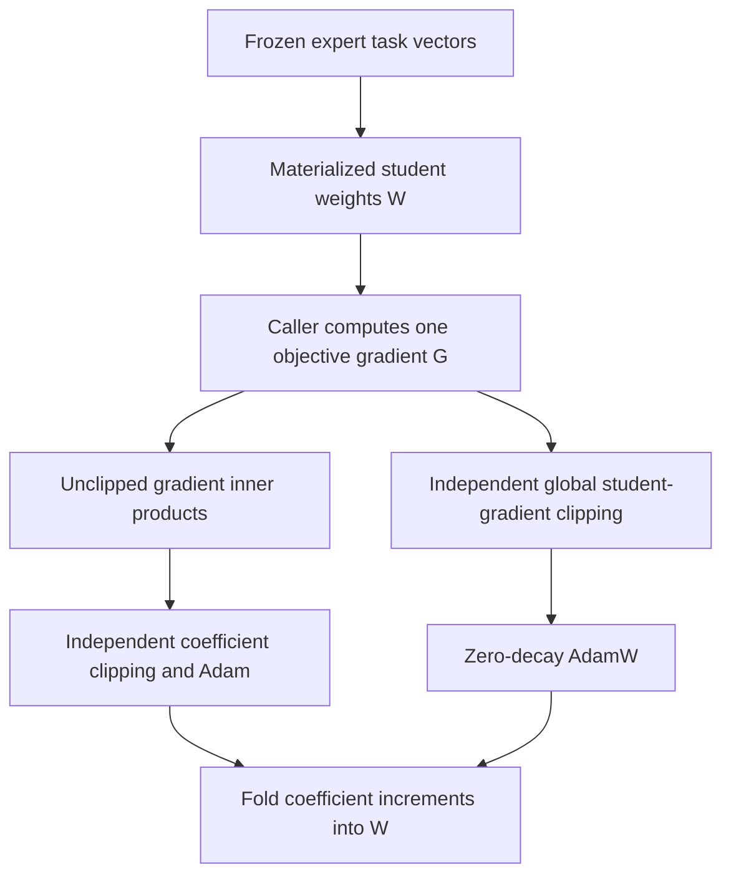

# P²-MOPD: expert parameters as learnable optimization directions

<!-- source-sha256: 6d2a3a096180543571b4aaf924aca02276bc99957b1f4e8864623060216c6161 -->

[简体中文](README.md)

> **L1 parameter-update component, diagnostic only**. Full multi-teacher LLM distillation is **not reproduced because of excessive cost (review DONE)**. No language model, domain teacher or rollout engine is supplied. Descent on a synthetic objective is not capability recovery; `evolve_integrated=false`.

## Paper information

| Field | Value |
|---|---|
| Paper | [P²-MOPD: Accelerating Multi-Teacher On-Policy Distillation via Parameter Priors](https://arxiv.org/abs/2611.03953v1); [full text](https://arxiv.org/html/2611.03953v1) |
| Company / institution | First author **Sinuo Wang**: **Australian Institute for Machine Learning, Adelaide University / StepFun**, following the original per-author mapping |
| Original publication | arXiv v1: **2026-11-02 20:53:15 UTC**; announced **2026-11-04**, not first published that day |
| Original author code | **No verified implementation repository found** as of 2026-11-04. The paper does not link its own implementation; referenced IM-MOPD/Open-MOPD repositories do not establish this method's release |
| Upstream license / revision | Not applicable without a verified repository; independently implemented from equations. The paper uses the arXiv non-exclusive license; figure copyright stays with the authors, not CC BY |
| Local adapter / key | `p2-mopd`; standalone update component, not a complete LLM adapter |
| Local code | `src/auto_research/post_training/p2_mopd.py`; `PriorModule`, `ParameterPriorOptimizer`, `diagnostic(seed=42, device='cpu')` |
| Validation boundary | CPU tests/diagnostics do not substitute for real CUDA validation. Actual GPU evidence is integrated by the batch runner; unexecuted checks are not pre-marked passed |

## Original method

### Motivation and change

Multi-teacher OPD supervises student-generated trajectories with domain experts, yet a merged student can fail to move toward one expert. P²-MOPD does more than change initialization: each projection is a free student tensor plus learnable coefficients over frozen expert task vectors. Free weights can leave their span; coefficient gradients explicitly move along expert directions. Inference capacity does not increase, and coefficients fold into ordinary exported weights.

<!-- paper-figure:start -->
### Original paper figure



Unmodified original PNG from [Figure 2](https://arxiv.org/html/2611.03953v1#S3.F2). Copyright remains with the authors; source, license boundary and visual review are in `assets/provenance.json`. The depicted teacher and rollout systems are not local implementations.
<!-- paper-figure:end -->



### Equations

For module $m$, frozen task vectors are $\tau_{k,m}=W^{(k)}_m-W^{(0)}_m$:

$$
W_m=B_m+\sum_k\alpha_{k,m}\tau_{k,m},\qquad
\frac{\partial L}{\partial B_m}=G_m,\quad
\frac{\partial L}{\partial\alpha_{k,m}}=\langle G_m,\tau_{k,m}\rangle.
$$

Algorithm 1 / Appendix B stores materialized $W$, not $B$:

$$
W_{t+1,m}=\operatorname{AdamW}_{\eta_W}(W_{t,m},\operatorname{clip}_{c_W}(G_t))
+\sum_k(\alpha_{t+1,k,m}-\alpha_{t,k,m})\tau_{k,m}.
$$

Both channels use the same pre-update gradient. Compute coefficient inner products before weight clipping, with independent global norm budgets. The student channel includes non-projection parameters $\phi$. **Weight decay must be zero** for equivalence to optimizing $B$. A non-finite gradient/norm in either channel skips both optimizers.

The complete paper's MOPD objective separately uses student-top-16 support, a 0.99 nucleus threshold, frozen rewards, asymmetric PPO and dual clipping. Local code does **not** rename an arbitrary KL as that complete objective; it implements only the parameter-prior update operator.

### Reported outcomes, not local results

Across three training seeds, the 1.7B model reports **94.7%** average recovery versus **80.9%** for MOPD. Recovery normalizes each domain's base-to-teacher score span; it is not accuracy. Four checkpoints are not four independent seeds. No production online A/B is reported. These scores are not reproduced locally.

## Local implementation

### Data protocol and code mapping

`PriorModule` composes caller-supplied base weights, task vectors and coefficients, storing detached cloned directions. `ParameterPriorOptimizer` implements module-granularity coefficients, two channels from one gradient, independent global clipping, zero-decay AdamW/Adam, all-or-nothing non-finite checks and coefficient folding. It does not implement layer/model coefficient tying, FSDP shards, teacher routing, text sampling or deployment export.

`diagnostic` executes five actual backward/Adam steps on small random matrices and compares every step with independently maintained $B,\alpha$. It also checks motion outside the task-vector span and absence of partial updates on non-finite batches. Inputs are seeded synthetic tensors, not capability data, gold labels, model calls or evaluation splits. Multiple seeds remain L1 evidence.

```bash
PYTHONPATH=src python -m pytest tests/post_training/test_nov04b_post_training.py -q
PYTHONPATH=src python -c 'from auto_research.post_training.p2_mopd import diagnostic; print(diagnostic(42, device="cpu"))'
```

### Checks, negative controls and limits

Tests cover multi-step explicit/materialized optimizer-state equivalence, unclipped coefficient gradients, independent clip budgets, non-projection participation in global clipping, frozen copied directions and unchanged parameters/state on non-finite steps. Synthetic descent establishes a differentiable, correctly updated operator, not MedQA recovery or OPD improvement. Actual GPU results/receipts are integrated by the batch validation; no numbers are invented here.

### High-cost full experiments

Table 7 reports **8-GPU** wall times of **4.90 hours** for the 1.7B module configuration and **6.51 hours** for 4B. The matrix includes four teachers, 65,075 prompts, 100 steps, multiple configurations/three seeds, and additional training for some 1.7B teachers; prompt/response caps reach 15,872/16,384. With one A100/A30 or a Mac, the complete matrix is excessive: **not reproduced because of excessive cost (review DONE)**. These are paper-reported costs, not local timing. No weights are downloaded, costly probe launched or automatic retry scheduled.
