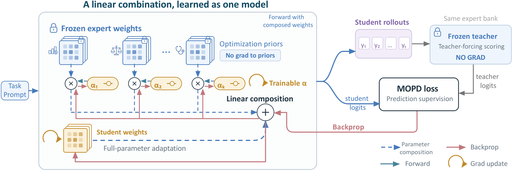
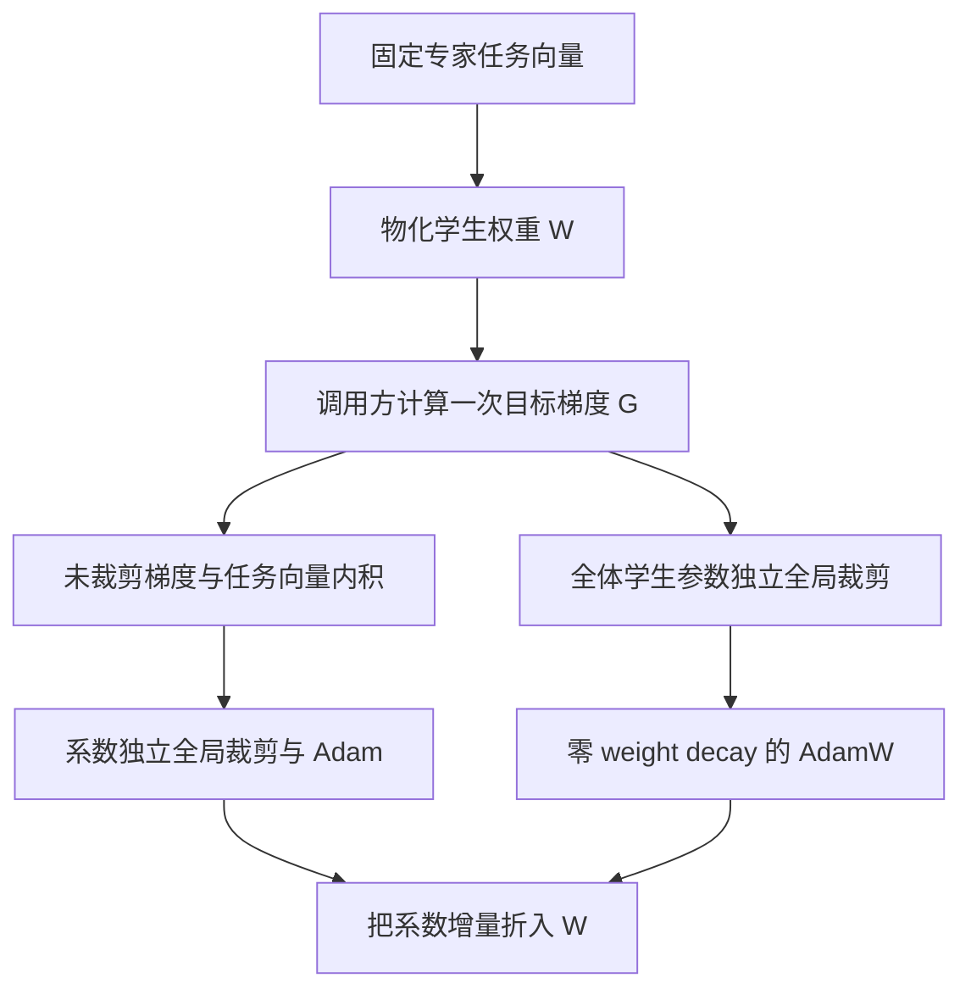

# P²-MOPD：让专家参数成为可学习的优化方向

> **L1 参数更新组件，diagnostic only**。完整多教师 LLM 蒸馏：**成本过高，不复现（审查 DONE）**。本地不提供模型、领域教师或 rollout，不把合成目标下降当作能力恢复；`evolve_integrated=false`。

## 论文信息

| 字段 | 内容 |
|---|---|
| 论文 | [P²-MOPD: Accelerating Multi-Teacher On-Policy Distillation via Parameter Priors](https://arxiv.org/abs/2611.03953v1)；[正文](https://arxiv.org/html/2611.03953v1) |
| 公司 / 作者机构 | 一作 **Sinuo Wang**：**Australian Institute for Machine Learning, Adelaide University / StepFun**；以原文逐作者机构为准 |
| 原始发布日期 | **2026-11-02 20:53:15 UTC**，arXiv v1；进入 2026-11-04 公告，不能称 11 月 4 日首发 |
| 原作者代码 | **未找到可核验作者实现仓库**：截至 2026-11-04，原文未给本方法代码链接；引用的 IM-MOPD/Open-MOPD 不是本方法已开源的证据 |
| 原作者代码许可 / 版本 | 未核实作者仓库，许可与固定 SHA 不适用；本地按公式独立实现。论文为 arXiv 非独占许可，原图版权仍归作者，不标成 CC BY |
| 本地 Adapter / key | `p2-mopd`；独立参数更新组件，不是完整 LLM adapter |
| 本地代码 | `src/auto_research/post_training/p2_mopd.py`；`PriorModule`、`ParameterPriorOptimizer`、`diagnostic(seed=42, device='cpu')` |
| 验收边界 | 本地测试和 CPU diagnostic 不替代真实 CUDA 验收；GPU 证据由本轮统一运行后接入，不预填已通过 |

## 原始论文总结

### 背景与主要改动

多教师 OPD 用各领域专家监督学生自己的轨迹，但一个已合并的学生可能长期学不到某个专家的方向。P²-MOPD 不只改合并初始点，而是把每个 projection 写成“自由学生权重 + 可学习系数乘固定专家任务向量”。自由权重可离开任务向量张成空间；系数梯度则显式沿教师方向走。它不增加推理模型容量，导出时系数已折入普通权重。

<!-- paper-figure:start -->
### 原论文关键图



图片来自[原论文](https://arxiv.org/html/2611.03953v1#S3.F2) 的 Figure 2，原始 PNG 未重绘。版权归原作者所有，来源、许可边界和视觉核对见 `assets/provenance.json`。图中的教师与 rollout 系统不代表本地已实现。
<!-- paper-figure:end -->



### 核心公式

对模块 $m$，固定任务向量 $\tau_{k,m}=W^{(k)}_m-W^{(0)}_m$：

$$
W_m=B_m+\sum_k\alpha_{k,m}\tau_{k,m},\qquad
\frac{\partial L}{\partial B_m}=G_m,\quad
\frac{\partial L}{\partial\alpha_{k,m}}=\langle G_m,\tau_{k,m}\rangle.
$$

Algorithm 1 / Appendix B 实际保存物化的 $W$，而非 $B$：

$$
W_{t+1,m}=\operatorname{AdamW}_{\eta_W}(W_{t,m},\operatorname{clip}_{c_W}(G_t))
+\sum_k(\alpha_{t+1,k,m}-\alpha_{t,k,m})\tau_{k,m}.
$$

两通道使用同一个更新前梯度；系数内积必须在权重梯度裁剪之前算，两个全局范数预算独立。学生通道包含非 projection 参数 $\phi$。**weight decay 必须为零**，否则在 $W$ 上 decay 与在 $B$ 上 decay 不等价。任一通道梯度/范数非有限时，两个 optimizer 都不更新。

完整论文的 MOPD 信号另有 student-top-16 支持、0.99 nucleus、冻结 reward、非对称 PPO/dual clipping。本地**没有**把任意 KL 换名为该完整目标；这里只实现其参数先验更新算子。

### 论文离线与线上效果

原文三训练种子结果中，1.7B 平均 recovery 为 **94.7%**，MOPD 对照为 **80.9%**。recovery 是相对基座到教师跨度归一化后的四领域指标，不是准确率；四个 checkpoint 也不是四次独立种子。未报告互联网生产线上 A/B，本地没有复现这些结果。

## 本地复现

### 数据协议与代码映射

`PriorModule` 从调用方提供的 base、task vectors 和系数构造物化权重，对方向做 detached clone；`ParameterPriorOptimizer` 提供 module-granularity 系数、同梯度双通道、独立全局裁剪、零衰减 AdamW/Adam、整步非有限保护和系数折叠。未实现 layer/model 系数共享、FSDP 分片、teacher routing、文本采样或部署模型导出。

`diagnostic` 对小型随机矩阵执行五步真实 backward/Adam，并与独立维护 $B,\alpha$ 的形式逐步比较；另外验证学生位移可离开任务向量空间和非有限步不会部分更新。使用 seeded 合成输入，无公开能力数据、gold、模型调用或评测集；多 seed 不提升 L1 层级。

```bash
PYTHONPATH=src python -m pytest tests/post_training/test_nov04b_post_training.py -q
PYTHONPATH=src python -c 'from auto_research.post_training.p2_mopd import diagnostic; print(diagnostic(42, device="cpu"))'
```

### 结果、负控与边界

测试覆盖多步显式/物化 optimizer state 等价、未裁剪系数梯度、独立 clip 预算、非 projection 参数参与全局 clip、不可变专家方向、非有限整步不变。合成目标下降只证明算子可导且按定义更新，不能证明 MedQA、四领域恢复或真实 OPD 提升。真实 GPU 结果和收据由本轮统一验收，不在文档中虚构数值。

### 高成本完整实验

原文 Table 7 在 **8 GPU** 上，1.7B module 配置 **4.90 小时**，4B 为 **6.51 小时**；四教师、65,075 prompts、100步，多配置/三种子，还有部分1.7B教师需另训；prompt/response cap 达15,872/16,384。可用资源仅一张 A100/A30 或 Mac，完整矩阵显著超预算，因此**成本过高，不复现（审查 DONE）**。这是原文成本，不是本地耗时实测；不下载权重、不开昂贵探针、不自动重试。
