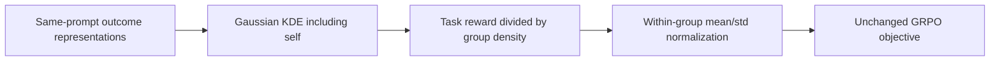
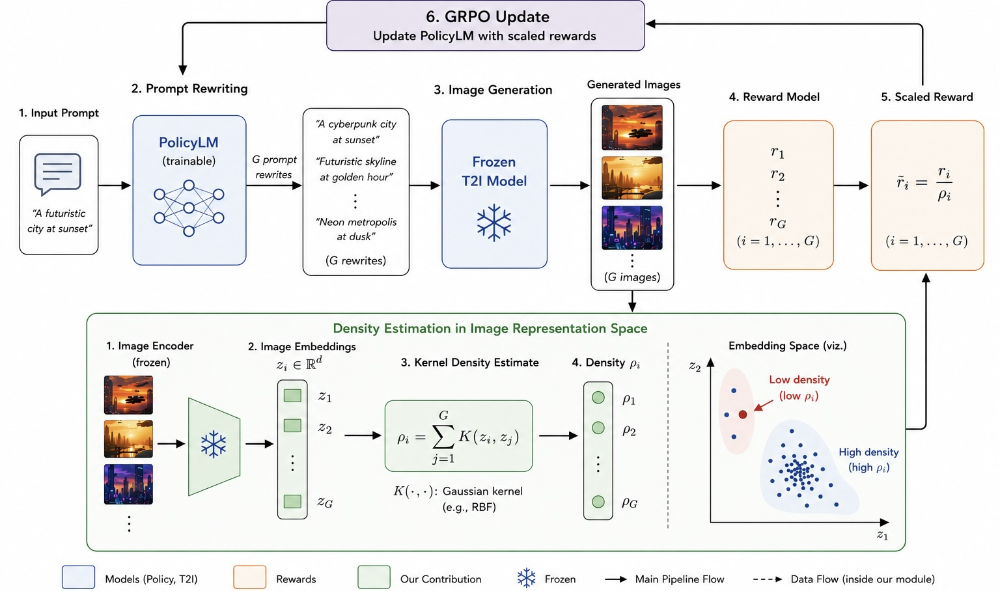

# DARS: within-group outcome-density reward scaling

<!-- source-sha256: c674746ca845bf722e7fab83b53e25158dc5f9076aeca7bb3f9b7cc37e5bfe69 -->

[简体中文](README.md)

## Paper information

| Field | Details |
| --- | --- |
| Paper | [arXiv 2611.04792](https://arxiv.org/abs/2611.04792); [fixed v1](https://arxiv.org/html/2611.04792v1) |
| Original title | Density-Aware Reward Scaling: A Reinforcement Learning Framework for Reward-Proportional Sampling |
| Institution | First author Ria Shekhawat: National University of Singapore; equal contribution with Abhijeet Sinha |
| First publication | 2026-11-03 12:29:58 UTC, not the November 4 announcement date |
| Author code | No verifiable DARS-author source found in fixed v1 or abstract; not found/not released. A GRPO framework is not this paper's release |
| Local key / adapter | `dars-density`; `adapter: null`; no executable Evolve mapping; distinct from `dars`, the key for Dependency-Aware Reward Shaping |
| Local code | `src/auto_research/post_training/dars.py` |
| Status | `component_only`, L1 Gaussian KDE/reward-scaling/group-standardization component, not full image-generation training |
| Full experiment | Too costly, not reproduced (review DONE); `not_reproduced_high_cost` |

## Original paper summary

### Background and main changes

DARS counters repeated reinforcement of densely sampled outcomes by dividing task reward by within-prompt outcome density, then applying ordinary group advantage normalization. It neither learns a density network nor replaces the policy objective. Conditioning groups, outcome representations and task rewards remain distinct. See Sections 3 and 5.3.



<!-- paper-figure:start -->
### Key original-paper figure

[](https://arxiv.org/html/2611.04792v1#S5)

> Original fixed-v1 HTML Figure 2 JPEG, losslessly re-encoded as PNG with identical pixels and visually checked; not regenerated or cropped. The language policy produces prompt rewrites, frozen image generation/encoding supply rewards and representations, and density-scaled rewards update the policy. Copyright belongs to the authors; CC BY 4.0. Not a local execution screenshot.
<!-- paper-figure:end -->

### Core equations

$$
\rho_i=\sum_{j=1}^{G}\exp\left(-\frac{\|y_i-y_j\|^2}{2h^2}\right),\qquad
\tilde r_i=r_i/\rho_i,\qquad A_i=(\tilde r_i-\overline{\tilde r})/s_{\tilde r}.
$$

Self terms ensure density ≥1. At vanishing bandwidth distinct points approach 1, but duplicates retain their multiplicities. Infinite bandwidth gives G, whose common reward scale cancels under normalization.

### Paper results

Navigation and text-to-image experiments examine coverage/diversity and quality. Results depend on embeddings, bandwidth and image-generation randomness. Production A/B is not reported. A local KDE check does not establish learned reward-proportional behavior or better image quality.

## Local component

### Implementation and commands

`density_scaled_advantages` takes outcomes `[...,G,D]` and nonnegative rewards `[...,G]`, computes full Gaussian KDE independently per group, scales rewards and normalizes. Following Section 3.1, negative rewards are explicitly rejected; a signed extension is not advertised as reward-proportional sampling. Features/rewards are stop-gradient; returned advantages feed the caller's unchanged GRPO objective. No PPO loss is redefined here.

```bash
PYTHONPATH=src python -c 'from auto_research.post_training.dars import diagnostic; print(diagnostic(42, "cpu"))'
PYTHONPATH=src python -m pytest tests/test_nov04b_foundation_components.py -q
```

### Checks and negative controls

The paper does not specify population versus sample standard deviation. The API explicitly defaults to `correction=0` and supports `correction=1`. Groups with constant scaled rewards have undefined 0/0: default zero advantages or explicit `zero_variance="raise"`, without hidden epsilon. Equal original rewards with different densities need not have zero variance.

Tests cover duplicates, isolated points, negative-reward rejection, permutation, group isolation, both bandwidth limits, an independent loop KDE reference, std convention and gradient isolation. A teaching example with outcomes (0,0,100), h=.001 and rewards (1,1,1) yields densities (2,2,1) and scaled rewards (.5,.5,1). This illustrates relative advantages, not learned new modes.

### Cost decision

Full experiments combine Qwen3-0.6B/GPT-2 rewriting, Stable Diffusion 1.4, CLIP/DINO evaluation, 64 rewrites per prompt and multiple reward/seed arms on four A100-40GB cards: **too costly, not reproduced (review DONE)**. No models/data are downloaded or navigation/image policies trained. There is no capability/Evolve conclusion; CPU arithmetic checks do not replace an actual A100/A30 receipt.
