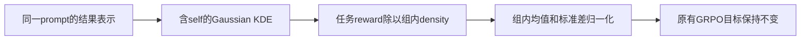
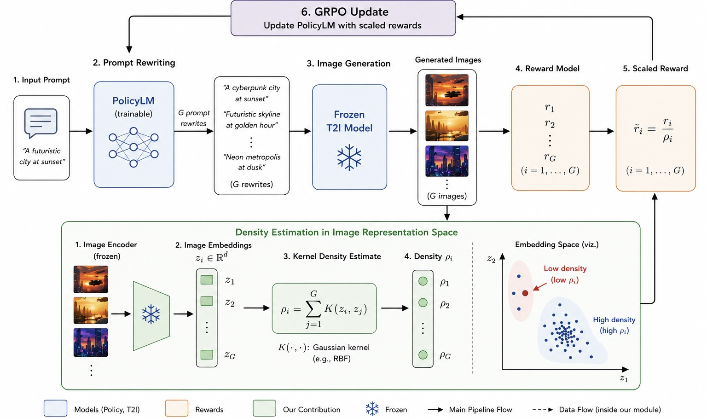

# DARS：按组内结果密度缩放奖励

[English](README-en.md)

## 论文信息

| 字段 | 内容 |
| --- | --- |
| 论文链接 | [arXiv 2611.04792](https://arxiv.org/abs/2611.04792)；[固定 v1 全文](https://arxiv.org/html/2611.04792v1) |
| 原文标题 | Density-Aware Reward Scaling: A Reinforcement Learning Framework for Reward-Proportional Sampling |
| 公司 / 机构 | 一作 Ria Shekhawat：National University of Singapore；与 Abhijeet Sinha 共同一作 |
| 首次公开日期 | 2026-11-03 12:29:58 UTC；2026-11-04 公告不是首发日期 |
| 原作者代码 | 固定 v1、摘要页未找到可核验作者 DARS 源码；未找到/尚未发布，不把 GRPO 框架当作本文代码 |
| 本地 adapter / 稳定键 | `dars-density`；`adapter: null`，无可执行 Evolve 映射；与另一篇 Dependency-Aware Reward Shaping 的 `dars` 键区分 |
| 本地复现代码目录 | `src/auto_research/post_training/dars.py` |
| 实现状态 | `component_only`，L1 Gaussian KDE、奖励缩放与组标准化；不是完整图像生成训练 |
| 完整实验 | 成本过高，不复现（审查 DONE）；`not_reproduced_high_cost` |

## 原始论文总结

### 背景与主要改动

期望奖励最大化容易持续强化已密集采样的结果。DARS 在同一条件输入的 rollout 组内估计结果表示密度，以 $r/\rho$ 替换原奖励，再执行常规 GRPO 组优势标准化；不引入 density 网络或替换 policy objective。结果表示、任务奖励与条件分组不可互相替代。依据固定 v1 §3、§5.3。



<!-- paper-figure:start -->
### 原论文关键图

[](https://arxiv.org/html/2611.04792v1#S5)

> 图片来自[原论文](https://arxiv.org/html/2611.04792v1#S5) 固定 v1 HTML 的 Figure 2 原始 JPEG 图本体，无损转换为 PNG，像素一致且已视觉核对；未重新生成或裁剪。原图说明：语言策略产生同 prompt 多个改写，冻结文生图与图像 encoder 提供奖励/表示，组内密度修正奖励后更新策略。版权归原作者所有；原文为 CC BY 4.0。该图不是本地执行截图。
<!-- paper-figure:end -->

### 核心公式

$$
\rho_i=\sum_{j=1}^{G}\exp\left(-\frac{\|y_i-y_j\|^2}{2h^2}\right),\qquad
\tilde r_i=r_i/\rho_i,\qquad A_i=(\tilde r_i-\overline{\tilde r})/s_{\tilde r}.
$$

包含 $j=i$，所以 $\rho_i\ge1$。$h\to0$ 时，**互不重复**的点趋向 density 1；重合点仍计重复数，不能一概写成全为 1。$h\to\infty$ 时 density 趋向 $G$，共同缩放可被优势标准化消去。

### 论文离线与线上效果

作者报告导航分布覆盖和文生图改写的多样性/质量对照；结果依赖 embedding、bandwidth 和随机图像生成。生产线上 A/B：未报告。局部 KDE 数值核对不能证明奖励比例分布已学成或图像质量改进。

## 本地复现

### 实现与运行

`density_scaled_advantages` 接收 `[...,G,D]` outcome 与 `[...,G]` 非负 reward，逐组计算完整 Gaussian KDE、缩放和标准化。遵循 §3.1 的非负奖励域，负 reward 显式拒绝，不把有符号扩展冒充奖励比例采样。结果表示与 reward 均 stop-gradient，返回优势供外部**原有** GRPO 目标使用，不在本组件里重定义 PPO loss。

```bash
PYTHONPATH=src python -c 'from auto_research.post_training.dars import diagnostic; print(diagnostic(42, "cpu"))'
PYTHONPATH=src python -m pytest tests/test_nov04b_foundation_components.py -q
```

### 检查与负控

原文未明确标准差采用总体还是样本约定，接口显式 `correction=0` 为总体标准差，也支持 `correction=1`，不隐瞒该选择。缩放后奖励为常数的组产生 $0/0$，默认返回零优势，可用 `zero_variance="raise"` 拒绝；不暗加 epsilon 来掩盖。原始奖励相同但密度不同，不一定具有零方差。

测试覆盖重复点、孤立点、负 reward 拒绝、同组置换、不同组隔离、两个 bandwidth 极限、独立循环 KDE 参考、标准差约定和无梯度泄漏。教学数例 $y=(0,0,100),h=0.001,r=(1,1,1)$ 得 $\rho=(2,2,1)$ 与 $\tilde r=(0.5,0.5,1)$，展示密度改变相对优势，而非声称策略学会了新模式。

### 成本判断与复现边界

完整实验包含 Qwen3-0.6B/GPT-2 改写、Stable Diffusion 1.4、CLIP/DINO 等评估、每 prompt 64 改写以及多 reward/seed 矩阵，原配置使用 4 张 A100 40GB。相对现有单卡资源**成本过高，不复现（审查 DONE）**。本轮无模型/数据下载、无导航 policy 或图像生成训练，无能力及 Evolve 晋级结论；CPU 数值核对不能替代 A100/A30 收据。
