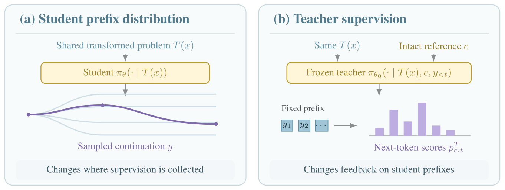
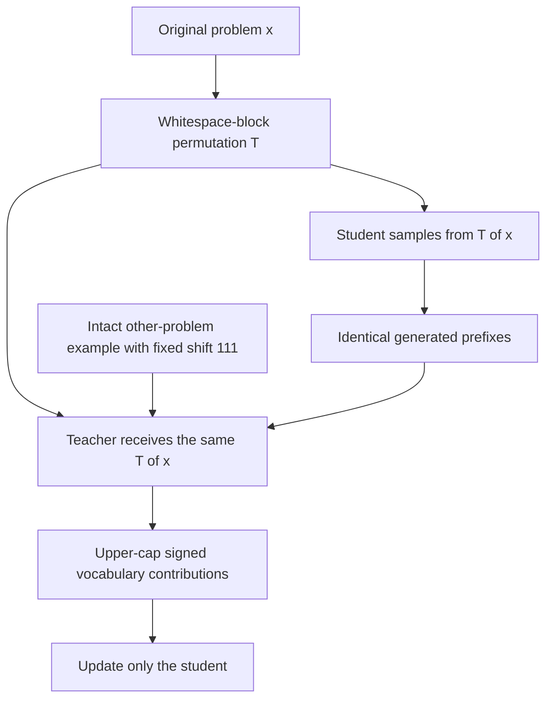

# Shuffled OPSD: disrupt the shared problem, preserve the teacher example

<!-- source-sha256: 5f0e2447e663b953ea24142c31d3056b509bce0310c84371761294fb0e750b4d -->

[简体中文](README.md)

> **L1 conditioning and loss components, diagnostic only**. Full multi-model training and long-reasoning evaluation are **not reproduced because of excessive cost (review DONE)**. No LLM rollout or mathematical benchmark is run locally; `evolve_integrated=false`.

## Paper information

| Field | Value |
|---|---|
| Paper | [Shuffled OPSD: When Semantic Consistency Hurts On-Policy Self-Distillation?](https://arxiv.org/abs/2611.04958v1); [full text](https://arxiv.org/html/2611.04958v1) |
| Company / institution | First author **Qingyuan Zheng**, **Duke University** |
| Original publication | arXiv v1: **2026-11-03 14:17:20 UTC**; announced **2026-11-04** |
| Original author code | The paper links [Pear3on/S_OPSD](https://github.com/Pear3on/S_OPSD), but it returned **404** during this 2026-11-04 review. A supplied URL is not verified accessible source code |
| Upstream license / revision | Unverified because the repository is inaccessible; independently implemented from equations. The paper uses the arXiv non-exclusive license; figure copyright remains with the authors |
| Local adapter / key | `shuffled-opsd`; standalone components, not a full teacher/student training adapter |
| Local code | `src/auto_research/post_training/shuffled_opsd.py`; `prepare_shared_inputs`, `capped_distillation_loss`, `diagnostic(seed=42, device='cpu')` |
| Validation boundary | CPU tests do not replace actual CUDA execution. The batch integrates actual three-seed runs; unexecuted results are not marked passed |

## Original method

### Motivation and change

In OPSD, a student samples from a problem while a frozen initial teacher scores the same generated prefixes with an additional worked example. This paper separates the shared problem from the teacher-only reference: use a complete example from another problem, shuffle whitespace-delimited blocks in the shared problem, and preserve the teacher example's order. The same transformation conditions student generation and teacher scoring. It is not post-generation trajectory shuffling or a teacher-only perturbation.

<!-- paper-figure:start -->
### Original paper figure



From the author's original SVG for Figure 2 in the [original paper](https://arxiv.org/html/2611.04958v1#S2.F2), retained alongside the PNG. It is only rasterized for the website, not redesigned. Copyright remains with the authors; source, transformation and visual review are in `assets/provenance.json`.
<!-- paper-figure:end -->



### Equations

Appendix A.2 selects the unrelated example by $j=(i+111)\bmod N$, avoiding self-pairing in the 29,434-record pool. Shuffle-$k$ permutes consecutive $k$-word whitespace blocks, preserving the word multiset but **not necessarily tokenizer-token counts**. A small local pool that makes shift 111 self-pair is rejected rather than silently changing the published assignment.

The student distribution is $p_{it}=\pi_\theta(\cdot\mid T(x_i),y_{i,<t})$ and the frozen teacher is $q_{it}=\pi_{\theta_0}(\cdot\mid T(x_i),c_j,y_{i,<t})$. Appendix A.1 implements:

$$
L_c=\frac1B\sum_i\frac1{T_i}\sum_t\sum_v
\min\left\{q_{it}(v)\log\frac{q_{it}(v)}{p_{it}(v)},0.05\right\}.
$$

This upper-caps each **signed vocabulary contribution**, retaining negatives. The total need not be nonnegative: it is neither ordinary KL nor clipping after vocabulary summation. Average tokens within each response, then responses equally. Default temperature is 1.1, with no extra $T^2$ multiplier. Freeze teacher and sampled histories; exclude prompt/padding positions. Do not give the teacher-only worked example to the student.

### Reported outcomes, not local results

Equal-weight mean improvements over Standard OPSD on three mathematical benchmarks are **+3.52pp** at 1.7B, **+1.11pp** at 4B and **+1.38pp** at 8B. Each condition has one training seed; paired problem-cluster bootstrap intervals do not estimate training-seed variability. Evaluation uses the final step-50 checkpoint, intact problems and no teacher-only context. No production online A/B is reported. No local score or universal benefit of shuffling is claimed.

## Local implementation

### Data protocol and code mapping

`prepare_shared_inputs` preserves complete worked examples as separate teacher fields and returns shared transformed problems plus fixed reference indices. It neither builds model chat templates nor loads checkpoints. `capped_distillation_loss` consumes aligned student/teacher logits and a response mask, freezes the teacher and follows the published reduction order. FP16/BF16 probability/reduction arithmetic promotes to FP32. Only active positions are evaluated; padding produces no gradient.

`diagnostic` checks word multisets, fixed reference offsets, intact teacher examples, an independent scalar loss reference, retained negative terms, frozen teachers and one small gradient step. Seeded synthetic logits involve no model calls. They neither test mathematical reasoning nor replace an inaccessible training repository with a completed capability claim.

```bash
PYTHONPATH=src python -m pytest tests/post_training/test_nov04b_post_training.py -q
PYTHONPATH=src python -c 'from auto_research.post_training.shuffled_opsd import diagnostic; print(diagnostic(42, device="cpu"))'
```

### Checks, negative controls and limits

Tests distinguish the actual objective from ordinary KL, nonnegative clipping and token-weighted aggregation, and verify teacher stop-gradient, temperature, padding-NaN isolation, finite gradients and gradcheck. Only the main Shuffle-$k$ conditioning and loss are implemented, not all CrossShuffle/NoTarget ablations, original model-mode switching, LoRA training or full same-prefix replay. GPU evidence is integrated after actual batch execution, without expected scores inserted by hand.

### High-cost full experiments

The paper/Appendix A uses Qwen3-1.7B/4B/8B, 29,434 OpenThoughts examples, 50 steps per condition, batch 16, prompt/response limits 4096/1024 and LoRA rank 64. Every evaluated checkpoint generates **1,080 responses**, each capped at **38,912 new tokens**, across multiple transformation conditions. The full matrix is excessive for one A100/A30 or a Mac: **not reproduced because of excessive cost (review DONE)**. No weights/data, long rollouts or retries are requested. This is a configuration-based assessment, not measured local training time.
