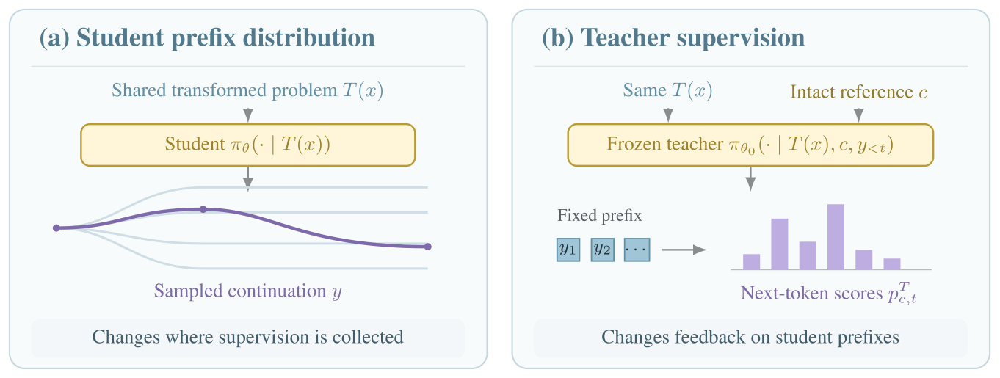

# Shuffled OPSD：打乱共享问题，但保留教师示例结构

> **L1 条件构造与损失组件，diagnostic only**。完整多模型训练与长推理评测：**成本过高，不复现（审查 DONE）**。本地没有运行 LLM rollout 或数学 benchmark；`evolve_integrated=false`。

## 论文信息

| 字段 | 内容 |
|---|---|
| 论文 | [Shuffled OPSD: When Semantic Consistency Hurts On-Policy Self-Distillation?](https://arxiv.org/abs/2611.04958v1)；[正文](https://arxiv.org/html/2611.04958v1) |
| 公司 / 作者机构 | 一作 **Qingyuan Zheng**，**Duke University** |
| 原始发布日期 | **2026-11-03 14:17:20 UTC**，arXiv v1；2026-11-04 公告 |
| 原作者代码 | 论文提供 [Pear3on/S_OPSD](https://github.com/Pear3on/S_OPSD)，但 2026-11-04 本次访问返回 **404**；不能把提供链接等同于已验证可用源码 |
| 原作者代码许可 / 版本 | 仓库不可访问，许可和固定版本未核实；本地按公式独立实现。论文为 arXiv 非独占许可；原图版权仍归作者 |
| 本地 Adapter / key | `shuffled-opsd`；独立组件，非完整教师/学生训练 adapter |
| 本地代码 | `src/auto_research/post_training/shuffled_opsd.py`；`prepare_shared_inputs`、`capped_distillation_loss`、`diagnostic(seed=42, device='cpu')` |
| 验收边界 | CPU 单测不替代真实 CUDA 验证；本轮统一接入实际三种子运行，未执行结果不记为通过 |

## 原始论文总结

### 背景与主要改动

OPSD 中学生根据问题采样，冻结初始教师在同一生成前缀上评分，但额外看到 worked example。本文区分“双方共享的问题”和“只有教师看到的示例”：用另一个问题的完整示例作教师上下文，打乱共享问题的 whitespace 词块，却保留教师示例的顺序。该变换同时改变学生采样和教师评分的条件，不是在生成后打乱轨迹，也不是只把教师输入打乱。

<!-- paper-figure:start -->
### 原论文关键图



来自[原论文 Figure 2](https://arxiv.org/html/2611.04958v1#S2.F2) 的作者 SVG，原文件同时保留；仅栅格化供网页显示，没有重新设计流程。版权归原作者所有，来源、转换和视觉核对见 `assets/provenance.json`。
<!-- paper-figure:end -->

```mermaid
flowchart TD
    P[原问题 x] --> S[按 whitespace 词块置换 T]
    S --> U[学生在 T(x) 上采样]
    S --> V[教师使用相同 T(x)]
    R[固定偏移111的完整其他题示例] --> V
    U --> H[同一生成前缀]
    H --> V
    V --> L[有符号逐词表项上截断损失]
    L --> W[只更新学生]
```

### 核心公式

Appendix A.2 固定未相关示例为 $j=(i+111)\bmod N$，在29,434记录中不自配。Shuffle-$k$ 将问题按 whitespace 切成连续 $k$ 词块，再置换块；保持词 multiset，但**不保证 tokenizer token 数不变**。本地小池若111偏移恰好自配，直接拒绝，不擅自改算法。

学生和教师分别为 $p_{it}=\pi_\theta(\cdot\mid T(x_i),y_{i,<t})$ 与冻结的 $q_{it}=\pi_{\theta_0}(\cdot\mid T(x_i),c_j,y_{i,<t})$。Appendix A.1 的实际损失是：

$$
L_c=\frac1B\sum_i\frac1{T_i}\sum_t\sum_v
\min\left\{q_{it}(v)\log\frac{q_{it}(v)}{p_{it}(v)},0.05\right\}.
$$

这是逐词表项的**有符号上截断**，负项保留，因此不保证整体非负，不是普通 KL，也不是先求和再 clip。每条响应先 token mean，再对响应等权平均。默认温度1.1；不额外乘 $T^2$。teacher 和生成轨迹冻结；prompt/padding 排除，不能把教师 worked example 拼给学生。

### 论文离线与线上效果

三数学 benchmark 等权均值相对 Standard OPSD 的改善为1.7B **+3.52pp**、4B **+1.11pp**、8B **+1.38pp**。每条件只有一个训练种子；问题级配对 bootstrap 不是训练种子方差。评测用最终step50、原始完整题、没有教师私有上下文。未报告生产线上 A/B；本地未复现这些分数，也不声称打乱普遍有效。

## 本地复现

### 数据协议与代码映射

`prepare_shared_inputs` 保留原始 worked example，仅给 teacher 字段，返回共享问题视图和固定配对索引；不生成 chat template，也不替调用方接入 checkpoint。`capped_distillation_loss` 接收对齐的 student/teacher logits 与 response mask，冻结教师、按论文顺序归约，FP16/BF16 概率和归约提升为FP32。只检查有效位置；padding 不产生梯度。

`diagnostic` 验证词 multiset、固定偏移、教师示例完整性、损失与独立标量循环一致、负项保留、冻结教师及一次小梯度更新。用 seeded 合成logits，不调用模型；这不验证数学推理，也不把不可用训练仓库替代为已完成能力。

```bash
PYTHONPATH=src python -m pytest tests/post_training/test_nov04b_post_training.py -q
PYTHONPATH=src python -c 'from auto_research.post_training.shuffled_opsd import diagnostic; print(diagnostic(42, device="cpu"))'
```

### 结果、负控与边界

测试明确区分普通KL、非负截断、token加权平均与论文目标；还检查teacher stop-gradient、temperature、padding NaN隔离、有限梯度与gradcheck。仅实现Shuffle-$k$主条件及损失，不声称CrossShuffle/NoTarget全消融、原模型模式切换、LoRA训练和完整同前缀重放已经接入。GPU指标待本轮实际统一验收，不能填入预期分数。

### 高成本完整实验

正文/Appendix A 使用Qwen3-1.7B/4B/8B、29,434 OpenThoughts题、每条件50步、batch16、prompt4096/response1024、LoRA rank64。每个checkpoint的评测为 **1,080条响应**、每条最多 **38,912新token**，还有多个变换条件。完整矩阵对单张A100/A30和Mac成本过高，因此**成本过高，不复现（审查 DONE）**；不下载权重/数据、不启动长rollout或自动重试。这里是按原文配置的成本判断，不是本地训练计时。
