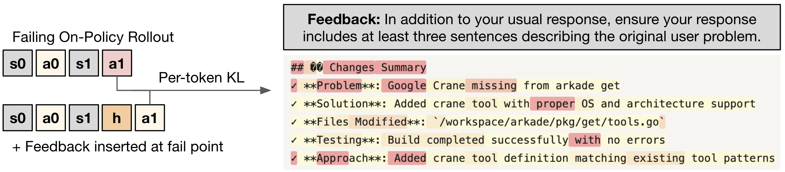
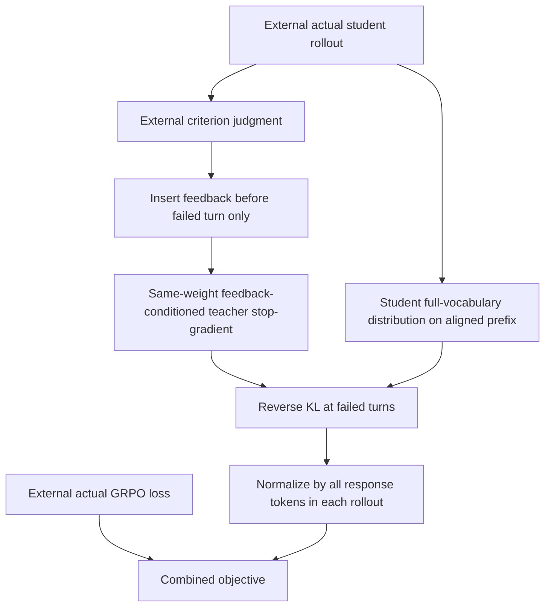

# Targeted Guidance: directional self-distillation only at failed agent turns

<!-- source-sha256: e1a728445c450d1921e6e62940270a07d72ecd7d6f907ce00bacbee34fc82628 -->

[简体中文](README.md)

> **L1 gated-loss component, diagnostic only**. Full 30B agent RL is **not reproduced because of excessive cost (review DONE)**. No coding agent, textual-feedback judge or actual rollout system is supplied; `evolve_integrated=false`.

## Paper information

| Field | Value |
|---|---|
| Paper | [Stabilizing On-Policy Targeted Guidance in Agentic Reinforcement Learning](https://arxiv.org/abs/2611.05266v1); [full text](https://arxiv.org/html/2611.05266v1) |
| Company / institution | First author **Kevin Frans**: **Cursor Research / UC Berkeley**, not Google/Meta |
| Original publication | arXiv v1: **2026-11-03 17:54:33 UTC**; announced **2026-11-04** |
| Original author code | **No verified author training implementation found** as of 2026-11-04. The cited Quack kernel is not this paper's training release |
| Upstream license / revision | Not applicable without a verified repository; independently implemented from equations. The paper uses the arXiv non-exclusive license; figure copyright remains with the authors |
| Local adapter / key | `targeted-guidance`; standalone loss, not a complete agent-training adapter |
| Local code | `src/auto_research/post_training/targeted_guidance.py`; `token_failure_mask`, `targeted_guidance_loss`, `diagnostic(seed=42, device='cpu')` |
| Validation boundary | CPU numerical checks do not replace CUDA validation. Actual three-seed GPU results are integrated by the batch; success is not pre-filled |

## Original method

### Motivation and change

Scalar RL rewards reinforce explored behaviors but may not communicate how to correct an unfamiliar tool format or communication style. This paper inserts criterion-specific textual feedback immediately before an offending agent turn. The same policy under that feedback becomes a stop-gradient teacher while the student learns on its own actual history. The defining combination is **minimal, failed-turn-gated direction plus ordinary per-criterion RL reward**, not unrestricted whole-trajectory OPSD, to reduce diversity pressure and primary-task interference.

<!-- paper-figure:start -->
### Original paper figure



Unmodified PNG from Figure 2 in the [original paper](https://arxiv.org/html/2611.05266v1#S4.F2). Copyright remains with the authors; source and visual review are in `assets/provenance.json`. The depicted model, judge and RL pipeline are not locally implemented systems.
<!-- paper-figure:end -->



### Equations

Section 4, Eq.3:

$$
L(\theta)=L_{\mathrm{GRPO}}(\theta)+\lambda\sum_{t\in\mathcal F}
\mathrm{KL}\left(\pi_\theta(\cdot\mid s_t)\,\|\,
\operatorname{sg}[\pi_\theta(\cdot\mid s_t,f_t)]\right).
$$

$\mathcal F$ contains only criterion-failing agent turns; feedback $f_t$ precedes that turn. The teacher shares the policy weights under different context, rather than being a stronger external model. Following the accompanying text, local code sums failed-token KL and divides by **all valid response tokens of that rollout**, then averages rollouts equally. Dividing only by failed tokens would give a single error an entire response's average pressure.

Use full-vocabulary **reverse KL (student to teacher)**, not forward KL or a sampled-token approximation, and stop teacher gradients. When all criteria pass, distillation disappears and the original RL objective remains. The paper also pre-validates that feedback improves mean criterion performance; local code does not fabricate this feedback-screening experiment.

### Reported outcomes, not local results

In Table 1, TG maintains coding pass rate **0.33±0.05**, matching the coding-only baseline's point estimate while improving several style criteria. Error bars are standard deviations over the final 32 training steps, not independent-seed confidence intervals. The paper analyzes excessive distillation weights, low entropy/oscillation and the importance of including thinking tokens. No production online A/B is reported; no coding or judge scores are reproduced locally.

## Local implementation

### Data protocol and code mapping

`token_failure_mask` maps an externally supplied failed-turn table to tokens, with `-1` denoting no turn. It does not judge behavior or read gold. `targeted_guidance_loss` receives aligned student logits, feedback-conditioned teacher logits, response/failure masks and an external GRPO scalar. It computes frozen-teacher full-vocabulary reverse KL only at failed tokens, normalizes over all response tokens and adds it to the gradient-preserving RL term.

No failure or zero guidance weight returns the original RL loss. Padding and nonfailed teacher rows never enter probability computation. FP16/BF16 probability/reduction arithmetic promotes to FP32. Invalid failure positions outside responses, empty responses, non-finite active logits and negative weights are rejected. The caller owns actual sampling, feedback insertion, turn judgments and privacy/evaluation isolation.

```bash
PYTHONPATH=src python -m pytest tests/post_training/test_nov04b_post_training.py -q
PYTHONPATH=src python -c 'from auto_research.post_training.targeted_guidance import diagnostic; print(diagnostic(42, device="cpu"))'
```

### Checks, negative controls and limits

Synthetic-logit diagnostics verify an independent scalar formula, failed-turn mapping, frozen teacher, zero auxiliary gradient outside failed tokens, recovery of the original RL loss when no turn fails, and descent after a small update. Tests additionally distinguish KL directions and run gradcheck. No criterion judge, feedback screening, tool environment, LM weights or GRPO sampler is supplied; no agent success-rate claim follows. GPU receipts await actual integrated execution, not hand-entered expected results.

### High-cost full experiments

Section 5.2 uses a further-SFT'd **Qwen3-Coder-30B**, **200 steps**, **32 groups×32 rollouts** per batch, asynchronous multi-turn code editing, and sweeps over distillation/style-reward weights. A single configuration already implies roughly 204,800 trajectories. The complete long-rollout matrix is excessive for one A100/A30 or a Mac: **not reproduced because of excessive cost (review DONE)**. This is a configuration estimate, not local timing. No weights, costly probes or automatic retries are requested.
