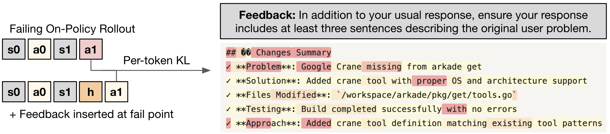
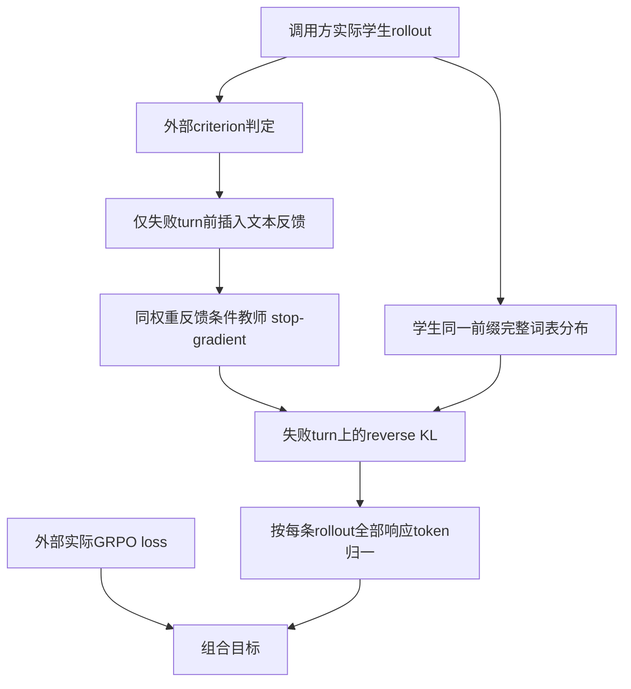

# Targeted Guidance：只在失败的 Agent 轮次加入定向自蒸馏

> **L1 门控损失组件，diagnostic only**。完整30B Agent RL：**成本过高，不复现（审查 DONE）**。未实现代码Agent、文本反馈judge或真实rollout；`evolve_integrated=false`。

## 论文信息

| 字段 | 内容 |
|---|---|
| 论文 | [Stabilizing On-Policy Targeted Guidance in Agentic Reinforcement Learning](https://arxiv.org/abs/2611.05266v1)；[正文](https://arxiv.org/html/2611.05266v1) |
| 公司 / 作者机构 | 一作 **Kevin Frans**：**Cursor Research / UC Berkeley**；不是Google/Meta论文 |
| 原始发布日期 | **2026-11-03 17:54:33 UTC**，arXiv v1；2026-11-04公告 |
| 原作者代码 | **未找到已核实作者训练实现仓库**；截至2026-11-04原文仅链接引用的Quack kernel，不将其冒充本论文代码 |
| 原作者代码许可 / 版本 | 无已核实仓库，许可/固定SHA不适用；本地按公式独立实现。论文为arXiv非独占许可，原图版权归作者 |
| 本地 Adapter / key | `targeted-guidance`；独立损失组件，不是完整Agent训练adapter |
| 本地代码 | `src/auto_research/post_training/targeted_guidance.py`；`token_failure_mask`、`targeted_guidance_loss`、`diagnostic(seed=42, device='cpu')` |
| 验收边界 | CPU数值检查不替代CUDA验收；三种子GPU结果由本轮实际运行接入，不预写成功 |

## 原始论文总结

### 背景与主要改动

标量RL奖励只能强化已有可探索行为，难以告诉Agent“怎样修正一种此前几乎不会的工具格式/沟通风格”。本文把每个criterion的文本反馈放在出错的Agent turn之前，同一策略在反馈条件下成为stop-gradient教师；学生仍在自己的实际历史上学习。关键不是全轨迹无差别OPSD，而是**失败轮次门控的最小定向信号 + 对应criterion的普通RL奖励**，避免蒸馏持续挤压多样性并干扰主要代码任务。

<!-- paper-figure:start -->
### 原论文关键图



图片来自[原论文](https://arxiv.org/html/2611.05266v1#S4.F2) 的 Figure 2 原始 PNG，未重绘。版权归原作者所有；来源和视觉核验见 `assets/provenance.json`。图中的模型、judge与RL流水线不是本地已实现的系统。
<!-- paper-figure:end -->



### 核心公式

Sec.4 Eq.3：

$$
L(\theta)=L_{\mathrm{GRPO}}(\theta)+\lambda\sum_{t\in\mathcal F}
\mathrm{KL}\left(\pi_\theta(\cdot\mid s_t)\,\|\,
\operatorname{sg}[\pi_\theta(\cdot\mid s_t,f_t)]\right).
$$

$\mathcal F$仅包含criterion失败的Agent turn，$f_t$放在该turn之前；teacher是同权重、不同上下文，不是更强外部模型。本地按照正文说明，将每条rollout上失败token的KL之和除以**这条rollout全部有效响应token数**，再对rollout等权平均。不能只除以失败token数，否则一个错误token也得到整条响应的平均压力。

采用完整词表**reverse KL（student到teacher）**，不是forward KL或单采样token近似；teacher停止梯度。所有criterion满足时蒸馏项消失，只剩原RL目标。原文还要求反馈字符串先显示比无反馈策略更高的平均criterion表现；本地不伪造这一步反馈筛选。

### 论文离线与线上效果

原文Table1中，TG维持代码pass rate **0.33±0.05**，与只优化代码的baseline点估计相同，同时改善多项style criterion；这些error bar是训练最后32步的标准差，不是独立种子置信区间。原文也分析过大蒸馏权重带来的低entropy/振荡与thinking token参与的重要性。未报告互联网生产线上A/B；本地不复现代码分数或Judge表现。

## 本地复现

### 数据协议与代码映射

`token_failure_mask` 将外部给定的failed-turn表映射到token，`-1`为非turn；不生成判定、不读gold。`targeted_guidance_loss` 接收同历史对齐的student logits、反馈条件teacher logits、response mask、failed mask与外部GRPO标量；仅在失败token计算冻结教师的完整词表reverse KL，按全部response token归一，再加权到保留梯度的RL项。

无失败或引导系数为零时返回原RL loss；padding和非失败教师行完全不参与概率运算。FP16/BF16概率与归约提升为FP32。代码拒绝失败mask越过response边界、空响应、非有限有效logits或负权重。调用方负责真实采样、正确反馈插入、turn判定与隐私/评测隔离。

```bash
PYTHONPATH=src python -m pytest tests/post_training/test_nov04b_post_training.py -q
PYTHONPATH=src python -c 'from auto_research.post_training.targeted_guidance import diagnostic; print(diagnostic(42, device="cpu"))'
```

### 结果、负控与边界

小型合成logits的diagnostic核对独立标量公式、失败轮次mask、teacher stop-gradient、非失败/填充零辅助梯度、无失败时还原原RL和小更新下降。单测另区分forward/reverse KL并做gradcheck。不提供criterion judge、反馈效果筛选、工具执行环境、LM权重或GRPO采样器，也不证明Agent任务成功率。GPU收据待本轮真实统一验证，不手写预期结果。

### 高成本完整实验

§5.2采用进一步SFT的 **Qwen3-Coder-30B**，**200steps**，每批 **32groups×32rollouts**，异步多轮代码编辑环境，还扫蒸馏权重与style奖励权重；单次配置已约204,800轨迹量级。对一张A100/A30或Mac，完整长rollout矩阵明显高成本，因此**成本过高，不复现（审查 DONE）**。这是配置推算而非本地耗时；不下载权重、不启动昂贵探针、不自动重试。
