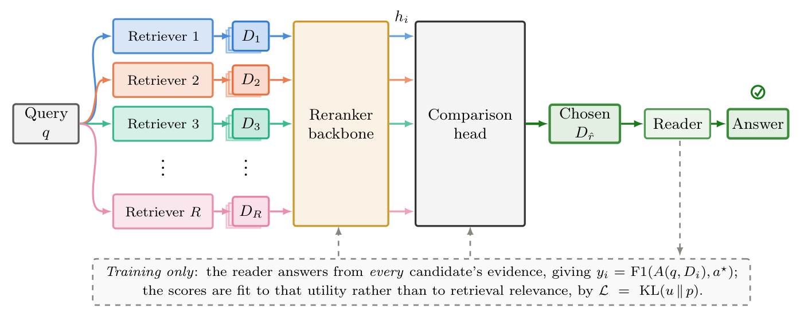

# RAGCompass: supervising retriever routing with answer utility

<!-- source-sha256: 36cbf84b0c356d709501888ddd785daefddacac12e341663c3074987b07ba430 -->

[简体中文](README.md)

> **L1 candidate-set distillation objective, diagnostic only.** No reranker or reader was trained. The full experiments are **too costly and not reproduced (review DONE)**.

## Paper information

| Field | Details |
| --- | --- |
| Paper | [RAGCompass: Generalizable Retriever Routing via Reranking](https://arxiv.org/abs/2611.05596v1); [fixed v1 full text](https://arxiv.org/html/2611.05596v1) |
| Company / author institutions | First author **Valentin Six**, University of Virginia. Mufei Li and Pan Li list Georgia Institute of Technology; Dongqi Fu, Yinglong Xia, and Hong Li list Meta. Meta is a collaborator, not the first author's affiliation. |
| First publication | **2026-11-03 20:36:24 UTC**, arXiv v1; see the November 5 [cs.CL announcement](https://arxiv.org/list/cs.CL/recent?show=2000). |
| Original author code | [Graph-COM/RAGCompass](https://github.com/Graph-COM/RAGCompass) is public under MIT; verified at [this revision](https://github.com/Graph-COM/RAGCompass/tree/60c329175c4a7d1fc5ea9a4a3d88d69279aee7e6). The local implementation follows the formula independently. |
| Local adapter / key | `ragcompass`; `adapter: null`, L1 component only, not integrated into Evolve. |
| Local code | `src/auto_research/post_training/ragcompass.py` |

## Original paper summary

### Background and main changes

A query-only classifier trained on a fixed pool may not score a retriever it has never seen. RAGCompass uses each retriever's entire evidence bundle as a candidate. A shared Qwen3-Reranker-0.6B reads each bundle separately, without relying on retriever identity or noncomparable confidence scores. Answer utility first supervises the backbone's yes logit; a two-layer cross-candidate comparison head is then trained on frozen backbone representations. The goal is to choose one evidence bundle for a reader, not to merge all passages.

<!-- paper-figure:start -->
### Key original-paper figure

[](https://arxiv.org/pdf/2611.05596v1#page=4)

Figure 2, page 4 of the [original paper](https://arxiv.org/pdf/2611.05596v1#page=4), fixed v1. Cropped at the figure boundary without redrawing it. Copyright belongs to the original authors; arXiv's nonexclusive license is not described as a CC license. See `assets/provenance.json` for crop coordinates, dimensions, and hash.
<!-- paper-figure:end -->

### Core equation

In Section 3.1, the fixed reader answers from each evidence bundle $D_i$. Its offline F1 against reference answer $a^\star$ is converted to a distribution over candidates for the current query:

$$
y_i=\operatorname{F1}(A(q,D_i),a^\star),\quad
u_i=\operatorname{softmax}(y/\tau)_i,\quad
p_i=\operatorname{softmax}(s)_i,\quad
L=\operatorname{KL}(u\Vert p),\qquad
\frac{\partial L}{\partial s_i}=p_i-u_i .
$$

Temperature $\tau$ scales utilities only. Normalization is over the query's candidate axis, not vocabulary or batch. The paper's minimum top-two F1 margin of 0.05 filters offline examples only. At inference, the reference answer is unknown, and routing takes the highest scorer or comparison-head score.

### Offline and online paper results

The paper and author repository report F1 of 0.2782 for the strongest fixed retriever, 0.3412 for the scalar scorer, and 0.3552 with the comparison head on the filtered 3,735-query test set. The roughly 28% relative improvement refers to that filtered subset, not unfiltered QA. The paper also studies shifts in corpora, retrievers, and readers; it reports no production A/B test. The local diagnostic does not reproduce these results.

## Local reproduction

### Data protocol and code mapping

`distillation_objective` computes stable candidate-set KL and its analytical gradient from externally supplied aligned logits, offline F1 scores, and a positive temperature. `eligible_query` implements the offline margin separately. `select_retriever` accepts scores only, not gold answers, F1, or retriever IDs. It does not derive predictions from gold, encode passages, or train a comparison head.

```bash
PYTHONPATH=src python -c 'from auto_research.post_training.ragcompass import diagnostic; print(diagnostic(42, "cpu"))'
PYTHONPATH=src python -m pytest tests/test_nov06_priority.py -q
```

### Results, negative controls, and limits

Small synthetic examples check stable softmax/KL and finite-difference gradients, candidate permutation, equal targets and predictions, extreme logits, and utility-gap controls. A separate check confirms that the selection API cannot accept labels. A correct candidate-set objective does not establish transfer to unseen retrievers and does not qualify as capability evidence.

### Cost of the full experiment

The original setup uses Natural Questions, MuSiQue, HotpotQA, and 2WikiMultihopQA, with five passages per retriever from a pool of five. Its reader is Llama-3.1-8B-Instruct. The complete pipeline requires generating or accessing cached supervision, training the 0.6B reranker and comparison head, and running baseline and distribution-shift evaluations. The authors' quick cached CPU baseline does not run the RAGCompass scorer and does not make the complete training experiment inexpensive. **Too costly, not reproduced (review DONE).** No weights, indexes, or datasets were downloaded, and no end-to-end timing was measured. The CPU distribution objective needs no GPU acceptance.
