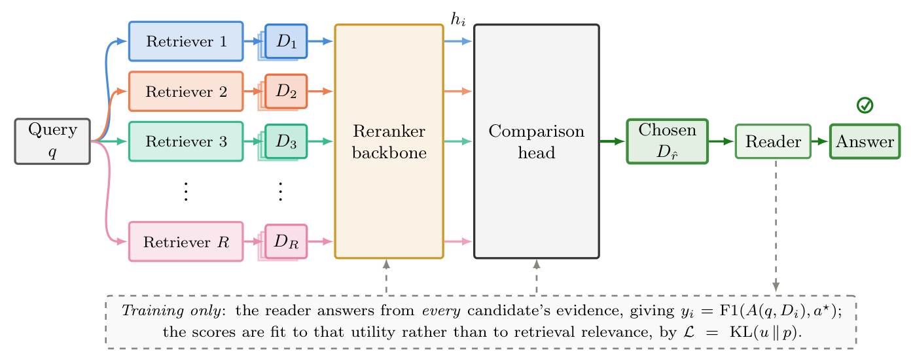

# RAGCompass：用答案效用监督检索器路由

> **L1 候选集蒸馏目标，diagnostic only。** 未训练 reranker 或 reader；完整实验**成本过高，不复现（审查 DONE）**。

## 论文信息

| 字段 | 内容 |
| --- | --- |
| 论文 | [RAGCompass: Generalizable Retriever Routing via Reranking](https://arxiv.org/abs/2611.05596v1)；[固定 v1 正文](https://arxiv.org/html/2611.05596v1) |
| 公司 / 作者机构 | 一作 **Valentin Six**，University of Virginia；Mufei Li、Pan Li 署名 Georgia Institute of Technology；Dongqi Fu、Yinglong Xia、Hong Li 署名 Meta。Meta 合作，不是一作单位。 |
| 原始发布日期 | **2026-11-03 20:36:24 UTC**，arXiv v1；见 2026-11-05 [cs.CL 公告](https://arxiv.org/list/cs.CL/recent?show=2000)。 |
| 原作者代码 | [Graph-COM/RAGCompass](https://github.com/Graph-COM/RAGCompass) 已公开，MIT；核实 [固定提交](https://github.com/Graph-COM/RAGCompass/tree/60c329175c4a7d1fc5ea9a4a3d88d69279aee7e6)，本地按公式独立实现。 |
| 本地 Adapter / key | `ragcompass`；`adapter: null`，仅 L1 组件，不接入 Evolve。 |
| 本地代码 | `src/auto_research/post_training/ragcompass.py` |

## 原始论文总结

### 背景与主要改动

固定候选池的 query-only 分类器可能不能给从未见过的检索器打分。RAGCompass 把各检索器返回的整组证据作为候选，复用同一个 Qwen3-Reranker-0.6B 独立读每组 passage，不依赖检索器身份或各自不可比的置信度。先用答案效用微调 backbone 的 yes logit，后在冻结 backbone 表示上训练跨候选的两层比较头。目标是选出一组证据供 reader 回答，不是融合所有 passage。

<!-- paper-figure:start -->
### 原论文关键图

[](https://arxiv.org/pdf/2611.05596v1#page=4)

图片来自[原论文](https://arxiv.org/pdf/2611.05596v1#page=4) v1 第 4 页 Figure 2，按图边界栅格裁取、未重绘。版权归原作者所有；不将 arXiv 非独占许可误写为 CC 许可。裁剪区域、尺寸与哈希见 `assets/provenance.json`。
<!-- paper-figure:end -->

### 核心公式

Section 3.1 定义训练目标：固定 reader 在每组证据 $D_i$ 上得到答案，离线求与参考答案 $a^\star$ 的 F1。将该效用向量转为当前 query 的候选分布：

$$
y_i=\operatorname{F1}(A(q,D_i),a^\star),\quad
u_i=\operatorname{softmax}(y/\tau)_i,\quad
p_i=\operatorname{softmax}(s)_i,\quad
L=\operatorname{KL}(u\Vert p),\qquad
\frac{\partial L}{\partial s_i}=p_i-u_i .
$$

$\tau$ 只缩放效用；归一化在同一 query 的候选轴上，不在词表或全 batch 上。top-two F1 差至少 0.05 是论文离线样本筛选；推理不能使用该门，因为真实答案未知。推理以 scorer 或 comparison head 的分数取最大项。

### 论文离线与线上效果

原文与作者仓库报告：在筛选后的 3,735 条测试查询上，最佳固定检索器 F1 为 0.2782、仅标量 scorer 为 0.3412、加比较头为 0.3552；约 28% 相对改善对应这组筛选口径。不能将它解释为无筛选 QA 总体提升。原文还报告跨语料、检索器、reader 泛化实验；未报告生产线上 A/B。本地诊断不复现这些结果。

## 本地复现

### 数据协议与代码映射

`distillation_objective` 从外部给定的同序 logits、离线 F1 向量和正温度计算稳定的候选集 KL 与解析梯度。`eligible_query` 单独实现离线 gap 条件；`select_retriever` 仅接收分数，不接收 gold、F1 或候选身份。没有从 gold 反推实际预测，也没有实现 passage 编码与比较头训练。

```bash
PYTHONPATH=src python -c 'from auto_research.post_training.ragcompass import diagnostic; print(diagnostic(42, "cpu"))'
PYTHONPATH=src python -m pytest tests/test_nov06_priority.py -q
```

### 结果、负控与边界

小合成候选用独立的 softmax/KL 与有限差分检验数值和梯度，覆盖排列不变、目标等于预测、极端 logits 和有/无效用差；独立检查分数选择签名无标签。候选集 KL 的数学正确性不验证未见检索器的真实效果，不对诊断作能力晋级。

### 高成本完整实验

原文用 Natural Questions、MuSiQue、HotpotQA、2WikiMultihopQA，5 类检索器各取 5 个 passage，reader 为 Llama-3.1-8B-Instruct。完整链路须生成或读取缓存监督并训练 0.6B reranker、比较头，再跑多基线与跨分布对照。作者另有使用缓存的 CPU 基线快查，但它不运行 RAGCompass scorer，不代表原论文完整训练可低成本完成。**成本过高，不复现（审查 DONE）**；未下载权重、索引或数据，也未测完整实验耗时。CPU 分布目标不需要 GPU 验收。
