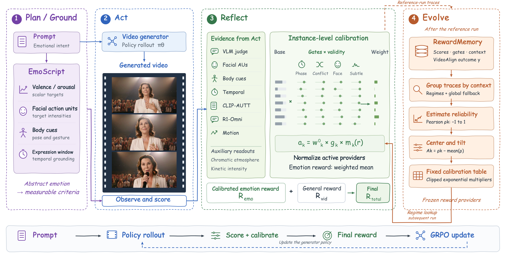

# EmoReward: calibrating the next run's emotion reward from completed traces

<!-- source-sha256: a5bbb06fcc7e2f8a66759b189b1ecab1b97642dbd525aba797820a4419b75694 -->

[简体中文](README.md)

## Paper information

| Field | Value |
| --- | --- |
| Paper | [arXiv 2611.06518](https://arxiv.org/abs/2611.06518); [pinned v1 full text](https://arxiv.org/html/2611.06518v1) |
| Original title | EmoReward: Self-Evolving Reward Calibration for Emotional Video Generation RL |
| Company / institution | First author Mingzhe Zheng: The Hong Kong University of Science and Technology and Tencent Hunyuan; the work was done during an internship at Tencent Hunyuan |
| First public date | 2026-11-04 13:43:09 UTC (arXiv v1); announced 2026-11-05. This is a backfill from the previous bulletin window, not a November 7 first publication |
| Author code | [Public author code](https://github.com/Tencent-Hunyuan/EmoReward), under the Tencent Hunyuan Community License with separate third-party provider terms. No upstream code was copied |
| Local adapter / key | `emoreward`; `adapter: null`, not integrated into Evolve |
| Local code | `src/auto_research/post_training/emoreward.py` |
| Implementation status | `component_only`: CPU scalar reward allocation, L1 diagnostic |
| Full experiment | Not reproduced because of excessive cost (review DONE) |

## Original method

### Motivation and change

Fixed fusion assumes that every video provides equally reliable evidence for each emotion cue. When no usable face is visible, for example, a facial provider's neutral fallback is not an observation. EmoReward plans evaluation criteria from the prompt, obtains scores and availability from providers, and combines per-example Reflect gates with between-run RewardMemory multipliers. Temperature, clipping and support thresholds affect reward allocation, not generator parameters.

<!-- paper-figure:start -->
### Original paper figure



Figure 2 is from the [original paper](https://arxiv.org/html/2611.06518v1#S3.F2) by Zheng et al. Copyright remains with the authors. The unmodified, uncropped image is shared under [CC BY 4.0](https://creativecommons.org/licenses/by/4.0/); see `assets/provenance.json` for its source and hash.
<!-- paper-figure:end -->

### Equations

Eq. (8) multiplies each base weight $w_k^0$ by its current gate $g_k$ and its regime multiplier $m_k(r)$. Only contributions strictly above the threshold enter the sum; normalizing across all channels before applying the threshold changes the calculation:

$$
a_k=w_k^0g_km_k(r),\qquad
\mathcal A=\{k:a_k>\epsilon_g\},\qquad
R_{\mathrm{emo}}=\frac{\sum_{k\in\mathcal A}a_ks_k}{\sum_{k\in\mathcal A}a_k+\epsilon}.
$$

Eq. (9) estimates the correlation of raw, ungated provider scores with the VideoAlign proxy outcome $y$ from a **completed reference run**. Constant providers get zero correlation. Sparse regimes fall back to global statistics, and an empty table falls back to unit multipliers. Eq. (10) centers correlations within the regime, then clips the log multiplier:

$$
\rho_k=\frac{\operatorname{Cov}(s_k,y)}{\sigma_{s_k}\sigma_y+\epsilon},\qquad
m_k=\exp\!\left(\operatorname{clip}\!\left(\frac{\rho_k-\bar\rho}{\tau},-c,c\right)\right),\qquad
w_k^{\mathrm{RM}}=\frac{w_k^0m_k}{\sum_j w_j^0m_j}.
$$

The interval $[e^{-c},e^c]$ bounds unnormalized multipliers, not the normalized weight ratio. Zero base weight stays zero. Eq. (4) combines the emotion reward with general video reward as $R_{\mathrm{total}}=\alpha R_{\mathrm{vid}}+\beta R_{\mathrm{emo}}$. The next run uses a frozen table; it does not refit the allocation with current outcomes during generator updates.

### Reported outcomes and caveats

On 302 held-out emotion prompts in Table 1, the within-optimizer gains in VideoAlign Overall are 0.3218 for DanceGRPO with Reflect, 0.2343 for FlowGRPO with full EmoReward, and 0.5645 for SAGE-GRPO with full EmoReward. PickScore and CLIPScore did not consistently improve. VideoAlign is both part of the training objective and the reference outcome: correlation and metric gains do not establish independent human preference, emotional fidelity, or causality. Appendix H's sensitivity analysis does not support monotonic improvement as more memory accumulates.

## Local implementation

### Data protocol and code mapping

`build_reward_memory` takes raw scores, regimes and outcomes supplied from a completed reference run and constructs an immutable Eq. (9)–(10) table. The caller supplies regime keys (the paper groups by arousal and face-branch activity) and Eq. (7) gates that already include observation validity. `fuse_reward` reads the frozen table, applies Eq. (8) selection and normalization, then computes the Eq. (4) scalar. The current outcome is not a fitting input, and the prior cannot reactivate a missing channel. The local scope excludes the planner, visual providers, and video GRPO.

```bash
PYTHONPATH=src python -m pytest tests/test_nov07_emoreward.py -q
PYTHONPATH=src python -c 'from auto_research.post_training.emoreward import diagnostic; print(diagnostic(42))'
```

### Diagnostic and boundaries

Three-seed artifact: [`metrics/component-cpu-seeds42-44.json`](metrics/component-cpu-seeds42-44.json).

CPU seeds 42, 43 and 44 generate only reference scores and outcomes. Positive, negative and constant providers check signed calibration; threshold equality, missing evidence, sparse fallback and runtime immutability have negative controls. After masking the positively correlated channel, the fixed teaching example changes the emotion scalar from approximately 0.7000 to 0.6538. This illustrates reallocation, **not** a judgment of quality or a generation capability gain. No model, public capability benchmark, GPU path, or promotion-eligible Evolve evidence is involved.

### Cost of the full experiment

The author repository recommends 32 GPUs with 80 GB each across four nodes. The main suite needs HunyuanVideo 1.5 rollouts and multiple scoring providers, compares three RL optimizers, and samples four videos per training group. Appendix H contains 6,016 training candidates, and SD 3.5 and FLUX add a transfer matrix. A single A100/A30 or local Mac does not cover this budget: **not reproduced because of excessive cost (review DONE)**. No weights or datasets are downloaded, and no retry is queued.
