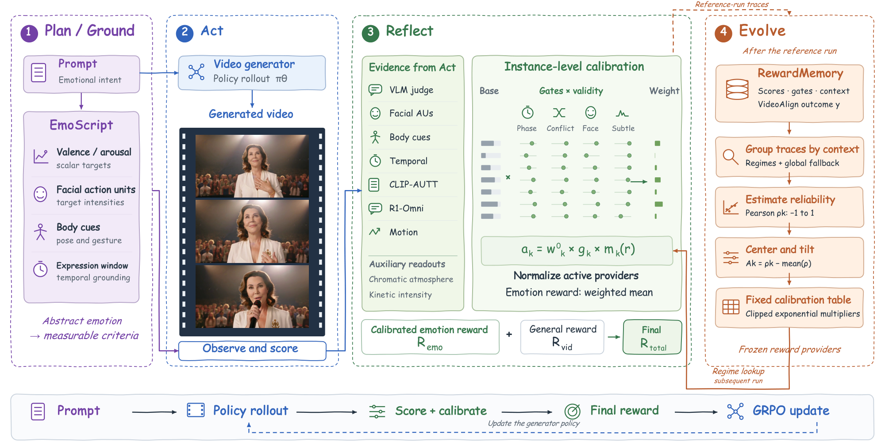

# EmoReward：用已完成的训练轨迹校准下一轮情绪奖励

[English](README-en.md)

## 论文信息

| 字段 | 内容 |
| --- | --- |
| 论文链接 | [arXiv 2611.06518](https://arxiv.org/abs/2611.06518)；[固定 v1 全文](https://arxiv.org/html/2611.06518v1) |
| 原文标题 | EmoReward: Self-Evolving Reward Calibration for Emotional Video Generation RL |
| 公司/机构 | 一作 Mingzhe Zheng：香港科技大学、腾讯混元；工作在腾讯混元实习期间完成 |
| 首次公开日期 | 2026-11-04 13:43:09 UTC（arXiv v1）；2026-11-05 公告。本次是上批公告窗口的补漏，不是 11 月 7 日首发 |
| 原作者代码 | [原作者公开代码](https://github.com/Tencent-Hunyuan/EmoReward)；采用腾讯混元社区协议，各第三方评分器另有许可。本地未复制上游代码 |
| 本地 adapter / key | `emoreward`；`adapter: null`，未接入 Evolve |
| 本地复现代码位置 | `src/auto_research/post_training/emoreward.py` |
| 实现状态 | `component_only`：CPU 标量奖励分配核，L1 机制诊断 |
| 完整实验 | 成本过高，不复现（审查 DONE） |

## 原文方法

### 背景与主要改动

固定融合权重假设每段视频的情绪证据同样可信。例如，没有可用人脸时，给面部动作通道的默认中性分数不是观测证据。EmoReward 让 Plan 根据提示构建评估条件，Act 得到分数和可用性，再用 Reflect 的样本门控与 RewardMemory 的跨轮经验乘子做融合。温度、上限和最小支持数作用在奖励分配上，不是生成器参数。

<!-- paper-figure:start -->
### 原论文关键图



图 2 的图片来自[原论文](https://arxiv.org/html/2611.06518v1#S3.F2)（Zheng 等），版权归原作者所有，按 [CC BY 4.0](https://creativecommons.org/licenses/by/4.0/) 原样引用，未裁剪或改绘。来源和哈希见 `assets/provenance.json`。
<!-- paper-figure:end -->

### 核心公式

Eq. (8) 对当前样本用原始权重 $w_k^0$、当前门控 $g_k$、情境乘子 $m_k(r)$ 计算有效质量。只保留严格超过门槛的通道，不能先做 Eq. (10) 的全通道归一再筛选：

$$
a_k=w_k^0g_km_k(r),\qquad
\mathcal A=\{k:a_k>\epsilon_g\},\qquad
R_{\mathrm{emo}}=\frac{\sum_{k\in\mathcal A}a_ks_k}{\sum_{k\in\mathcal A}a_k+\epsilon}.
$$

Eq. (9) 用**已经结束的参考训练轮**计算未门控的原始分数与 VideoAlign 代理结果 $y$ 的相关性，常数通道记零。低支持的情境使用全局数据，空表退回全 1 的乘子。Eq. (10) 对各通道减去情境内平均相关，再对 log 乘子裁剪：

$$
\rho_k=\frac{\operatorname{Cov}(s_k,y)}{\sigma_{s_k}\sigma_y+\epsilon},\qquad
m_k=\exp\!\left(\operatorname{clip}\!\left(\frac{\rho_k-\bar\rho}{\tau},-c,c\right)\right),\qquad
w_k^{\mathrm{RM}}=\frac{w_k^0m_k}{\sum_j w_j^0m_j}.
$$

$[e^{-c},e^c]$ 约束未归一的乘子，不直接约束归一权重比；原先权重为零的通道仍是零。Eq. (4) 把情绪奖励与通用视频奖励合成 $R_{\mathrm{total}}=\alpha R_{\mathrm{vid}}+\beta R_{\mathrm{emo}}$。论文将表冻结在下一轮，生成器更新时不会用当前结果重新拟合表。

### 原文结果与限制

在论文 Table 1 的 302 条留出情绪提示上，VideoAlign Overall 同优化器对照中，DanceGRPO 加 Reflect、FlowGRPO 加完整 EmoReward、SAGE-GRPO 加完整 EmoReward 分别提高 0.3218、0.2343、0.5645。PickScore 与 CLIPScore 并非一致改善。VideoAlign 既是训练目标的一部分，也是参考结果；相关性和分数改善不能当成独立人评、情绪忠实度或因果证据。论文附录 H 的窗口敏感性分析也不支持“累计记忆必然单调变好”。

## 本地复现

### 数据协议与代码映射

`build_reward_memory` 从调用者提供的参考轮原始分数、情境和结果按 Eq. (9)–(10) 一次性构造不可变表。为保持边界清楚，情境键（论文按唤醒度和人脸分支活跃度分组）和已经包含有效掩码的 Eq. (7) 门控均为外部输入。`fuse_reward` 只查固定表，按 Eq. (8) 筛活跃通道，算 Eq. (4) 标量，不接受当前结果作为拟合输入；缺失通道不能被历史乘子重新激活。没有实现 Plan、感知打分器或视频 GRPO。

```bash
PYTHONPATH=src python -m pytest tests/test_nov07_emoreward.py -q
PYTHONPATH=src python -c 'from auto_research.post_training.emoreward import diagnostic; print(diagnostic(42))'
```

### 诊断与边界

三种子产物：[`metrics/component-cpu-seeds42-44.json`](metrics/component-cpu-seeds42-44.json)。

CPU 种子 42、43、44 只生成参考分数和结果。正相关、负相关及常数通道覆盖有符号校准；严格阈值、无证据、稀疏回退和运行期冻结均有负控。固定教学样本中，门控排除正相关通道后，情绪标量由约 0.7000 变成 0.6538；这是权重重分配的演示，**不是**好坏或生成能力提升。没有模型、公开能力测试、GPU 路径或可晋级 Evolve 证据。

### 完整实验成本

原仓推荐 4 节点共 32 张 80 GB GPU，需 HunyuanVideo 1.5、视频生成候选和多路评分器；论文有三种视频 RL 优化器、每组四段候选，附录 H 涉及 6,016 段训练候选，另有 SD 3.5 与 FLUX 迁移矩阵。单张 A100/A30 或本地 Mac 的预算不适合：**成本过高，不复现（审查 DONE）**。不下载模型或数据，不自动重试。
