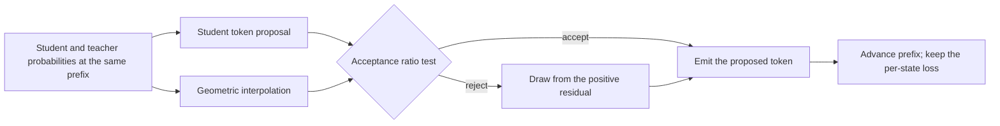
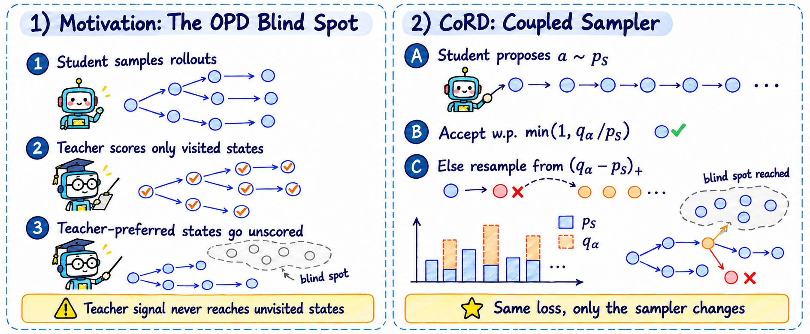

# CoRD: use maximal coupling to change which states distillation visits

<!-- source-sha256: a67422453982ead1fe3cd4cf66ceb7a1b8b975644412150e78370f0694873be6 -->

[简体中文](README.md)

## Paper information

| Field | Value |
| --- | --- |
| Paper | [arXiv 2611.07959](https://arxiv.org/abs/2611.07959); [pinned v1 full text](https://arxiv.org/html/2611.07959v1) |
| Original title | CoRD: Coupled Rollouts Fill the Blind Spot of On-Policy Distillation |
| Company / institution | First author Guhan Chen: Tsinghua University. Collaborators include Harbin Institute of Technology, Shenzhen; Nanjing University; and Huawei Large Model Data Technology Lab |
| Original publication | arXiv v1: 2026-11-05 12:55:51 UTC; announced on 2026-11-06 |
| Original author code | No CoRD implementation by the authors was found in pinned v1 or a targeted search. The cited evaluation tool is not the CoRD code |
| Local adapter / key | `cord-rollout`; `adapter: null`, no Evolve integration. Distinct from the cataloged conflict-aware gradient CORD paper |
| Local code | `src/auto_research/post_training/cord_rollout.py` |
| Implementation status | `component_only`: CPU one-position coupled sampling, L1 diagnostic |
| Full experiment | Not reproduced because of excessive cost (review DONE); `not_reproduced_high_cost` |

## Original method

### Motivation and change

In ordinary OPD, a teacher scores prefixes the student actually visits, which provides little supervision for teacher-preferred paths the student rarely takes. CoRD retains per-state reverse KL and changes how prefixes are generated. The student proposes a token; maximal coupling corrects that proposal toward a teacher-leaning target. Both probability vectors must score the same prefix over the same vocabulary. It borrows the rejection rule of speculative decoding, not a claim of faster serving.



<!-- paper-figure:start -->
### Original paper figure



Figure 1 is from the [original paper](https://arxiv.org/html/2611.07959v1#S1.F1), using the author's PNG unchanged. Copyright remains with the authors; the paper uses the arXiv perpetual non-exclusive license. Source, checksum and visual review are in `assets/provenance.json`.
<!-- paper-figure:end -->

### Equations

At a fixed prefix, Eq. (2) in Section 3 geometrically interpolates student $p_S$ and teacher $p_T$ to form the emitted-token marginal:

$$
q_\alpha(v)=
\frac{p_S(v)^{1-\alpha}p_T(v)^\alpha}
{\sum_u p_S(u)^{1-\alpha}p_T(u)^\alpha}.
$$

Algorithm 1 proposes $a$ from $p_S$, accepts it with probability $\min(1,q_\alpha(a)/p_S(a))$, and otherwise draws from the normalized positive residual $(q_\alpha-p_S)_+$. The emitted mass at each token is $\min(p_S,q_\alpha)+(q_\alpha-p_S)_+=q_\alpha$. Replacement probability equals $\mathrm{TV}(p_S,q_\alpha)$, not a fixed rate. At $\alpha=0$ the marginal is the student, and at $\alpha=1$ it is the teacher. Intermediate targets are not linear mixtures, and $q_\alpha$ does not replace the distillation target. The original per-state training loss is still $D_{\mathrm{KL}}(p_S\|p_T)$.

### Reported outcomes, not local results

For six Qwen3/Qwen3.5 students across five math benchmarks, Table 1 reports mean pass@1 gains of about 0.9 to 2.0 percentage points over OPD and pass@8 gains of 1.2 to 3.4 points. Table 6 does not show higher pass@16 for every student: the five-task mean for Qwen3-1.7B goes from 47.5% to 47.4%. Appendix A identifies one MATH500 question duplicated between training and evaluation. No production online A/B is reported. These are not local scores.

## Local implementation

### Data protocol and code mapping

`maximal_coupling` takes normalized same-vocabulary probabilities at one prefix and builds the target, keep probabilities, positive residual and TV using a log-space interpolation. `Coupling.draw` returns the proposal and emitted token using a caller-provided RNG. It does not load models, generate LLM trajectories or run reverse-KL training. For $0<\alpha<1$, only the support intersection has mass. Empty intersection is rejected, not silently replaced by uniform or ordinary teacher sampling.

```bash
PYTHONPATH=src python -m pytest tests/test_nov06_llm.py -q
PYTHONPATH=src python -c 'from auto_research.post_training.cord_rollout import diagnostic; print(diagnostic(42))'
```

### Results, negative controls and boundaries

On Appendix D's three-token example with $p_S=(0.6,0.3,0.1)$, $p_T=(0.2,0.3,0.5)$ and $\alpha=0.6$, the analytic replacement rate is approximately 0.24449. CPU seeds 42/43/44 each run 4096 categorical draws. Maximum empirical marginal and replacement-rate errors are about 0.01741 and 0.01793; the analytic identity's error is below $10^{-12}$. Uniform replacements incorrectly restore mass to a token already overweighted by the student. Tests cover that control, disjoint and zero-mass supports, endpoints and RNG stream consistency. These are not math capability or pass@k results.

### High-cost full experiment

Appendix A pairs six 0.6B-to-4B students with 8B/9B teachers. Main training uses 80 steps, 256 prompts per step and up to 320 new tokens per rollout. Table 1's twelve configurations cost about 670 accelerator-hours for training alone, before evaluation on 1,919 problems with 16 samples per problem per model. The full matrix exceeds the budget of one A100/A30 or a local Mac: **not reproduced because of excessive cost (review DONE)**. No weights or datasets are downloaded, and no automatic retry is queued.
