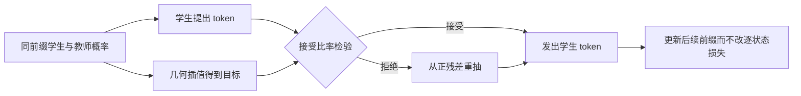
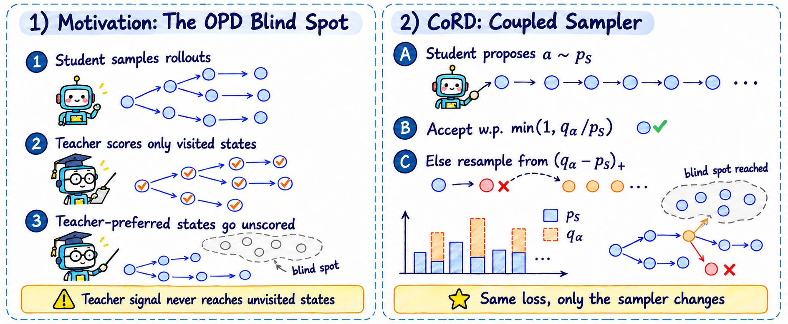

# CoRD：最大耦合改变蒸馏访问的状态

[English](README-en.md)

## 论文信息

| 字段 | 内容 |
| --- | --- |
| 论文链接 | [arXiv 2611.07959](https://arxiv.org/abs/2611.07959)；[固定 v1 全文](https://arxiv.org/html/2611.07959v1) |
| 原文标题 | CoRD: Coupled Rollouts Fill the Blind Spot of On-Policy Distillation |
| 公司 / 机构 | 一作 Guhan Chen：清华大学；合作单位含哈尔滨工业大学（深圳）、南京大学和华为大模型数据技术实验室 |
| 首次公开日期 | arXiv v1 2026-11-05 12:55:51 UTC；2026-11-06 公告 |
| 原作者代码 | 固定 v1 和作者定向检索未找到原作者 CoRD 实现；文中引用的评测工具不是本论文源码 |
| 本地 adapter / 稳定键 | `cord-rollout`；`adapter: null`，未接入 Evolve；不同于已收录的冲突梯度优化 CORD |
| 本地复现代码目录 | `src/auto_research/post_training/cord_rollout.py` |
| 实现状态 | `component_only`：CPU 单位置耦合采样 L1 诊断 |
| 完整实验 | 成本过高，不复现（审查 DONE）；`not_reproduced_high_cost` |

## 原始论文总结

### 背景与主要改动

普通 OPD 的教师只给学生已经访问的前缀评分，难以覆盖学生很少走到的教师路径。CoRD 不改每状态的反向 KL 监督，改变的是产生前缀的采样分布。学生先提出 token，再以最大耦合向教师倾斜的目标分布修正提议；同前缀、同词表，两侧概率都必须可用。这里借用了投机解码的拒绝规则，但目的不是增加服务吞吐。



<!-- paper-figure:start -->
### 原论文关键图



图片来自[原论文](https://arxiv.org/html/2611.07959v1#S1.F1) Figure 1，作者发布的 PNG 原样保留。版权归原作者所有；原论文为 arXiv 永久非独占许可。来源、校验值和目视核对见 `assets/provenance.json`。
<!-- paper-figure:end -->

### 核心公式

固定同一前缀，论文 §3 Eq. (2) 以 $p_S$、$p_T$ 的几何插值建立发出 token 的目标边缘：

$$
q_\alpha(v)=
\frac{p_S(v)^{1-\alpha}p_T(v)^\alpha}
{\sum_u p_S(u)^{1-\alpha}p_T(u)^\alpha}.
$$

Algorithm 1 从 $p_S$ 提议 $a$，以 $\min(1,q_\alpha(a)/p_S(a))$ 接受，否则从归一化正残差 $(q_\alpha-p_S)_+$ 重抽。每个 token 的发出质量是 $\min(p_S,q_\alpha)+(q_\alpha-p_S)_+=q_\alpha$；总替换概率是 $\mathrm{TV}(p_S,q_\alpha)$，不是给定的常数。$\alpha=0$ 保留学生分布；$\alpha=1$ 发出教师分布。中间值不是线性混合，也不是把蒸馏目标从 $p_T$ 换成 $q_\alpha$；原文每状态训练损失仍为 $D_{\mathrm{KL}}(p_S\|p_T)$。

### 论文离线与线上效果

原文表 1 对六个 Qwen3/Qwen3.5 学生，在五个数学 benchmark 的平均 pass@1 报告相对 OPD 约 +0.9 至 +2.0 个百分点，pass@8 约 +1.2 至 +3.4 个百分点。表 6 并非每个学生都提高 pass@16：Qwen3-1.7B 的五任务均值为 47.5% → 47.4%。附录 A 记录训练与评测之间有一个 MATH500 重复问题。生产线上 A/B：未报告；这些不是本地指标。

## 本地复现

### 数据协议与代码映射

`maximal_coupling` 接收已经归一化、同词表的同前缀概率，使用 log 空间几何插值，返回目标、接受概率、正残差及 TV；`Coupling.draw` 用调用方传入的随机源返回提议和发出 token。不加载模型，不生成 LLM 轨迹，不执行反向 KL 训练。$0<\alpha<1$ 只在支持集交集上有质量；若交集为空则拒绝，不能偷偷换成均匀分布或普通教师重抽。

```bash
PYTHONPATH=src python -m pytest tests/test_nov06_llm.py -q
PYTHONPATH=src python -c 'from auto_research.post_training.cord_rollout import diagnostic; print(diagnostic(42))'
```

### 结果、负控与边界

附录 D 的三 token 示例，$p_S=(0.6,0.3,0.1)$、$p_T=(0.2,0.3,0.5)$、$\alpha=0.6$，解析替换率约 0.24449。CPU seeds 42/43/44 每个执行 4096 次分类抽样，最大经验边缘误差约 0.01741，最大替换率误差约 0.01793；同时解析恒等式误差小于 $10^{-12}$。均匀重抽会把质量错误分配回学生已高估的 token；测试覆盖这项负控、空交集与零质量、端点和随机数序列一致性。不是数学能力或 pass@k 复现。

### 高成本完整实验

附录 A：六种 0.6B 至 4B 学生配 8B/9B 教师，主实验 80 步、每步 256 prompts、每轨迹最多 320 新 tokens。仅表 1 的十二个训练配置约 670 accelerator-hours，不含每模型在 1,919 道题上每题 16 次的评测。单张 A100/A30 或 Mac 不适合完整矩阵，**成本过高，不复现（审查 DONE）**。不下载权重或数据，也不排入自动重试。
