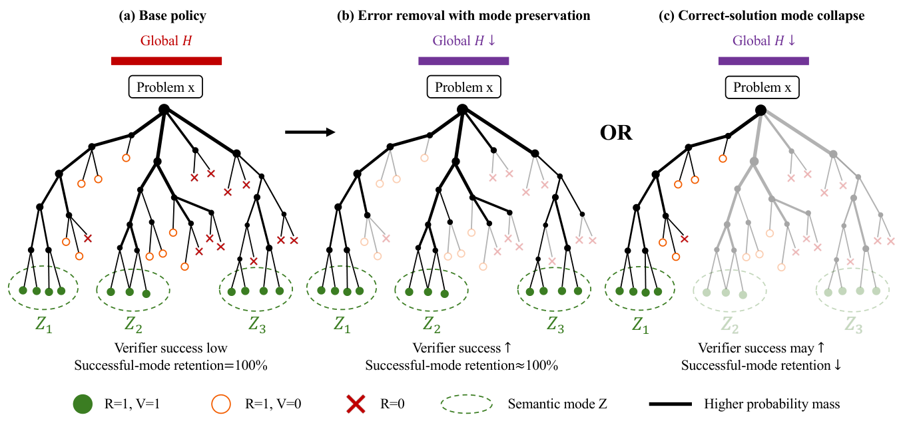

# RCEA: Where did the entropy go during RLVR?

<!-- source-sha256: 00b50a563e4c7c1037873e188e9a0a80c1d211069880328ce84177e56ac5ac6c -->

[简体中文](README.md)

## Paper information

| Field | Value |
| --- | --- |
| Paper | [arXiv 2611.09448](https://arxiv.org/abs/2611.09448) · [Pinned v1 text](https://arxiv.org/html/2611.09448v1) |
| Original title | Not All Entropy Is Equal: Reward-Conditioned Entropy Allocation in Reinforcement Learning with Verifiable Rewards |
| Company / institution | School of Computer and Information Science, Southwest University; first author Song Yu |
| First public date | 2026-11-06 13:22:42 UTC (arXiv v1 submission timestamp); identified in the November 9 incremental scan |
| Author code | No author code link in the paper or supplement; no verifiable public author implementation found |
| Local adapter / key | `rcea`; no runnable training adapter or Evolve integration |
| Local code | `src/auto_research/post_training/rcea.py` |
| Implementation status | `component_only`: exact CPU decomposition and local covariance; L1 mechanism diagnostic |
| Full experiment | Not reproduced because of excessive cost (review DONE) |

## Original method

### Motivation and method

Falling average token entropy can mean fewer failed trajectories, or fewer distinct ways to reach a correct answer. RCEA separates them by partitioning trajectory entropy by verifier outcome, process validity, and valid semantic mode. At the prefix level it uses covariance between log probability and logit change across the vocabulary to explain the direction of local entropy change. It is a diagnostic framework, not a new RL loss.

<!-- paper-figure:start -->
### Original paper figure



Figure 2 is from the [original paper](https://arxiv.org/html/2611.09448v1#Sx3.F2) by Yu et al. Copyright remains with the authors. The image is unchanged under [CC BY 4.0](https://creativecommons.org/licenses/by/4.0/).
<!-- paper-figure:end -->

### Equations

For a fixed prompt, let $Y$ be a trajectory, $R$ its deterministic verifier outcome, $V$ process validity within successes, and $Z$ the deterministic solution class of a valid success. Let $p=P(R=1)$, $v=P(V=1\mid R=1)$, and $C=(R=1,V=1)$. Eq. (7) splits trajectory entropy into six terms:

$$
H(Y)=h_b(p)+(1-p)H(Y\mid R=0)
+p\left[h_b(v)+v H(Z\mid C)+v\,\mathbb E_{Z\mid C}H(Y\mid Z,C)
+(1-v)H(Y\mid R=1,V=0)\right].
$$

Eq. (8) gives an effective mode count $\exp H(Z\mid C)$, distinct from the total probability of valid trajectories. It is undefined if none have positive probability. Eq. (5) applies total expectation to mean token entropy; it does **not** add outcome entropy. Eq. (10) is a first-order expansion at the same prefix:

$$
\Delta h\approx-\operatorname{Cov}_{a\sim\pi}(\log\pi(a),\Delta z(a)).
$$

### Paper results and limitations

In §5.4, local covariance correctly predicted the sign in 42 of 44 adjacent-checkpoint comparisons across 11 nonfailed runs. That fraction is not an error bound and does not identify which correct strategies contracted. Training used one seed and one model family. Semantic mode labels were independently audited, but within-mode realization entropy was not measured.

## Local reproduction

### Data protocol and code mapping

`entropy_allocation` implements Eqs. (7)–(8) for enumerated distinct trajectories of one prompt with normalized probabilities and externally supplied deterministic labels. `local_entropy_change` compares Eq. (10) with the finite entropy change for the same vocabulary and prefix. The fixed-probe sampling estimator, validity judge, mode labeling, and RLVR training are out of scope. Zero-mass branches contribute zero without fabricating a conditional mode count.

```bash
PYTHONPATH=src python -m pytest tests/test_nov09_rcea.py -q
PYTHONPATH=src python -c 'from auto_research.post_training.rcea import diagnostic; print(diagnostic(42))'
```

### Diagnostic and boundaries

The [standalone artifact](metrics/component-cpu-seeds42-44.json) uses finite distributions and small logit perturbations at seeds 42–44. It records decomposition residuals, effective mode count, and first-order error. These results do not measure RLVR quality and cannot support Evolve promotion. There is no advertised CUDA path.

### Full experiment cost

The original matrix uses six RLVR objectives at each of 3B and 7B, 8 on-policy candidates for each of 8,000 prompts, and 64 fixed-probe samples for each of 200 prompts per checkpoint, plus validity and semantic-mode audits. **Not reproduced because of excessive cost (review DONE)** on the current single-GPU or Mac budget; no automatic retry.
