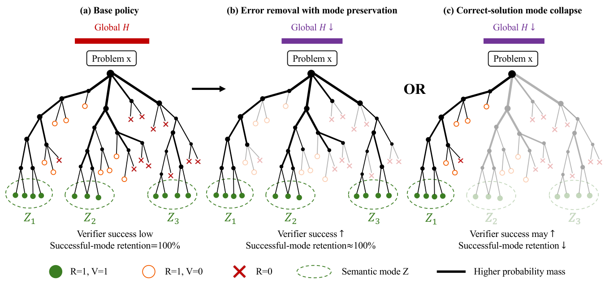

# RCEA：RLVR 的熵减少了，究竟减少在哪里？

[English](README-en.md)

## 论文信息

| 字段 | 内容 |
| --- | --- |
| 论文链接 | [arXiv 2611.09448](https://arxiv.org/abs/2611.09448) · [固定 v1 全文](https://arxiv.org/html/2611.09448v1) |
| 原文标题 | Not All Entropy Is Equal: Reward-Conditioned Entropy Allocation in Reinforcement Learning with Verifiable Rewards |
| 公司/机构 | 西南大学计算机与信息科学学院；一作 Song Yu |
| 首次公开日期 | 2026-11-06 13:22:42 UTC（arXiv v1 提交时间）；11 月 9 日增量发现 |
| 原作者代码 | 正文及附录未给出链接；未找到可核验的公开原作者实现 |
| 本地 adapter / key | `rcea`；无可执行训练 adapter，未接入 Evolve |
| 本地复现代码位置 | `src/auto_research/post_training/rcea.py` |
| 实现状态 | `component_only`；CPU 上的精确分解与局部协方差，L1 机制诊断 |
| 完整实验 | 成本过高，不复现（审查 DONE） |

## 原文方法

### 背景与主要改动

训练日志里的平均 token 熵变小，既可能是模型更少走错误路径，也可能是它不再尝试原来会做的其它正确解法。RCEA 将两类信号分开：轨迹层按验证器成败、过程有效性和有效解法模式拆分；前缀层用全词表的 log 概率与 logit 增量的协方差解释局部熵方向。它是诊断框架，不是一种新的 RL 损失。

<!-- paper-figure:start -->
### 原论文关键图



图 2 的图片来自[原论文](https://arxiv.org/html/2611.09448v1#Sx3.F2)（Yu 等），版权归原作者所有，按 [CC BY 4.0](https://creativecommons.org/licenses/by/4.0/) 原样引用。
<!-- paper-figure:end -->

### 核心公式

固定题目，轨迹为 $Y$，$R$ 是确定性验证器结果，$V$ 是成功轨迹的过程有效性，$Z$ 是有效成功轨迹的确定性解法类别。令 $p=P(R=1)$、$v=P(V=1\mid R=1)$、$C=(R=1,V=1)$。Eq. (7) 将轨迹熵拆为六项：

$$
H(Y)=h_b(p)+(1-p)H(Y\mid R=0)
+p\left[h_b(v)+v H(Z\mid C)+v\,\mathbb E_{Z\mid C}H(Y\mid Z,C)
+(1-v)H(Y\mid R=1,V=0)\right].
$$

Eq. (8) 的有效模式数是 $\exp H(Z\mid C)$，与有效轨迹的总概率是两件事；不存在有效轨迹时该指标不可定义。Eq. (5) 对平均 token 熵用全期望公式，**没有**额外的验证结果熵项。Eq. (10) 对同一前缀做一阶展开：

$$
\Delta h\approx-\operatorname{Cov}_{a\sim\pi}(\log\pi(a),\Delta z(a)).
$$

### 原文结果与限制

原文 §5.4 的 11 个非失败运行中，局部协方差在 44 个相邻检查点比较中预测对了 42 次方向。这个比例不是精确误差上界，也不能识别收缩的是哪种正确解法。训练只用一个种子和一个模型家族；语义模式由独立审查支持，但模式内实现熵没有实测。

## 本地复现

### 数据协议与代码映射

`entropy_allocation` 接收单题枚举的不同轨迹及归一概率、外部确定性标签，实现 Eq. (7)–(8)。`local_entropy_change` 输入同前缀两次词表 logit 的差值，返回 Eq. (10) 的近似与真正的有限差。未实现论文的固定探针采样估计、过程判分、语义标注和训练。零质量分支贡献为零，不伪造条件模式数。

```bash
PYTHONPATH=src python -m pytest tests/test_nov09_rcea.py -q
PYTHONPATH=src python -c 'from auto_research.post_training.rcea import diagnostic; print(diagnostic(42))'
```

### 诊断与边界

种子 42–44 的[单独指标产物](metrics/component-cpu-seeds42-44.json)使用有限概率分布和小 logit 扰动，核对分解残差、有效模式数和一阶误差；不能拿它当论文 RLVR 效果或 Evolve 晋级证据。仅 CPU，无 CUDA 验证路径。

### 完整实验成本

完整矩阵包含 3B/7B 各六个 RLVR 优化目标、8,000 条训练题各 8 个在线候选、每检查点 200 题各 64 次固定探针，以及过程有效性和语义模式复核。对当前单卡与本地预算，**成本过高，不复现（审查 DONE）**，不自动重试。
