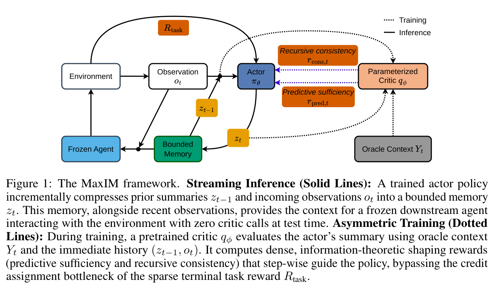
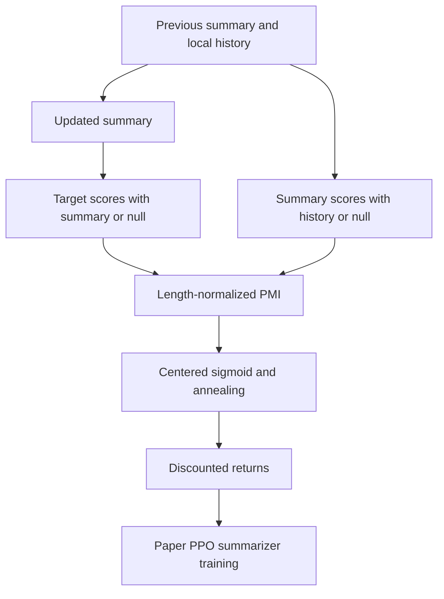

# MaxIM: Maximally Informative Incremental Summarization via Reinforcement Learning

<!-- source-sha256: c7a3a721c843a1384f1e8f052af34a4124e1eeee4f7635bb2d9bc397c43f96e3 -->

[简体中文](README.md)

> **L1 mechanism component, diagnostic only.** Full experiment not reproduced due to cost (review DONE). Not integrated with Evolve.

## Paper information

| Field | Value |
| --- | --- |
| Paper | [arXiv:2611.12825v1](https://arxiv.org/abs/2611.12825v1); [fixed v1 full text](https://arxiv.org/html/2611.12825v1) |
| First author and affiliation | **Jihwan Jeong**; **Google Research** |
| Original publication date | **2026-11-09 18:25:42 UTC**, arXiv v1 submission; not announcement or local review date |
| Author code | No verified author implementation repository found in the fixed v1 as of 2026-11-11; local implementation is independent. |
| Local adapter / key | `maxim`; `adapter: null`, independent component |
| Local code | `src/auto_research/post_training/maxim.py` |
| Validation scope | Three-seed CPU numerical diagnostics; no GPU requirement or task-capability claim |

## Paper summary

### Motivation and main change

An incremental summarizer must discard history under a strict memory budget. MaxIM separates the trainable summarizer from a frozen action model. The summarizer observes only its previous summary, the previous action and the current observation; privileged targets may train the critic but must not enter the evaluated summarizer's inference context.

The two rewards ask whether the summary preserves target-relevant information and whether its claims are supported by the local history. Consistency scores the summary in the forward direction. Reconstructing history from the summary can overlook fabricated claims appended to otherwise valid content.

<!-- paper-figure:start -->
### Key original figure

[](https://arxiv.org/pdf/2611.12825v1#page=2)

Original Figure 1, PDF page 2: solid lines describe streaming memory and the frozen agent; dotted lines show critic training with privileged targets. The model loop is not part of the local reward-arithmetic component.

Rendered from fixed v1 PDF with the complete figure and its original caption. No scientific content was redrawn or altered. Copyright remains with the authors; source, page, crop and SHA-256 are recorded in [assets/provenance.json](assets/provenance.json).
<!-- paper-figure:end -->



This is a locally authored explanatory diagram of Sections 4.3–4.4, not an original paper screenshot. The final model-training stage is not implemented here.

### Core equations

Equations 4–5 subtract frozen teacher-forced null-context log probabilities from conditional scores and average over the corresponding valid target tokens:

$$
r_{pred}=\operatorname{mean}_{i\in Y}[\log q(Y_i\mid Y_{<i},z)-\log q(Y_i\mid Y_{<i},z_{null})],
$$

$$
r_{cons}=\operatorname{mean}_{i\in z}[\log q(z_i\mid z_{<i},\widetilde H)-\log q(z_i\mid z_{<i},\widetilde H_{null})].
$$

Equations 6–7 center the calibrated sigmoid rewards and balance their accumulated scale:

$$
\widehat r=w_s[\sigma(\alpha_s(r_{pred}-b_s))-.5]+w_c[\sigma(\alpha_c(r_{cons}-b_c))-.5],\quad 0\le w_c<w_s,
$$

$$
G_t=\sum_{k=t}^{T}\gamma^{k-t}[R_{task,k}+(1-\gamma)\lambda_s\widehat r_k].
$$

Calibration must use pre-RL data, not test tuning. The cosine schedule eventually removes shaping; the local hold/end parameters are explicit inputs, not claimed paper-optimal defaults. Nonlinear shaping and an approximate critic do not guarantee preservation of the original optimum.

### Paper evidence and limitations

The paper studies arXiv reading and WildChat dialogue across memory budgets, task utility and claim grounding, with separate critic-bias analysis. It uses Gemini 2.5 Flash roles and a GPT-4.1 judge. None of those capability scores were reproduced locally. The information-theoretic motivation has stated assumptions and is not a guarantee that critic scores measure true mutual information or correctness.

## Local implementation

### Protocol and code mapping

`normalized_pmi` consumes aligned, already frozen conditional/null token log probabilities and masks. `shaping_reward`, `cosine_weight` and `discounted_returns` implement the numerical transforms. Episodes must be right-padded. These functions are CPU-only; CUDA requests fail explicitly.

```bash
PYTHONPATH=src python -c 'from auto_research.post_training.maxim import diagnostic; print(diagnostic(42, device="cpu"))'
PYTHONPATH=src python -m pytest -q tests/test_nov11_post_training_components.py
```

### Checks and boundaries

Seeds 42/43/44 cover null subtraction, valid-token averaging, zero-centered rewards, bounded shaping, discounting and removal of the critic at schedule end. Padding cannot leak future rewards and may contain ignored NaNs. A shared target-difficulty offset cancels in the score difference.

These are illustrative numerical inputs, not an evaluated critic or summarizer. Critic training, actual target construction, PPO, leave-one-out advantages, KL regularization, action/user models and generation are omitted. This is **L1 mechanism evidence**, not full MaxIM or an executable Evolve integration.

### High-cost full experiment

Appendix D.4 uses Google Cloud TPUs for SFT, RL and serving with Gemini 2.5 Flash; arXiv RL runs 1000 steps and WildChat 800. Evaluation includes 500 dialogue seeds, up to 15 turns, an independent judge and bootstrap analysis. This proprietary multi-role training protocol is **not reproduced: high cost, review DONE**. The assessment is source-based, not measured local runtime; no checkpoints, training probes or automatic retries are attempted.
