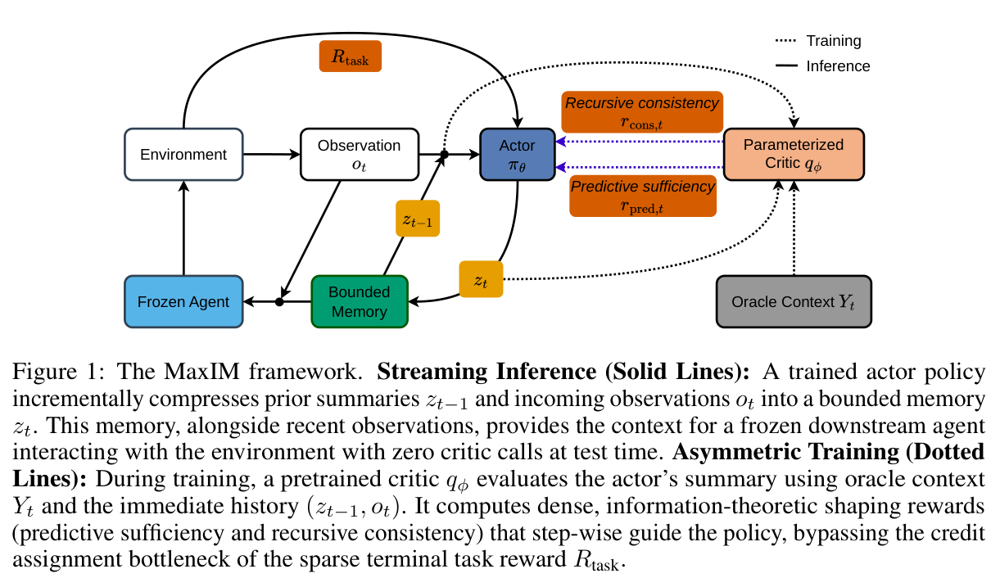
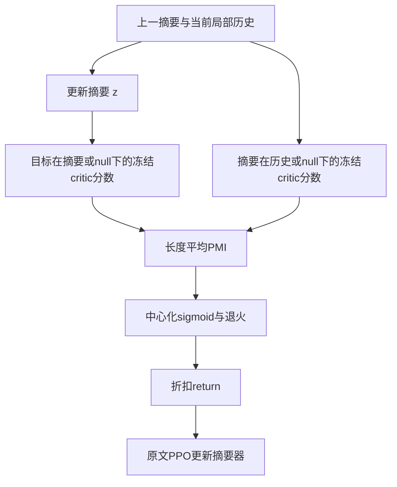

# MaxIM：用任务信息与事实一致性训练增量摘要

[English](README-en.md)

> **L1 机制组件，diagnostic only。** 完整实验成本过高，不复现（审查 DONE）；未接入 Evolve。

## 论文信息

| 字段 | 内容 |
| --- | --- |
| 论文链接 | [arXiv:2611.12825v1](https://arxiv.org/abs/2611.12825v1)；[固定 v1 全文](https://arxiv.org/html/2611.12825v1) |
| 公司 / 作者机构 | 一作 **Jihwan Jeong**：**Google Research** |
| 首次公开日期 | **2026-11-09 18:25:42 UTC**，以 arXiv v1 提交记录为准，不把公告或本地审查日当首发 |
| 原作者开源代码 | 截至2026-11-11，固定v1正文未给出已核实的MaxIM作者实现仓库；本地据式4–7独立实现奖励算术，不包含critic或摘要策略。 |
| 本地 adapter / key | `maxim`；`adapter: null`，独立机制组件 |
| 本地复现代码 | `src/auto_research/post_training/maxim.py` |
| 验收范围 | CPU 三种子数值诊断；不需要 GPU，不能据此主张任务能力 |

## 原始论文总结

### 背景与主要改动

长程交互不能无限保留历史，增量摘要却会不可逆地丢失信息。MaxIM 把摘要更新器与冻结的行动模型分开：摘要器只根据上一摘要、上一动作和当前观测更新有限记忆，不得直接读取任务目标。训练 critic 时可以使用特权标签；这不允许被评估的摘要器或 Agent 在推理时读取答案。

方法同时奖励“摘要能预测任务相关变量”和“新摘要有当前局部历史支持”。第二项必须向前逐 token 评分摘要：反过来从摘要重建历史，可能对附加的幻觉声明不敏感。

<!-- paper-figure:start -->
### 原论文关键图

[](https://arxiv.org/pdf/2611.12825v1#page=2)

原论文 Figure 1（PDF 第 2 页）：实线为部署时的增量记忆/冻结 Agent，虚线为使用特权目标的 critic 训练。图中的模型闭环不等于本地奖励算术已包含它。

来自固定 v1 PDF；裁图保留完整图与原图注，未重绘或修改科学内容。版权归原作者，来源、页码、裁切范围和 SHA-256 见 [assets/provenance.json](assets/provenance.json)。
图片来自[原论文](https://arxiv.org/pdf/2611.12825v1#page=2)，版权归原作者所有；图中完整系统或实验结果不等于本地组件结果。

<!-- paper-figure:end -->



该图为依据原文 §4.3–4.4 绘制的本地说明图，不是论文截图；最后的模型训练未在本地实现。

### 核心公式

固定 critic 的四个 teacher-forced 查询产生式 4–5：

$$
r_{pred}=\operatorname{mean}_{i\in Y}[\log q(Y_i\mid Y_{<i},z)-\log q(Y_i\mid Y_{<i},z_{null})],
$$

$$
r_{cons}=\operatorname{mean}_{i\in z}[\log q(z_i\mid z_{<i},\widetilde H)-\log q(z_i\mid z_{<i},\widetilde H_{null})].
$$

两项在各自目标 token 上平均，不在拼接后的 prompt 上平均。再按式 6–7：

$$
\widehat r=w_s[\sigma(\alpha_s(r_{pred}-b_s))-.5]+w_c[\sigma(\alpha_c(r_{cons}-b_c))-.5],\quad 0\le w_c<w_s,
$$

$$
G_t=\sum_{k=t}^{T}\gamma^{k-t}[R_{task,k}+(1-\gamma)\lambda_s\widehat r_k].
$$

中心与斜率应由初始策略的离线校准数据固定，不能在 test 上调。$\lambda_s$ 先为 1，再余弦衰减到 0；本地函数把 hold/end 明确作为调用参数，不声称默认值就是原文最优超参。中心化避免给每个额外回合固定正奖励；$1-\gamma$ 控制跨回合累积尺度，但非线性 shaping 不保证保持原始最优策略。

### 原文结果与限制

原文在 arXiv 阅读与 WildChat 长程对话比较记忆预算、任务表现和声明 grounding，并单独分析 critic 偏差。所有角色涉及 Gemini 2.5 Flash，评测还有 GPT-4.1 judge；作者分数不是本仓库的实测结果。信息论动机依赖文中的条件假设，近似 critic 和 sigmoid 变换不能被当成无偏互信息测量或正确性保证。

## 本地复现

### 数据协议与代码映射

`normalized_pmi` 接收已冻结、对齐的 conditional/null token log-prob 和 Boolean mask；本地没有生成这些分数的模型。`shaping_reward` 实现式 6；`cosine_weight` 实现调用方固定的退火；`discounted_returns` 在右填充 episode 上执行式 7。只支持 CPU；CUDA 请求明确报错。

```bash
PYTHONPATH=src python -c 'from auto_research.post_training.maxim import diagnostic; print(diagnostic(42, device="cpu"))'
PYTHONPATH=src python -m pytest -q tests/test_nov11_post_training_components.py
```

### 结果、负控与边界

seed 42/43/44 的小数组诊断覆盖 null 抵消、长度平均、中心零奖励、有界 shaping、任务折扣及退火为零后去掉 critic。检查填充 NaN 不进入归约、episode 后方不能泄漏奖励，且相同目标难度偏移从 conditional/null 差分抵消。这里输入分数是教学数值，不输出摘要质量、任务成功率或伪造的模型调用结果。

未实现 critic 监督训练、真实目标构造、PPO、leave-one-out 组优势、KL 正则、行动模型、用户模拟器或语言生成。因此是 **L1 机制组件**，不是完整 MaxIM，也未接入 Evolve。

### 高成本完整实验

Appendix D.4 使用 Google Cloud TPU 执行 SFT/RL/serving，训练角色基于 Gemini 2.5 Flash；arXiv RL 1000 步，WildChat 800 步；评测 500 个对话种子、最多 15 轮并使用独立 judge 和 bootstrap。闭源可训练 checkpoint、多角色交互和 TPU 协议超出单张 A100/A30 或 Mac 的低成本范围：**成本过高，不复现（审查 DONE）**。这不是本地测得的耗时，不下载模型、不试训、不自动重试。
