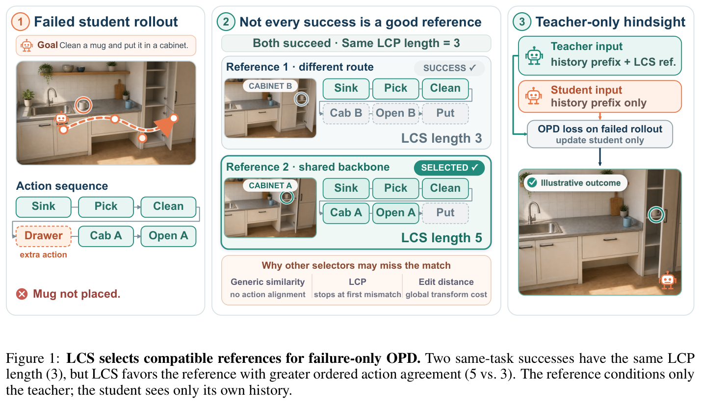
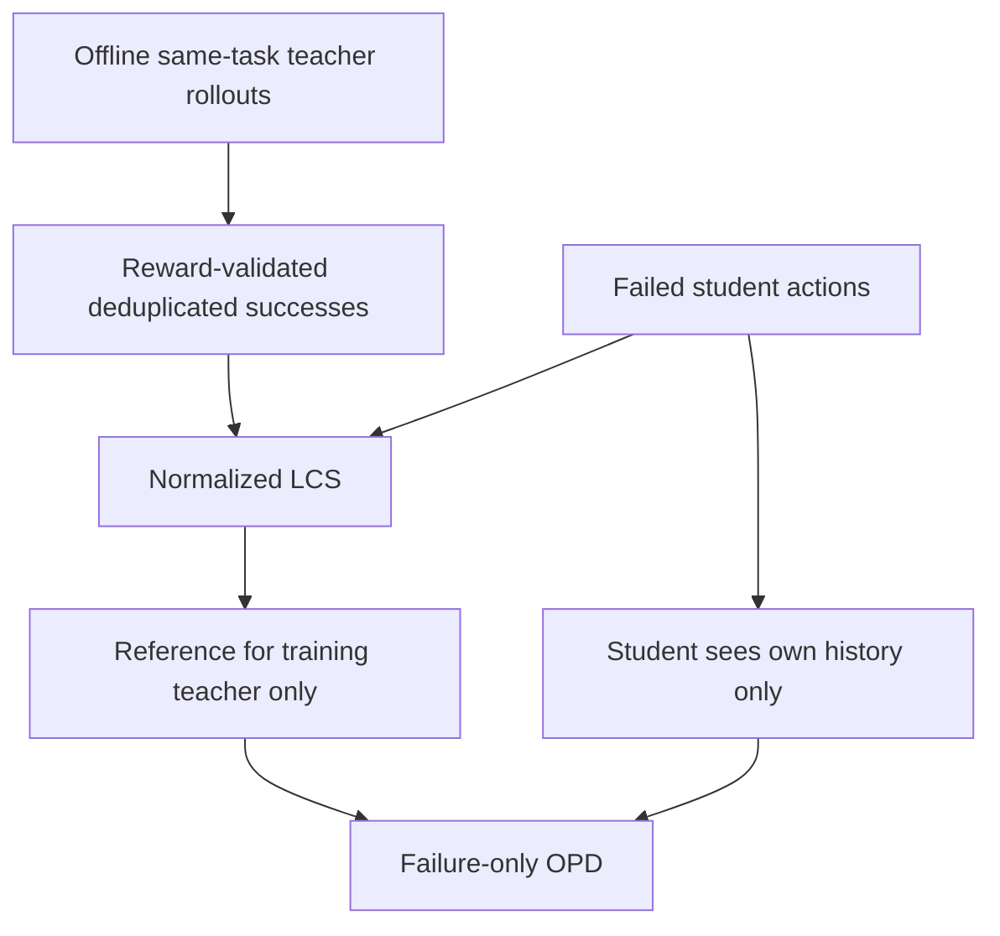

# Which Successes Make Good References? Action-Sequence Alignment for Multi-Turn On-Policy Distillation

<!-- source-sha256: 65879615c38c9270fee5e4424d6437e6ab920a70a477efefd027ca246cf5f685 -->

[简体中文](README.md)

> **L1 mechanism component, diagnostic only.** Full experiment not reproduced due to cost (review DONE). This closes a previously discovered lead, not a November 12 first publication. No Evolve integration.

## Paper information

| Field | Value |
| --- | --- |
| Paper | [arXiv:2611.13135v1](https://arxiv.org/abs/2611.13135v1); [fixed v1 full text](https://arxiv.org/html/2611.13135v1) |
| First author and affiliation | **Mufei Li**: **Georgia Institute of Technology (work during an Amazon Web Services internship)**, verified from PDF page 1 |
| Original publication | **2026-11-09 19:18:25 UTC**, official arXiv v1 submission, not announcement/review date |
| Author code | No verified paper-specific author repository was found in fixed v1. Appendix I lists TCOD/Trinity-RFT/veRL and other upstream infrastructure, not this method's release. |
| Local adapter / key | `lcs-reference-opd`; `adapter: null`, independent component |
| Local code | `src/auto_research/post_training/lcs_reference_opd.py` |
| Entry | `select_reference`; `diagnostic(seed, device='cpu')` |

## Paper summary

### Motivation and main change

A successful trajectory is not automatically a useful corrective reference for every failed student. The paper aligns executed actions: unlike longest common prefix, LCS preserves ordered agreement after recoverable detours and selects a compatible same-task success. References are training-only teacher inputs; the student sees only its own history.

Free-target OT also optimizes reference-use frequencies, so failures **independently select their best reference**. There is no balanced target marginal, Hungarian matching or one-reference-per-failure constraint. Successful students skip OPD; failures without a same-task success use ordinary reference-free OPD.

<!-- paper-figure:start -->
### Key original figure

[](https://arxiv.org/pdf/2611.13135v1#page=2)

Original Figure 1, PDF page 2, retaining the complete figure and caption. Copyright remains with the authors; [provenance](assets/provenance.json) records source/page/hashes. The illustrated ALFWorld interactions and outcome are the authors' example, not local agent execution.



### Core equations

LCS preserves order and repeated actions while allowing unmatched actions:

$$
s(\tau^-,\tau^+)=\frac{\ell_{LCS}(a^-,a^+)}{Z(T^-,T^+)},
\qquad f(x,\tau^-)\in\arg\max_{\tau^+\in R_x}s(\tau^-,\tau^+).
$$

Appendix D uses $Z=\min(T^-,T^+)$ for ALFWorld and $Z=T^-$ for tau3-bench. They can select different references and must not be silently unified. Training averages over failures, not the complete collected batch:

$$
L=\frac1{|I^-|}\sum_{i\in I^-}L_i.
$$

An all-success batch performs no optimizer step. Matching actions imply matching states only under shared-initial-state and transition assumptions; later LCS matches additionally require recoverable detours. This is not universal state equivalence or a guarantee of better teacher supervision.

### Paper evidence and limits

The authors compare two students and seven other selectors on ALFWorld and tau3-airline, with transfer to retail. No production A/B is reported and no model success rate is reproduced locally. The theory requires recoverability and supervision-gain assumptions. High LCS can still hide incompatible latent states or misleading references.

## Local implementation

### Protocol and code mapping

`lcs_length` implements exact dynamic programming. `compatibility` exposes both paper normalizers. `reference_pool` keeps externally evaluated successes and deduplicates **complete parsed sequences within each task**, preserving order and repetition. `select_reference` implements independent argmax, first-tie behavior, successful-student skips and fallback. `failure_only_mean` returns None for all-success batches; callers must not quietly take a zero-loss optimizer step.

`canonical_tool_call` only canonicalizes exact tool names/JSON arguments. It is not an ALFWorld parser, semantic matcher or state reasoner. The source assumes positive denominators; empty local sequences explicitly score zero, a boundary convention not attributed to the paper.

```bash
PYTHONPATH=src python -c 'from auto_research.post_training.lcs_reference_opd import diagnostic; print(diagnostic(42, device="cpu"))'
PYTHONPATH=src python -m pytest -q tests/test_nov12_post_training_components.py
```

### Checks and boundaries

Independent exhaustive subsequences check DP. Tests cover detours, repetitions, normalizer-dependent selection, exclusion of exact cross-task matches, shared reference reuse, full-sequence deduplication, ignored NaN success losses and all-success no-update behavior. Three-seed loss values are reduction inputs, not model outputs or task success.

Real offline references, student rollouts, teacher scoring, the OPD loss/trainer and environments are absent. Returned references belong only to the training-teacher interface, not student-visible context. No Evolve integration or CUDA capability is claimed.

### High-cost full experiment

Appendix J specifies **eight 80 GB A100s**: four for training, two for teacher scoring and two for model updates. ALFWorld training takes about 10 hours and tau3-airline about 1 hour, with roughly **4500 A100 GPU-hours** across reported runs. The matrix also includes multiple students/selectors, up to 200 environment steps and 10,000 output tokens. **Too costly; full experiment not reproduced, review DONE.** These are source disclosures, not local timing; no checkpoints, environment/LLM probes or retries are attempted.
