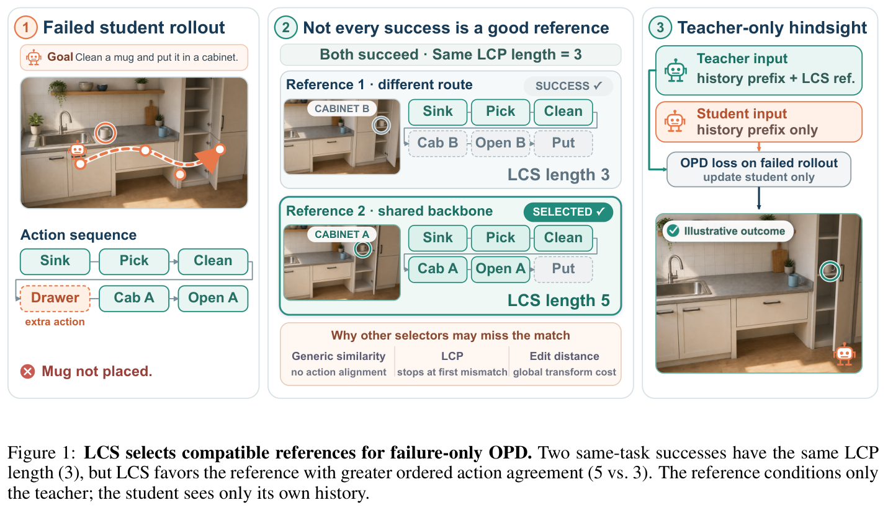
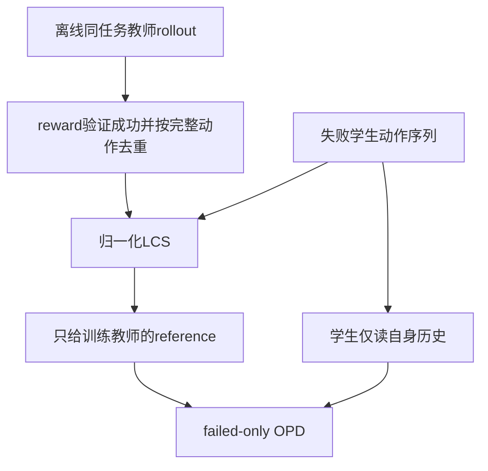

# LCS 引用选择：为失败轨迹寻找同任务兼容成功

[English](README-en.md)

> **L1 机制组件，diagnostic only。** 完整实验成本过高，不复现（审查 DONE）。 本轮补审上批线索，不计为 11 月 12 日首发；未接入 Evolve。

## 论文信息

| 字段 | 内容 |
| --- | --- |
| 论文链接 | [arXiv:2611.13135v1](https://arxiv.org/abs/2611.13135v1)；[固定 v1 全文](https://arxiv.org/html/2611.13135v1) |
| 公司 / 作者机构 | 一作 **Mufei Li**：**Georgia Institute of Technology（工作在Amazon Web Services实习期间完成）**；已核对 PDF 首页作者栏 |
| 首次公开日期 | **2026-11-09 19:18:25 UTC**，官方 arXiv v1 提交时间，不用公告/本次审查日期替换 |
| 原作者开源代码 | 固定v1未提供已核实的本篇作者代码仓库；Appendix I说明基于TCOD/Trinity-RFT/veRL等上游，不把这些依赖记作本篇开源。 |
| 本地 adapter / key | `lcs-reference-opd`；`adapter: null`，独立组件 |
| 本地复现代码 | `src/auto_research/post_training/lcs_reference_opd.py` |
| 本地入口 | `select_reference`；`diagnostic(seed, device='cpu')` |

## 原始论文总结

### 背景与主要改动

同一任务可有多条成功路线，但并非任意成功 reference 都适合纠正当前失败学生。论文仅用执行动作序列作对齐：相比最长公共前缀 LCP，LCS 在可恢复绕行之后仍保留有序一致，选择更兼容的同任务成功轨迹。reference 只给训练教师，学生始终仅看自己的历史。

free-target OT 的目标使用频率也自由，因此各失败 rollout **独立选最兼容 reference**；没有 balanced target marginal，不需要 Hungarian 匹配，也不能强制不同失败选择不同成功。成功学生跳过 OPD，缺同任务成功 reference 时回退普通无参考 OPD。

<!-- paper-figure:start -->
### 原论文关键图

[](https://arxiv.org/pdf/2611.13135v1#page=2)

图片来自[原论文](https://arxiv.org/pdf/2611.13135v1#page=2)第 2 页 Figure 1，版权归原作者所有；完整保留图与原图注，来源/页码/哈希见 [provenance](assets/provenance.json)。图中的 ALFWorld 交互和成功结果是作者说明，不是本地 Agent 执行。



### 核心公式

对失败动作序列 $a^-$ 与成功动作序列 $a^+$，LCS 保留顺序和重复动作，允许中间存在未匹配动作：

$$
s(\tau^-,\tau^+)=\frac{\ell_{LCS}(a^-,a^+)}{Z(T^-,T^+)},
\qquad f(x,\tau^-)\in\arg\max_{\tau^+\in R_x}s(\tau^-,\tau^+).
$$

Appendix D 的 ALFWorld 使用 $Z=\min(T^-,T^+)$，tau3-bench 使用 $Z=T^-$。两者会选择不同 reference，不能无说明统一。训练归约除以失败样本数，不是整个采样 batch：

$$
L=\frac1{|I^-|}\sum_{i\in I^-}L_i.
$$

若没有失败样本就不执行 optimizer step。相同动作只在共享初始状态、确定性转移或相应分布假设下联系到状态；LCS 的后缀一致还要求未匹配绕行能恢复，不能把动作相同当成普适状态等价或更好监督保证。

### 论文离线与线上效果

作者比较 ALFWorld 和 tau3-airline 的两个学生、七种其他 selector，并报告到 retail 的迁移；未报告生产线上 A/B。本地不复测这些模型成功率。论文保证依赖 recoverable-detour 与监督收益假设；高度 LCS 也可能对应不同潜在状态或误导教师。

## 本地复现

### 数据协议与代码映射

`lcs_length` 是精确动态规划；`compatibility` 显式选择论文两种归一化。`reference_pool` 只保留外部 evaluator 验证的成功，按**同任务完整解析动作序列**去重，不丢弃动作重复和顺序。`select_reference` 独立 argmax、确定性首个 tie、成功 skip/无 reference fallback。`failure_only_mean` 在全成功时返回 None，调用方不得偷偷执行一次零 loss 更新。

`canonical_tool_call` 只对 tool-name/JSON arguments 做严格身份规范化，不是 ALFWorld parser、语义相似或状态推理器。原文假设正分母；空解析序列的本地边界明确为零分，不声称论文定义了该情况。

```bash
PYTHONPATH=src python -c 'from auto_research.post_training.lcs_reference_opd import diagnostic; print(diagnostic(42, device="cpu"))'
PYTHONPATH=src python -m pytest -q tests/test_nov12_post_training_components.py
```

### 结果、负控与边界

测试用独立穷举子序列核对 DP，覆盖绕行、重复动作、两种 normalizer 反转选择、跨任务完全匹配仍不能选、多个失败共用同一 reference、整序列去重、NaN success-loss 忽略和全成功不更新。42/43/44 的损失只是归约输入；没有模型返回答案或 gold plan，没有任务成功率指标。

这里没有离线真实教师 reference 收集、在线学生 rollout、reference-conditioned scoring、OPD loss/trainer 或环境。本地 selector 返回的引用只供训练教师接口，不是学生可读上下文；未接入 Evolve。模块只支持 CPU，不声明 CUDA 或 GPU 能力。

### 高成本完整实验

Appendix J 明确使用 **8 张 80GB A100**，分别 4 训练、2 teacher scoring、2 model update；ALFWorld 训练约 10 小时、tau3-airline 约 1 小时，全部运行约 **4500 A100 GPU-hours**。还包括多学生、多 selector、最长 200 环境步骤和最高 10000 输出 token。**成本过高，不复现（审查 DONE）**，这是原文资源披露而非本地测速；不下载 checkpoint、不启动环境/LLM 试跑、不自动重试。
