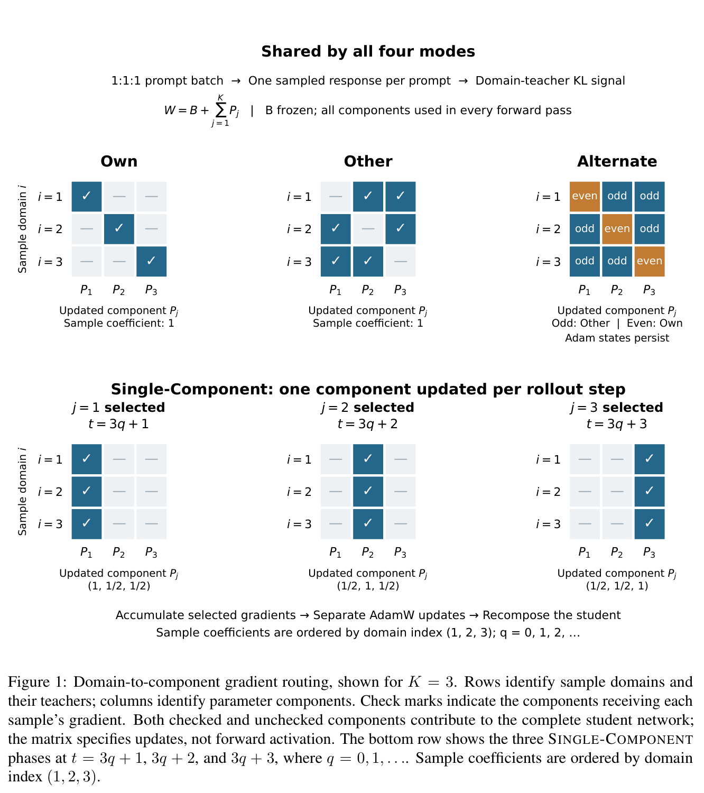
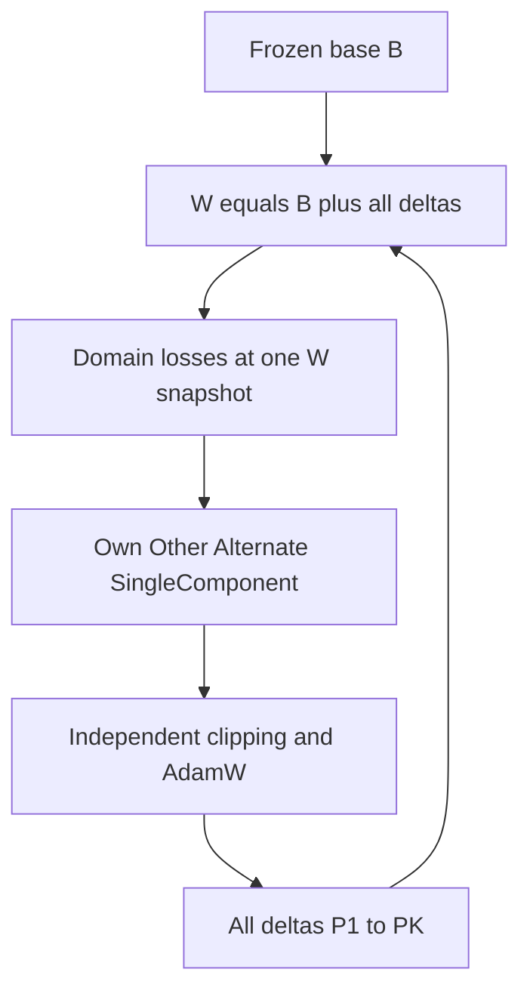

# DRD-MOPD: Domain-Routed Delta Optimization for Multi-Teacher On-Policy Distillation

<!-- source-sha256: 3fb54a6a2d9501802204e106c8b89d010713c1da560da1cd77bcb54977862a05 -->

[简体中文](README.md)

> **L1 mechanism component, diagnostic only.** CPU and three-seed real NVIDIA A100 validation passed. Full experiment not reproduced due to cost (review DONE). Not integrated with Evolve.

## Paper information

| Field | Value |
| --- | --- |
| Paper | [arXiv:2611.13249v1](https://arxiv.org/abs/2611.13249v1); [fixed v1 full text](https://arxiv.org/html/2611.13249v1) |
| First author and affiliation | **Lin Yao**; **Shanghai Jiao Tong University / Zhongguancun Academy** |
| Original publication date | **2026-11-09 21:21:41 UTC**, arXiv v1 submission |
| Author code | Appendix C explicitly says the source bundle contains no training implementation or checkpoints. [Open-MOPD](https://github.com/BytedTsinghua-SIA/Open-MOPD/tree/4809a96cf85a869106ff0ff3f37d0a51e12010ae) is an upstream reference, not DRD-MOPD author code. No independently verifiable author repository was found. |
| Local adapter / key | `drd-mopd`; `adapter: null`, independent component |
| Local code | `src/auto_research/post_training/drd_mopd.py` |
| Validation scope | CPU checks and real A100 seeds 42/43/44 L1 validation; [sanitized GPU receipt](../../gpu-validations/drd-mopd-a100-20261111.json) |

## Paper summary

### Motivation and main change

DRD-MOPD separates domain updates into full-parameter deltas over a frozen base. Domain labels route **updates**, not inference activations, teachers or experts. Every input uses the same student, composed from every delta.

<!-- paper-figure:start -->
### Key original figure

[](https://arxiv.org/pdf/2611.13249v1#page=5)

Original Figure 1, PDF page 5: check marks select which parameter components receive domain gradients. Unchecked components still participate in every composed-student forward; SingleComponent changes updates, not the activated model.

Rendered from fixed v1 PDF with the complete figure and its original caption. No scientific content was redrawn or altered. Copyright remains with the authors; source, page, crop and SHA-256 are recorded in [assets/provenance.json](assets/provenance.json).
<!-- paper-figure:end -->



This diagram explains Sections 3.1–3.4. Teacher scoring, generation and distributed training are outside the local implementation.

### Core equations

$$
W=B+\sum_{j=1}^{K}P_j,\qquad g_j=\sum_i w_iR_{ij}\nabla_W\mathcal L_i(W).
$$

All domain gradients must be computed at the **same composed-weight snapshot before any update**.

- **Own:** update the matching component.
- **Other:** copy each domain gradient to every other component, **without** dividing by $K-1$.
- **Alternate:** odd one-based rollout steps use Other; even steps use Own.
- **SingleComponent:** update only $a_t=1+((t-1)\bmod K)$; its own domain has coefficient 1, every other domain $1/(K-1)$.

Each selected component independently clips its aggregated gradient and advances its AdamW parameters, moments and counter. Unselected components receive no update, momentum decay, counter advance or weight decay. With plain SGD, Other's composite update is $K-1$ times Own's; separate adaptive states invalidate that general equivalence for AdamW.

### Paper evidence and limitations

Appendix C documents SmolLM3-3B and Math/Code/IF configurations and local parameter-geometry analysis. It explicitly states that the source bundle does not contain training implementation or checkpoints. Open-MOPD is an upstream reference, not released DRD-MOPD code. The local Own checkpoint and reported references are not a strict matched comparison. No task score or general multi-teacher improvement is claimed locally.

## Local implementation

### Protocol and code mapping

`route_matrix` defines domain-to-component coefficients. `DeltaAdamW.composed` includes every delta. `step_losses` obtains real autograd gradients at a shared snapshot before routing; `step` accepts externally computed common-snapshot gradients. The base stays frozen and each component maintains independent AdamW state. Small tensors support CPU and CUDA.

```bash
PYTHONPATH=src python -c 'from auto_research.post_training.drd_mopd import diagnostic; print(diagnostic(42, device="cpu"))'
PYTHONPATH=src python -m pytest -q tests/test_nov11_post_training_components.py
```

### Checks and boundaries

Multi-step Own/SingleComponent/Other updates are compared against separate `torch.optim.AdamW` instances. Tests cover unchanged inactive state, domain coefficients, parity, independent clipping, the frozen base and the SGD composite identity. Seeds 42/43/44 execute actual backward/update operations on small squared losses; these are not distillation-capability results.

Teacher checkpoints, the top-16 distillation surrogate, dynamic domain weights, token-share normalization, LM rollouts, FSDP and Evolve integration are absent. All component checks passed on a real **NVIDIA A100** for seeds 42/43/44. [Per-seed metrics](metrics/component-cuda-seeds42-44.json) and the [sanitized receipt](../../gpu-validations/drd-mopd-a100-20261111.json) bind the execution to frozen source `ef3521b7a3bdef545a584bc356ada87c68938a99`. This validates actual CUDA autograd/update execution, not multi-teacher or task capability.

### High-cost full experiment

The source configuration has a 3B base, three full-parameter deltas, two frozen teachers and independent Adam states. It specifies FSDP1, $24\times N_{GPU}$ prompts per step, 200 rollout steps, up to 16384 output tokens, 79380 training prompts and 1536 validation prompts. GPU count and wall time are not reported and are not invented. The full configuration is **not reproduced: high cost, review DONE**. No checkpoints, expensive probes or automatic retries are attempted; the affordable routing core is implemented.
