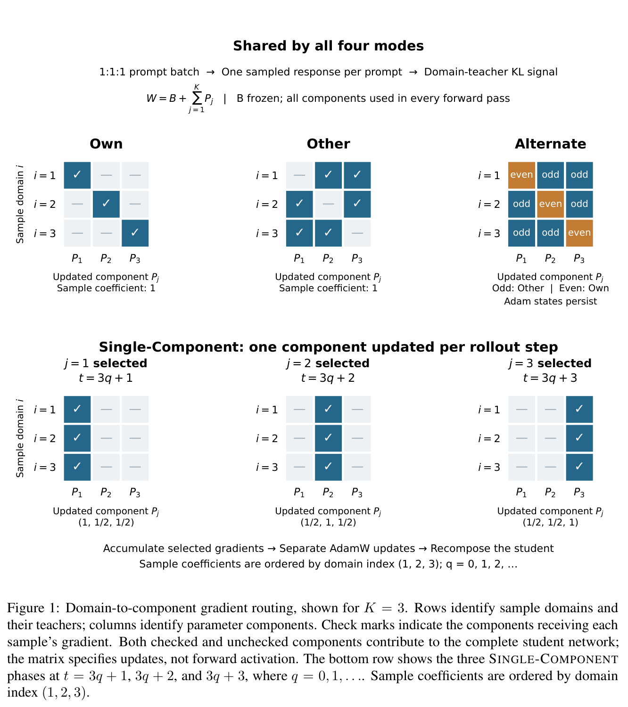
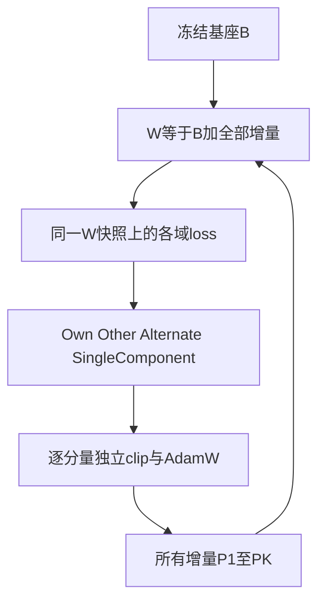

# DRD-MOPD：对全参数增量路由更新，而不是路由前向

[English](README-en.md)

> **L1 机制组件，diagnostic only。** CPU 与真实 NVIDIA A100 三种子验证已通过；完整实验成本过高，不复现（审查 DONE）；未接入 Evolve。

## 论文信息

| 字段 | 内容 |
| --- | --- |
| 论文链接 | [arXiv:2611.13249v1](https://arxiv.org/abs/2611.13249v1)；[固定 v1 全文](https://arxiv.org/html/2611.13249v1) |
| 公司 / 作者机构 | 一作 **Lin Yao**：**Shanghai Jiao Tong University / Zhongguancun Academy** |
| 首次公开日期 | **2026-11-09 21:21:41 UTC**，以 arXiv v1 提交记录为准 |
| 原作者开源代码 | 原文Appendix C明确source bundle不含训练实现或checkpoint。引用的BytedTsinghua-SIA/Open-MOPD（4809a96cf85a869106ff0ff3f37d0a51e12010ae）仅为上游，不是DRD-MOPD作者开源；未找到本篇独立可验证仓库。 |
| 本地 adapter / key | `drd-mopd`；`adapter: null`，独立组件 |
| 本地复现代码 | `src/auto_research/post_training/drd_mopd.py` |
| 验收范围 | CPU 检查及真实 A100 42/43/44 三种子 L1 验证；[脱敏 GPU 收据](../../gpu-validations/drd-mopd-a100-20261111.json) |

## 原始论文总结

### 背景与主要改动

多个教师可能提供冲突的领域更新，直接优化一个学生无法区分冲突来自哪一份参数方向。DRD-MOPD 保留冻结基座与多个全参数增量，以域标签选择**哪些增量接受梯度**，而不是在推理时选择哪个教师或专家。三个域的任何输入都经过同一个合成学生。

<!-- paper-figure:start -->
### 原论文关键图

[](https://arxiv.org/pdf/2611.13249v1#page=5)

原论文 Figure 1（PDF 第 5 页）：勾号选择接受域梯度的参数分量。未勾分量仍参与完整学生的所有前向；下方 SingleComponent 改变更新者，不改变激活的模型。

来自固定 v1 PDF；裁图保留完整图与原图注，未重绘或修改科学内容。版权归原作者，来源、页码、裁切范围和 SHA-256 见 [assets/provenance.json](assets/provenance.json)。
图片来自[原论文](https://arxiv.org/pdf/2611.13249v1#page=5)，版权归原作者所有；图中完整系统或实验结果不等于本地组件结果。

<!-- paper-figure:end -->



这是依据 §3.1–3.4 绘制的解释图。教师评分、学生生成和分布式训练不属于本地实现。

### 核心公式

$$
W=B+\sum_{j=1}^{K}P_j,\qquad g_j=\sum_i w_i R_{ij}\nabla_W\mathcal L_i(W).
$$

所有域梯度必须在**任何参数改变之前的同一 $W$**计算并累积。路由矩阵为：

- **Own**：$R_{ij}=1[i=j]$。
- **Other**：$R_{ij}=1[i\ne j]$，不除以 $K-1$。
- **Alternate**：以一为起点的 rollout 奇数步 Other，偶数步 Own。
- **SingleComponent**：仅更新 $a_t=1+((t-1)\bmod K)$；本域系数 1，其他每域系数 $1/(K-1)$。

每个被选增量独立裁剪聚合梯度、维护 AdamW 一/二阶矩与更新计数。未选增量的参数、moment、计数及 weight decay 都不变，不能给它们置零梯度后仍调用全局 optimizer。普通无裁剪/衰减 SGD 的 Other 合成更新是 Own 的 $K-1$ 倍；独立自适应状态下不能沿用这个等价结论。

### 原文结果与限制

Appendix C 包含 SmolLM3-3B、Math/Code/IF 的配置及局部参数几何分析。它明确说明 source bundle 没有训练实现或 checkpoint；所引 Open-MOPD 是上游。论文局部 Own checkpoint 与参考结果不是严格同配置对照，不能据此宣称完整方法普遍优于基线。本地不复现其任务分数，也不声称验证了作者多教师损失或领域泛化。

## 本地复现

### 数据协议与代码映射

`route_matrix` 明确给出域到增量的系数。`DeltaAdamW.composed` 始终加上所有增量；`step_losses` 在同一合成权重上执行真实 autograd，然后一次性路由；`step` 接收调用方已经从相同快照计算的梯度。冻结基座不参加更新。每个分量保留独立 AdamW 状态，纯小张量 CPU/CUDA 都可执行。

```bash
PYTHONPATH=src python -c 'from auto_research.post_training.drd_mopd import diagnostic; print(diagnostic(42, device="cpu"))'
PYTHONPATH=src python -m pytest -q tests/test_nov11_post_training_components.py
```

### 结果、负控与边界

测试将多步 Own/SingleComponent/Other 更新与每分量独立的 `torch.optim.AdamW` 逐项比较，检查 inactive 状态逐字节不变、单域系数、rollout 奇偶、独立梯度裁剪和固定基座；另验证无自适应状态的 SGD 合成恒等式。42/43/44 的小平方 loss 都执行真实 backward/更新，只表示优化器机制，不是蒸馏能力。

尚无冻结教师、top-16 蒸馏 surrogate、动态域权重、token-share 归一化、实际学生 rollout、FSDP checkpoint 或 Evolve 控制器接口。真实 **NVIDIA A100** 上种子 42/43/44 的全部组件检查已通过；[逐种子指标](metrics/component-cuda-seeds42-44.json)与[脱敏收据](../../gpu-validations/drd-mopd-a100-20261111.json)绑定冻结源码 `ef3521b7a3bdef545a584bc356ada87c68938a99`。这只验收实际 CUDA autograd/更新路径，不升级为多教师或任务能力证据。

### 高成本完整实验

原配置有 3B 基座、三个全参数增量、两个冻结教师和独立 Adam 状态；FSDP1 下每步 $24\times N_{GPU}$ 个 prompt，200 rollout 步，最高 16384 输出 token，训练 79380 prompt、验证 1536。原文未给 GPU 总数或墙钟，不能填成实测小时数。多模型全参数与长生成配置的完整实验**成本过高，不复现（审查 DONE）**；不下载 checkpoint，不试训，不自动重试。低成本路由核心已实现，不能把“完整实验未跑”写成“核心未实现”。
