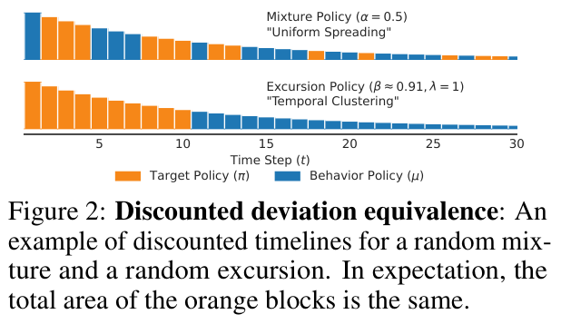
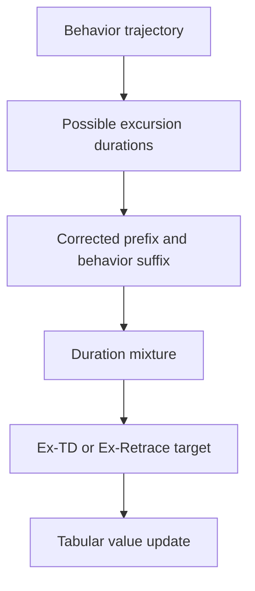

# Off-policy Learning with Excursion Policies

<!-- source-sha256: d9729625dcd35d32cbe7741eb613ea93410b7194802985892b414c597ebdff83 -->

[简体中文](README.md)

> **L1 mechanism component, diagnostic only.** Full experiment not reproduced due to cost (review DONE). Not integrated with Evolve.

## Paper information

| Field | Value |
| --- | --- |
| Paper | [arXiv:2611.13275v1](https://arxiv.org/abs/2611.13275v1); [fixed v1 full text](https://arxiv.org/html/2611.13275v1) |
| First author and affiliation | **Jiamin He**; **University of Alberta / Amii (work conducted at Google DeepMind)** |
| Original publication date | **2026-11-09 21:41:23 UTC**, arXiv v1 submission; not announcement or local review date |
| Author code | No verified author implementation repository found in the fixed v1 as of 2026-11-11; local implementation is independent. |
| Local adapter / key | `excursion-td`; `adapter: null`, independent component |
| Local code | `src/auto_research/post_training/excursion_td.py` |
| Validation scope | Three-seed CPU numerical diagnostics; no GPU requirement or task-capability claim |

## Paper summary

### Motivation and main change

Multi-step off-policy TD trades contraction speed, bias and variance. Importance-ratio products can be noisy, while mixing policies independently at each action changes trajectory semantics. An excursion instead follows the target for a random duration and then permanently switches to the behavior policy. The method mixes over that duration.

<!-- paper-figure:start -->
### Key original figure

[](https://arxiv.org/pdf/2611.13275v1#page=6)

Original Figure 2, PDF page 6: actionwise mixtures and target-then-behavior excursions allocate target-policy use differently over time. The matched quantity is expected discounted deviation, not identical trajectories or individual targets.

Rendered from fixed v1 PDF with the complete figure and its original caption. No scientific content was redrawn or altered. Copyright remains with the authors; source, page, crop and SHA-256 are recorded in [assets/provenance.json](assets/provenance.json).
<!-- paper-figure:end -->



This is a local explanatory diagram, not a paper screenshot. The neural MPO training system is not implemented.

### Core equations

Equation 11 defines:

$$
C_{t:k}=(1-\beta)+\beta\rho_t C_{t+1:k},\qquad C_{k+1:k}=1.
$$

The endpoints give uncorrected weights and importance-ratio products. Intermediate values are **not** products of per-action mixed ratios. The local sample target implements truncated Ex-Retrace, Appendix D Equations 29–31:

$$
\delta_k^\beta=(1-\beta)\left[\sum_{j=0}^{k-t}\beta^j\widehat\rho_{t+1:t+j}\right]\delta_k^\mu
+\beta^{k-t+1}\widehat\rho_{t+1:k}\delta_k^\pi,
$$

$$
G_t=Q(S_t,A_t)+\sum_{k=t}^{t+N-1}(\gamma\lambda)^{k-t}\delta_k^\beta,
\quad
\delta_k^\nu=R_{k+1}+\gamma\mathbb E_{A\sim\nu}Q(S_{k+1},A)-Q(S_k,A_k).
$$

Here $\widehat\rho=\min(\bar\rho,\pi/\mu)$ and empty products equal one. The initial action ratio is excluded from subsequent prefixes. At $\beta=0$ this is a behavior-policy N-step target in expectation; at $\beta=1$ it is clipped Retrace. Intermediate fixed points may be biased relative to the target-policy value.

### Paper evidence and limitations

The paper measures contraction, fixed-point MSE relative to $q_\pi$ and target variance on random MDPs, then evaluates MPO on seven dog/humanoid tasks. Its findings do not establish that every excursion parameter or policy pair improves performance. None of the continuous-control returns were reproduced here.

## Local implementation

### Protocol and code mapping

`excursion_weights` computes the duration recursion. `ex_retrace_targets` scores supplied trajectories, and `expected_operator` constructs the exact finite-MDP affine operator using corrected prefixes and behavior suffixes.

The diagnostic follows Appendix E.1's **5 states, 3 actions, Dirichlet(1) transitions/policies and discount .9**. Local choices are Uniform[0,1] rewards, horizon 6 and $\beta=.5$. It solves/iterates the real operator and samples an actual behavior trajectory. It does not reproduce the full temperature/parameter sweep or the paper's 10000 variance samples per state-action pair.

```bash
PYTHONPATH=src python -c 'from auto_research.post_training.excursion_td import diagnostic; print(diagnostic(42, device="cpu"))'
PYTHONPATH=src python -m pytest -q tests/test_nov11_post_training_components.py
```

### Checks and boundaries

An independent exhaustive enumeration of every two-step path in a two-state/two-action MDP checks the matrix operator against sample targets. Endpoint checks verify contraction $\gamma^N$ and behavior fixed point at $\beta=0$, and the target fixed point at $\beta=1$. A negative control distinguishes duration mixing from actionwise mixing.

For seed 42, the small MDP gives contraction about .6061 and target fixed-point MSE about .00305. These are numerical mechanism metrics, not language-model accuracy. Seeds 42/43/44 are checked without selecting hyperparameters from them. Neural critics, MPO, replay training and Evolve integration are absent; CUDA requests are rejected.

### High-cost full experiment

Appendix E.2 uses seven tasks, three-layer actor/critic networks, a two-million-entry replay buffer, trajectory length 20 and batch size 256. Each source run uses one A100 and typically **about 12 hours**, before the multi-setting/seed matrix. That full experiment is **not reproduced: high cost, review DONE**. The affordable CPU tabular component is implemented rather than incorrectly dismissed as high cost.
