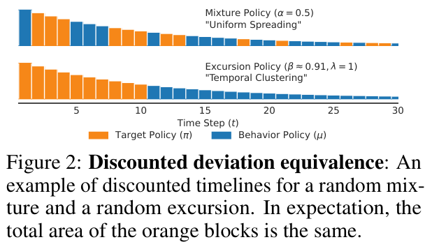
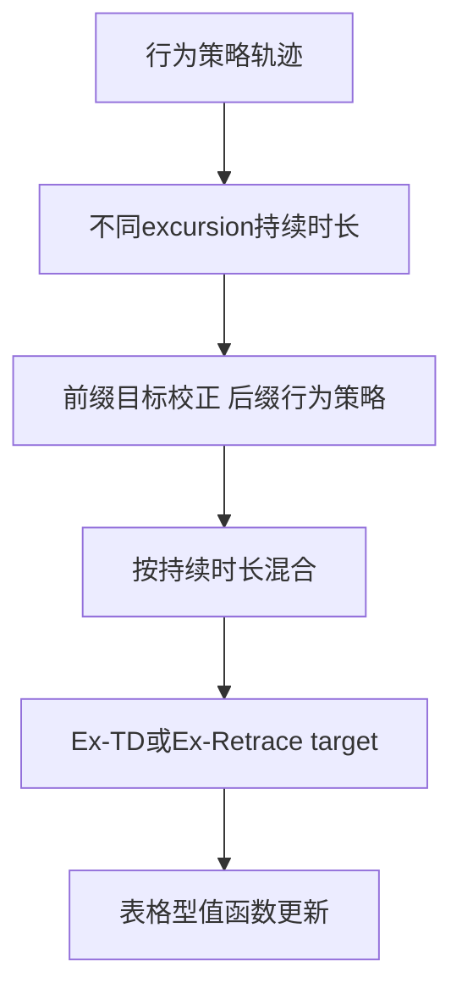

# Excursion TD：按持续时长混合离策略多步目标

[English](README-en.md)

> **L1 机制组件，diagnostic only。** 完整实验成本过高，不复现（审查 DONE）；未接入 Evolve。

## 论文信息

| 字段 | 内容 |
| --- | --- |
| 论文链接 | [arXiv:2611.13275v1](https://arxiv.org/abs/2611.13275v1)；[固定 v1 全文](https://arxiv.org/html/2611.13275v1) |
| 公司 / 作者机构 | 一作 **Jiamin He**：**University of Alberta / Amii（研究在Google DeepMind期间完成）** |
| 首次公开日期 | **2026-11-09 21:41:23 UTC**，以 arXiv v1 提交记录为准，不把公告或本地审查日当首发 |
| 原作者开源代码 | 截至2026-11-11，固定v1正文未给出已核实作者代码仓库；本地独立实现式11及附录D的表格型算子。 |
| 本地 adapter / key | `excursion-td`；`adapter: null`，独立机制组件 |
| 本地复现代码 | `src/auto_research/post_training/excursion_td.py` |
| 验收范围 | CPU 三种子数值诊断；不需要 GPU，不能据此主张任务能力 |

## 原始论文总结

### 背景与主要改动

离策略多步 TD 面临收敛速度、偏差与方差的权衡。重要性比连乘可以恢复目标分布，却容易放大方差；逐动作混合目标/行为策略又改变了整个轨迹的含义。本文先跟随目标策略一段随机持续时间，一旦 excursion 结束就永久切回行为策略，直接在持续时间上作混合。

<!-- paper-figure:start -->
### 原论文关键图

[](https://arxiv.org/pdf/2611.13275v1#page=6)

原论文 Figure 2（PDF 第 6 页）：逐步 mixture 与先目标后行为的 excursion 将目标策略计算分配到不同时间段。匹配的是折扣偏离量的期望，不是逐条轨迹或每个 target 相同。

来自固定 v1 PDF；裁图保留完整图与原图注，未重绘或修改科学内容。版权归原作者，来源、页码、裁切范围和 SHA-256 见 [assets/provenance.json](assets/provenance.json)。
图片来自[原论文](https://arxiv.org/pdf/2611.13275v1#page=6)，版权归原作者所有；图中完整系统或实验结果不等于本地组件结果。

<!-- paper-figure:end -->



该图为本地解释图。原文还有连续控制 MPO 实验；本地不实现它的 actor 或训练系统。

### 核心公式

式 11 的状态值权重为：

$$
C_{t:k}=(1-\beta)+\beta\rho_t C_{t+1:k},\qquad C_{k+1:k}=1.
$$

$\beta=0$ 时权重为 1，$\beta=1$ 时为重要性比乘积。一般情况下它**不是** $\prod_i[(1-\beta)+\beta\rho_i]$，后者会在各步重新混合策略。

本地轨迹 target 对应 Appendix D 式 29–31 的 truncated Ex-Retrace。令 $\widehat\rho_i=\min(\bar\rho,\pi/\mu)$：

$$
\delta_k^\beta=(1-\beta)\left[\sum_{j=0}^{k-t}\beta^j\widehat\rho_{t+1:t+j}\right]\delta_k^\mu
+\beta^{k-t+1}\widehat\rho_{t+1:k}\delta_k^\pi,
$$

$$
G_t=Q(S_t,A_t)+\sum_{k=t}^{t+N-1}(\gamma\lambda)^{k-t}\delta_k^\beta,
\quad
\delta_k^\nu=R_{k+1}+\gamma\mathbb E_{A\sim\nu}Q(S_{k+1},A)-Q(S_k,A_k).
$$

空乘积为 1；初始动作的 ratio 不进入后续前缀。$\beta=0$ 恢复行为策略的 N-step target（期望意义），$\beta=1$ 恢复 clipped Retrace。中间 $\beta$ 一般对目标值有偏，不能把降低方差说成无条件更准确。

### 原文结果与限制

原文以随机 MDP 的收缩率、相对 $q_\pi$ 的固定点 MSE、target 方差刻画权衡，并在七个 dog/humanoid 连续控制任务比较 MPO。作者的连续控制收益不等于所有 $\beta$ 或目标/行为策略都改善。本地不报告那些任务的回报。

## 本地复现

### 数据协议与代码映射

`excursion_weights` 实现持续时长递归；`ex_retrace_targets` 对真实给定轨迹计算附录 D target；`expected_operator` 在有限 MDP 上精确构造 $\mathcal RQ=b+MQ$，使用“校正前缀、行为后缀”的转移矩阵展开。所有数据与模型均为 CPU NumPy，不依赖 checkpoint。

诊断沿用 Appendix E.1 的 **5 状态、3 动作、Dirichlet(1) 随机转移与策略、折扣 .9**。本地明确选择 Uniform[0,1] 奖励、6 步截断、$\beta=.5$，计算真实固定点、收缩率与偏差并迭代算子；另实际采样一条行为轨迹计算 target。这是原协议同形的小型数值实验，不是重现原图全部温度/参数网格；未执行原文每状态动作 10000 次方差采样。

```bash
PYTHONPATH=src python -c 'from auto_research.post_training.excursion_td import diagnostic; print(diagnostic(42, device="cpu"))'
PYTHONPATH=src python -m pytest -q tests/test_nov11_post_training_components.py
```

### 结果、负控与边界

测试对两状态两动作的全部两步路径求和，独立核对精确仿射算子与 sample target；检查 $\beta=0$ 收缩率为 $\gamma^N$、其固定点为 $q_\mu$，以及 $\beta=1$ 时 $q_\pi$ 为固定点。负控区分持续时长混合与逐动作混合。seed 42 的本地 $\beta=.5$ 收缩率约 .6061，目标固定点 MSE 约 .00305；它们是随机小 MDP 的机制指标，不是语言模型准确率。42/43/44 均执行检查，不据此选最优参数。

没有神经 critic、MPO、replay buffer、环境交互训练或 Evolve operator。CPU 路径拒绝 CUDA；即使表格检查通过，也不能宣称 LLM RL 离策略训练已接入。

### 高成本完整实验

Appendix E.2 的七任务连续控制使用三层 actor/critic、200 万 replay、轨迹 20、batch 256。作者明确每个 run 用一张 A100，典型 **约 12 小时**；完整比较还包含多参数/种子。**完整连续控制实验成本过高，不复现（审查 DONE）**。Appendix E.1 的小 CPU 核可低成本执行，不把它也误标成高成本未实现。
