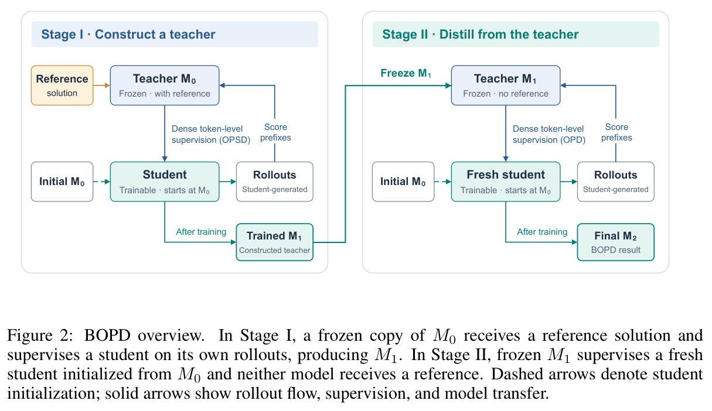
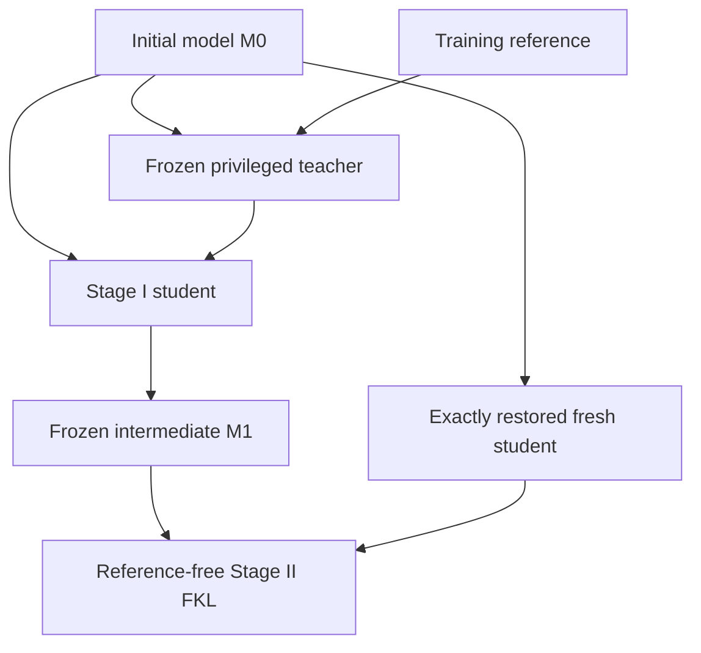

# Bootstrapped On-Policy Distillation

<!-- source-sha256: 51c807b00f02ae3ad96613edf9c3d7074cf46569aeb7e8b3ea9394c3145cea0d -->

[简体中文](README.md)

> **L1 mechanism component, diagnostic only.** CPU and three-seed real A100 validation passed. Full experiment not reproduced due to cost (review DONE). This closes a previously discovered lead, not a November 12 first publication. No Evolve integration.

## Paper information

| Field | Value |
| --- | --- |
| Paper | [arXiv:2611.13680v1](https://arxiv.org/abs/2611.13680v1); [fixed v1 full text](https://arxiv.org/html/2611.13680v1) |
| First author and affiliation | **Yue Wu**: **The Hong Kong Polytechnic University**, verified from PDF page 1 |
| Original publication | **2026-11-10 07:30:34 UTC**, official arXiv v1 submission, not announcement/review date |
| Author code | The paper links [BOPD](https://github.com/YueWu0301/BOPD), but the original GitHub page states that the repository is empty as of 2026-11-12. This is a placeholder, not a verified source release; license and code revision are unconfirmed. |
| Local adapter / key | `bopd`; `adapter: null`, independent component |
| Local code | `src/auto_research/post_training/bopd.py` |
| Entry | `stage_two_handoff`; `diagnostic(seed, device='cpu')` |

## Paper summary

### Motivation and main change

BOPD first uses a reference-conditioned frozen initial model to supervise a student, producing intermediate model M1. It then freezes M1 as a **reference-free** teacher and distills a fresh student restored exactly from M0. Both stages score their own student's generated prefixes; reusing Stage I trajectories is not fresh Stage II on-policy data.

This is not continued Stage I training. Parameters and persistent buffers restore to M0 and optimizer state starts anew. Only the Stage I teacher may receive the training reference. The evaluated student never sees it, and Stage II removes it from both models.

<!-- paper-figure:start -->
### Key original figure

[](https://arxiv.org/pdf/2611.13680v1#page=2)

Original Figure 2, PDF page 2, retaining the full diagram and caption. Copyright remains with the authors; [provenance](assets/provenance.json) records source, PDF/PNG hashes and crop. Its model-generation loop is not implemented locally.

<!-- paper-figure:end -->



### Core equations

Both stages minimize forward KL from teacher to student at student-generated prefixes:

$$
L=\mathbb E_{x,\widehat y\sim\pi_{student}(\cdot\mid x)}
\left[\frac1{|\widehat y|}\sum_t D_{KL}(q_t\Vert p_t)\right].
$$

Stage I uses $q_t=\pi_{M0}(\cdot\mid x,y^\star,\widehat y_{<t})$; Stage II uses $q_t=\pi_{M1}(\cdot\mid x,\widehat y_{<t})$. Stage II restores M0 and creates a new optimizer. Average valid tokens per trajectory before averaging trajectories; longer responses must not automatically receive greater sample weight.

### Paper evidence and limits

The paper reports mathematical reasoning, code generation and retention results for Qwen3-4B/8B and SmolLM3-3B, and examines mismatch from prolonged OPSD. No production A/B is reported. None of these capability scores are local measurements. Frozen teacher weights do not imply fixed predictions when student prefixes change.

Appendix A also specifies pointwise-clipped forward KL with threshold .05. The author's linked repository is currently empty, so its exact clipping implementation could not be audited. The local component implements the mathematical FKL and handoff, not a guessed clipping rule or the complete trainer.

## Local implementation

### Protocol and code mapping

`forward_kl` consumes aligned full-vocabulary logits/masks, detaches the teacher, promotes low-precision reductions to FP32 and weights trajectories equally. `stage_two_handoff` deep-copies real modules: a frozen/eval teacher from the intermediate, a student from the preserved initial checkpoint, and an empty-state optimizer bound exclusively to new student parameters. Persistent buffers and parameters have disjoint storage.

```bash
PYTHONPATH=src python -c 'from auto_research.post_training.bopd import diagnostic; print(diagnostic(42, device="cpu"))'
PYTHONPATH=src python -m pytest -q tests/test_nov12_post_training_components.py
```

### Checks and boundaries

Seeds 42/43/44 use a small Linear module and synthetic logits for actual FKL backward, an intermediate update, handoff and a fresh-student update. Tests independently cover unequal-length reduction, KL direction, gradcheck, NaN padding, teacher gradients, storage separation, buffer restoration and rejection of reused optimizers. This is not substitute BOPD task training and reports no answer accuracy.

All eight mechanism checks passed on a real **NVIDIA A100** for seeds 42/43/44. [Per-seed CUDA metrics](metrics/component-cuda-seeds42-44.json) and the [sanitized receipt](../../gpu-validations/bopd-a100-20261112.json) bind execution to frozen source `9d46c1778c3df693907c113c803e617ae0690117`. Initial-student and copied-teacher parameter errors are zero; this validates real loss/handoff and device execution only. LLMs, reference prompts, samplers, full stage rollout loops, source clipping, checkpoint runners and Evolve integration are absent.

### High-cost full experiment

Table 4 uses four GPUs for 4B and two for 8B, with 100 optimizer steps and 3200 student rollouts per stage, rank 64 / alpha 128 LoRA, BF16, ZeRO-2 and vLLM. Training permits 20000-token sequences and 1024 output tokens. Math evaluation samples twelve responses with up to 38,912 output tokens, plus model/retention matrices. Total wall time is not reported. **Too costly; full experiment not reproduced, review DONE.** This is source-based, not a measured runtime; no large downloads, training probes or retries are attempted.
