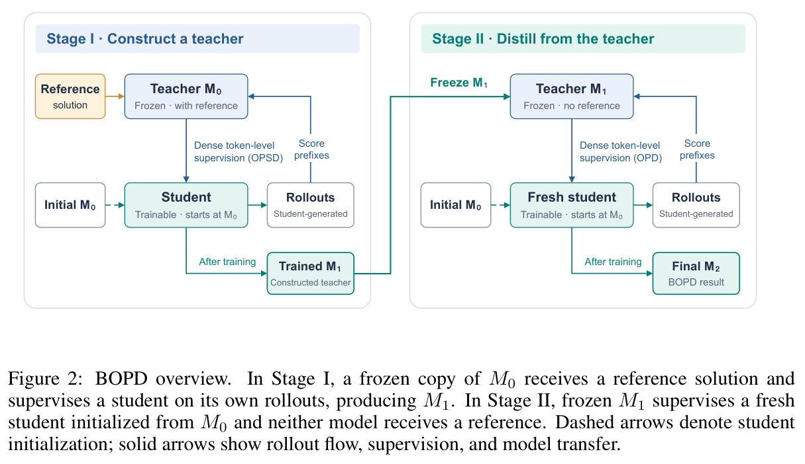
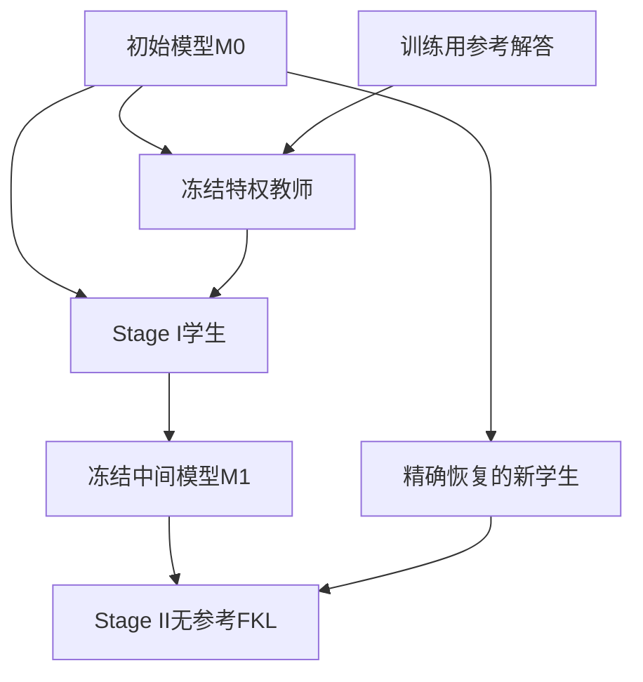

# BOPD：先构造无参考教师，再重置新学生

[English](README-en.md)

> **L1 机制组件，diagnostic only。** CPU 与真实 A100 三种子验证通过；完整实验成本过高，不复现（审查 DONE）。本轮补审上批线索，不计为 11 月 12 日首发；未接入 Evolve。

## 论文信息

| 字段 | 内容 |
| --- | --- |
| 论文链接 | [arXiv:2611.13680v1](https://arxiv.org/abs/2611.13680v1)；[固定 v1 全文](https://arxiv.org/html/2611.13680v1) |
| 公司 / 作者机构 | 一作 **Yue Wu**：**The Hong Kong Polytechnic University**；已核对 PDF 首页作者栏 |
| 首次公开日期 | **2026-11-10 07:30:34 UTC**，官方 arXiv v1 提交时间，不用公告/本次审查日期替换 |
| 原作者开源代码 | 作者在原文提供 https://github.com/YueWu0301/BOPD ，但2026-11-12原始GitHub页面明确显示空仓库；有项目链接不等于训练源码已开源，许可与固定代码revision未核实。 |
| 本地 adapter / key | `bopd`；`adapter: null`，独立组件 |
| 本地复现代码 | `src/auto_research/post_training/bopd.py` |
| 本地入口 | `stage_two_handoff`；`diagnostic(seed, device='cpu')` |

## 原始论文总结

### 背景与主要改动

BOPD 先用带参考解答的冻结初始模型监督学生，构造中间模型 M1；再冻结 M1，将它当作**不带参考**的教师，蒸馏一个从原始 M0 精确重置的新学生。两阶段都在各自学生的轨迹前缀上评分，不能把 Stage I 的旧轨迹直接当作 Stage II 的新 on-policy 数据。

这与“继续训练 Stage I 学生”不同：新学生的参数、持久 buffer 和 optimizer 状态都要恢复为初始/新建状态。参考解答只进入 Stage I 教师，不能让被评估学生读取；Stage II 连教师也不再接收参考。

<!-- paper-figure:start -->
### 原论文关键图

[](https://arxiv.org/pdf/2611.13680v1#page=2)

图片来自[原论文](https://arxiv.org/pdf/2611.13680v1#page=2)第 2 页 Figure 2，版权归原作者所有；裁取保留完整架构图与原图注，来源、PDF/PNG 哈希及裁切坐标见 [provenance](assets/provenance.json)。图中的模型生成闭环不属于本地组件。

<!-- paper-figure:end -->



### 核心公式

固定学生生成前缀下，两阶段都最小化教师到学生的前向 KL：

$$
L=\mathbb E_{x,\widehat y\sim\pi_{student}(\cdot\mid x)}
\left[\frac1{|\widehat y|}\sum_t D_{KL}(q_t\Vert p_t)\right].
$$

Stage I 的 $q_t=\pi_{M0}(\cdot\mid x,y^\star,\widehat y_{<t})$；Stage II 的 $q_t=\pi_{M1}(\cdot\mid x,\widehat y_{<t})$。Stage II 学生重新设为 M0，并使用新 optimizer。先对每条轨迹的有效 token 平均，再对轨迹平均，不能让长响应自动获得更高样本权重。

### 论文离线与线上效果

作者在 Qwen3-4B/8B、SmolLM3-3B 上报告数学、代码及能力保持结果，分析长期 OPSD 与冻结特权教师的分布失配；并未报告生产线上 A/B。这些分数不属于本地实测。冻结的是教师权重，不是所有前缀上的预测；学生访问不同前缀时教师分布也会变化。

Appendix A 另记 pointwise-clipped forward KL，阈值 .05；目前作者链接是空仓库，无法审核其精确 clipping 代码。本地严格实现正文数学 FKL 与 handoff，不猜测 clipping 或冒充完整作者训练器。

## 本地复现

### 数据协议与代码映射

`forward_kl` 接收同历史对齐的全词表 logits 与有效 mask，detach 教师，低精度归约提升到 FP32，逐轨迹等权。`stage_two_handoff` 深拷贝真实 PyTorch module：teacher 来自 intermediate、冻结并 eval；student 来自保留的 initial checkpoint；factory 必须返回绑定新学生、空状态的新 optimizer。parameters 与 persistent buffers 都不共享存储。

```bash
PYTHONPATH=src python -c 'from auto_research.post_training.bopd import diagnostic; print(diagnostic(42, device="cpu"))'
PYTHONPATH=src python -m pytest -q tests/test_nov12_post_training_components.py
```

### 结果、负控与边界

本地 42/43/44 使用小 Linear module 和合成 logits，实际执行 FKL backward、一次中间参数更新、fresh-student handoff 和新学生更新。测试另外覆盖非等长轨迹归约、FKL 方向、gradcheck、NaN padding、teacher 零梯度、不共享存储、buffer 精确恢复及拒绝复用 optimizer。不是在替身任务上训练 BOPD 能力，不输出答案准确率。

真实 **NVIDIA A100** 上 42/43/44 的八项机制检查均通过，见[逐种子 CUDA 指标](metrics/component-cuda-seeds42-44.json)与[脱敏收据](../../gpu-validations/bopd-a100-20261112.json)，绑定冻结源码 `9d46c1778c3df693907c113c803e617ae0690117`。新学生初始参数误差与冻结教师复制误差均为零，只验收真实 loss/交接与设备路径。未提供 LLM、reference prompt、采样器、Stage I/II 真实 rollout loop、原文 clipping、checkpoint runner 或 Evolve 算子，不能据此宣称完整 BOPD 已实现。

### 高成本完整实验

原文 Table 4 的 4B 配置用 4 GPU，8B 配置用 2 GPU；每阶段 100 optimizer 步、3200 个学生 rollout，LoRA rank64/alpha128，BF16/ZeRO-2/vLLM。训练序列上限 20000、输出上限 1024；数学评测每题 12 次、最高 38912 输出 token，另有多模型与保持能力评测。作者未披露总墙钟，不能编造 GPU 小时。**成本过高，不复现（审查 DONE）**；这是配置判断，不下载大权重/数据、不试训、不自动重试。
