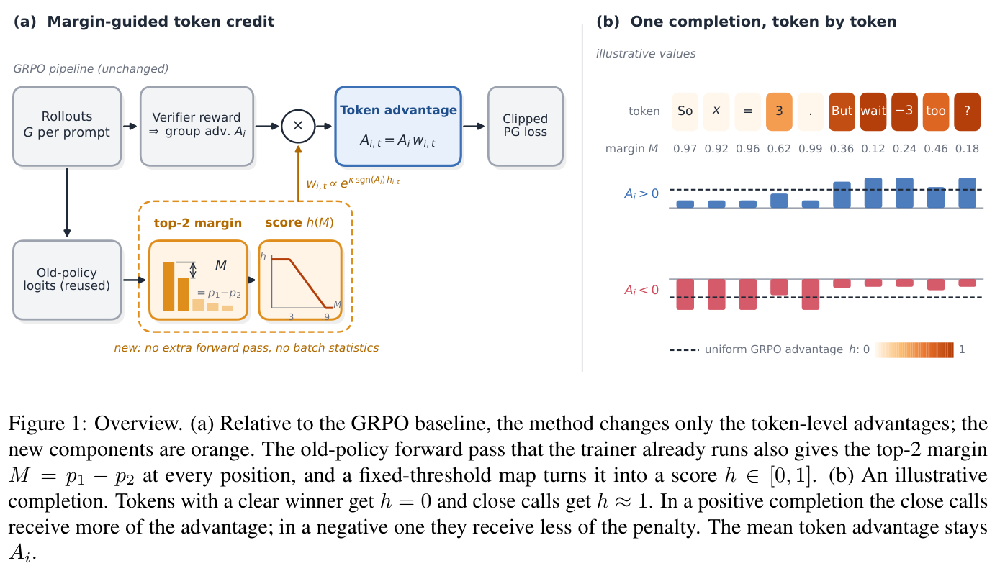
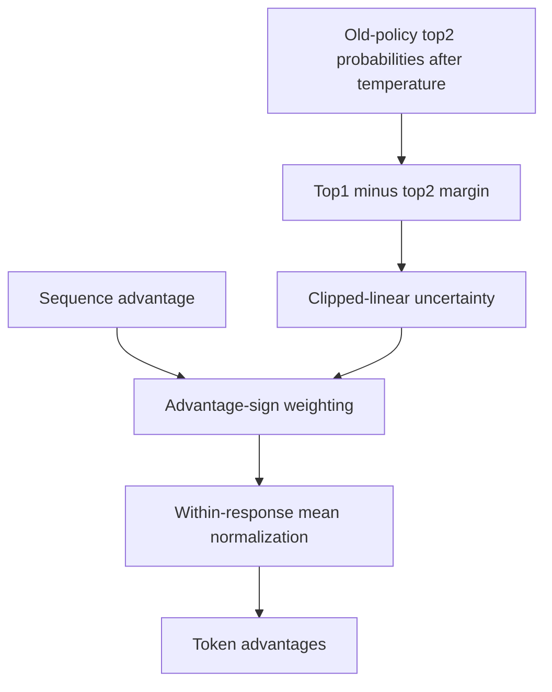

# Margin-Guided Token Credit for Reinforcement Learning with Verifiable Rewards

<!-- source-sha256: a3752eb5409a5c93d3c76fc3a8ba6445a76d1977d3797dd1c13d42e128a3164c -->

[简体中文](README.md)

> **L1 mechanism component, diagnostic only.** Full experiment not reproduced due to cost (review DONE). Not integrated with Evolve.

## Paper information

| Field | Value |
| --- | --- |
| Paper | [arXiv:2611.14015v1](https://arxiv.org/abs/2611.14015v1); [fixed v1 full text](https://arxiv.org/html/2611.14015v1) |
| First author and affiliation | **Chi Liu**; **PayPal.AI** |
| Original publication date | **2026-11-10 12:51:43 UTC**, arXiv v1 submission |
| Author code | The paper claims supplementary code, but no independently verifiable author-code URL was found in fixed v1 as of 2026-11-11. Math-Verify and cited upstream trainers are not this paper's code. |
| Local adapter / key | `mcpo`; `adapter: null`, independent component |
| Local code | `src/auto_research/post_training/mcpo.py` |
| Validation scope | CPU numerical component; no GPU required |

## Paper summary

### Motivation and main change

Sequence-level GRPO advantages give every token the same credit. MCPO reuses the rollout/old policy's top-two probabilities after temperature scaling to vary token credit without an extra teacher or verifier call. Its exponential weighting and within-response normalization follow the cited prior token-weighting rule; the paper's change is the margin signal, not an entirely new weighting framework.

<!-- paper-figure:start -->
### Key original figure

[](https://arxiv.org/pdf/2611.14015v1#page=2)

Original Figure 1, PDF page 2: old-policy margins redistribute token credit on the left; the right illustrates opposite weighting directions for positive/negative advantages. The example completion explains the mechanism, not locally generated text or capability.

Rendered from fixed v1 PDF with the complete figure and its original caption. No scientific content was redrawn or altered. Copyright remains with the authors; source, page, crop and SHA-256 are recorded in [assets/provenance.json](assets/provenance.json).
<!-- paper-figure:end -->



This is a local explanatory diagram; the training/rollout framework is not implemented.

### Core equations

Equations 2–3 are:

$$
M_t=p_{(1),t}-p_{(2),t},\quad h_t=\operatorname{clip}\left({1-M_t-l\over u-l},0,1\right),\quad(l,u)=(.1,.7),
$$

$$
w_{i,t}=\exp(\kappa\operatorname{sign}(A_i)h_{i,t}),\quad
A_{i,t}=A_i{w_{i,t}\over\operatorname{mean}_{t\in valid(i)}w_{i,t}},\quad\kappa=\log4.
$$

This is **clipped-linear uncertainty, not a band-pass**. Margins at least .9 give zero uncertainty; margins at most .3 give one. The mean token advantage remains the sequence advantage. Uncertain tokens receive more positive credit for positive advantages, but **less negative penalty** for negative advantages. A negative advantage does not necessarily mean an incorrect answer, since penalties can change its sign.

### Paper evidence and limitations

The paper reports +6.55 mean points over five MiniCPM5-2B-Base data seeds ($p=.004$), and +4.75 points over three Qwen3-4B-Base data seeds ($p=.083$). The latter is not statistically significant at .05. These seeds vary training-question samples, not all optimizer and generation randomness.

Generated lengths increase about 1.2–4.6×. There is no length-matched comparison and no entropy/random-credit/zero-strength path control. Equal optimizer steps are not equal generated-token compute. The results do not isolate margin credit as the sole cause. No task score is reproduced locally.

## Local implementation

### Protocol and code mapping

`token_credit` consumes frozen, temperature-adjusted old-policy top-two probabilities, sequence advantages and valid-token masks. It checks ordered probabilities and nonempty responses. Padding is excluded from the mean. Subtracting each response's maximum log-weight stabilizes exponentiation without changing the normalized answer. This is CPU NumPy arithmetic; CUDA requests are rejected.

```bash
PYTHONPATH=src python -c 'from auto_research.post_training.mcpo import diagnostic; print(diagnostic(42, device="cpu"))'
PYTHONPATH=src python -m pytest -q tests/test_nov11_post_training_components.py
```

### Checks and boundaries

Independent formula tests cover positive/negative/zero advantages, mean preservation, NaN padding, batch independence, zero-strength equivalence, probability validation and retention of maximally uncertain tokens. The probe's extreme weight ratio is 4 and negative-penalty ratio 1/4. Three-seed preservation errors are near floating-point precision, not mathematical reasoning accuracy.

LMs, rollout probability collection, temperature resampling, GRPO ratio/clip, overlong rewards and the trainer are absent. Callers must supply the **temperature-adjusted old policy**, not arbitrary current logits. There is no Evolve integration or fabricated success rate.

### High-cost full experiment

Section 3 uses 2B/4B models with all-linear LoRA rank32/alpha64. Each data seed has 2048 DAPO-Math-17k questions, 100 rollouts and 200 optimizer steps, with 16 prompts×8 completions and up to 10240 generated tokens. Evaluation has 297 problems×32 samples and a 16384-token cap. Each run uses one 80GB GPU, with multiple seeds and methods; total wall time is not reported. Fitting on one GPU does not make this inexpensive. The full study is **not reproduced: high cost, review DONE**; no downloads, training probes or retries are attempted.
