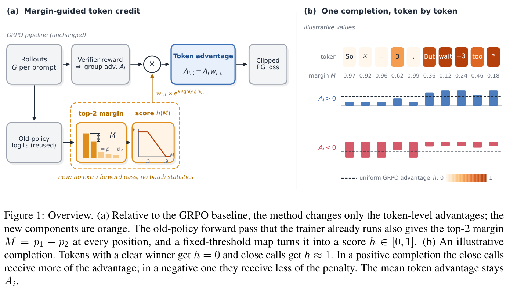
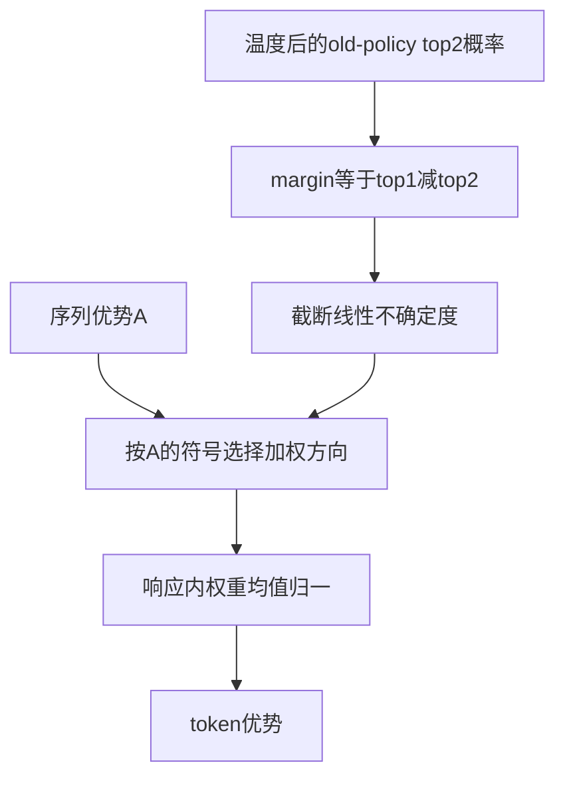

# MCPO：用 old-policy margin 重分配 token 信用

[English](README-en.md)

> **L1 机制组件，diagnostic only。** 完整实验成本过高，不复现（审查 DONE）；未接入 Evolve。

## 论文信息

| 字段 | 内容 |
| --- | --- |
| 论文链接 | [arXiv:2611.14015v1](https://arxiv.org/abs/2611.14015v1)；[固定 v1 全文](https://arxiv.org/html/2611.14015v1) |
| 公司 / 作者机构 | 一作 **Chi Liu**：**PayPal.AI** |
| 首次公开日期 | **2026-11-10 12:51:43 UTC**，以 arXiv v1 提交记录为准 |
| 原作者开源代码 | 论文称有supplementary code及固定上游trainer，但截至2026-11-11，固定HTML未发现独立可验证作者代码URL；Math-Verify与所引训练仓库不算本篇开源。 |
| 本地 adapter / key | `mcpo`；`adapter: null`，独立组件 |
| 本地复现代码 | `src/auto_research/post_training/mcpo.py` |
| 验收范围 | CPU 数值组件；不需要 GPU |

## 原始论文总结

### 背景与主要改动

GRPO 常把同一响应的序列优势分给所有 token，无法区分局部决策的不确定度。MCPO 复用 rollout/old policy 温度后的 top-1、top-2 概率差，不额外调用教师或 verifier，改变各 token 的信用分配。指数加权与响应内归一化沿用所引 token weighting 规则，论文新增的是以 probability margin 作为信号，不能把整套加权公式都说成全新提出。

<!-- paper-figure:start -->
### 原论文关键图

[](https://arxiv.org/pdf/2611.14015v1#page=2)

原论文 Figure 1（PDF 第 2 页）：左侧复用 old-policy margin 调整 token 信用，右侧展示正/负优势的相反加权方向。示例 completion 用于解释机制，不是本地模型生成或能力结果。

来自固定 v1 PDF；裁图保留完整图与原图注，未重绘或修改科学内容。版权归原作者，来源、页码、裁切范围和 SHA-256 见 [assets/provenance.json](assets/provenance.json)。
图片来自[原论文](https://arxiv.org/pdf/2611.14015v1#page=2)，版权归原作者所有；图中完整系统或实验结果不等于本地组件结果。

<!-- paper-figure:end -->



本地解释图，不是原文截图；训练和 rollout 框架未实现。

### 核心公式

式 2–3 定义：

$$
M_t=p_{(1),t}-p_{(2),t},\quad h_t=\operatorname{clip}\left({1-M_t-l\over u-l},0,1\right),\quad (l,u)=(.1,.7),
$$

$$
w_{i,t}=\exp(\kappa\operatorname{sign}(A_i)h_{i,t}),\quad
A_{i,t}=A_i{w_{i,t}\over\operatorname{mean}_{t\in valid(i)}w_{i,t}},\quad\kappa=\log4.
$$

这是**截断线性不确定度，不是 band-pass**：$M\ge.9$ 时 $h=0$，$M\le.3$ 时 $h=1$。每条响应有效 token 的平均优势仍为 $A_i$。正优势时，不确定 token 获得更多正信用；负优势时，不确定 token **少受负惩罚**，更确定的 token 承担更多惩罚。负优势也不等于答案必错，例如过长惩罚可改变符号。

### 原文结果与限制

作者在 MiniCPM5-2B-Base 的五个数据种子上报告平均 +6.55 点、配对检验 $p=.004$；Qwen3-4B-Base 三个数据种子平均 +4.75 点、$p=.083$，不能说后者显著改善。这些种子改变训练题目，不是 optimizer 或采样随机性的全面多种子检验。

生成长度增加约 1.2–4.6 倍，原文未作 length-matched 对照，也缺 entropy/random-credit/zero-strength 路径控制；同样 optimizer 步数不等于同样生成 token 预算。不能据此把收益全部归因到 margin 信用，或声称严格等算力优于基线。本地不复现这些任务分数。

## 本地复现

### 数据协议与代码映射

`token_credit` 接收已经冻结、按 rollout 温度计算的有序 top-2 概率、序列优势和有效 token mask。校验概率合法、每响应非空；padding 不进入权重均值。为数值稳定，从每响应 log-weight 减去最大值，不改变归一结果。函数只做 NumPy CPU 算术，CUDA 请求明确拒绝。

```bash
PYTHONPATH=src python -c 'from auto_research.post_training.mcpo import diagnostic; print(diagnostic(42, device="cpu"))'
PYTHONPATH=src python -m pytest -q tests/test_nov11_post_training_components.py
```

### 结果、负控与边界

测试独立计算式 2–3，覆盖正/负/零优势、均值守恒、padding NaN、batch 独立、$\kappa=0$ 回到序列优势、有序概率校验，以及最高不确定度不会像 band-pass 被抛弃。probe 的极端权重比为 4，负优势惩罚比为 1/4。42/43/44 的平均优势数值误差接近浮点精度，不是数学解题准确率。

未实现 LM、old-policy rollout 概率采集、温度重采样、GRPO ratio/clip、过长奖励或完整 trainer。接口要求调用方提供**温度后 old-policy**概率，不能随意换成当前 policy 或未经温度处理的 logits。未接入 Evolve，不输出虚假的成功率。

### 高成本完整实验

§3 使用 2B/4B 模型、all-linear LoRA rank32/alpha64；每个数据种子抽 2048 个 DAPO-Math-17k 问题，100 rollout、200 optimizer 步，16 prompt×8 completion，最长生成 10240 token。评测 297 题，每题 32 次、最长 16384 token；每 run 一张 80GB GPU，另有多种子、多方法。作者未提供总墙钟。单卡能容纳不代表低成本：**完整实验成本过高，不复现（审查 DONE）**，不下载模型、不试训、不自动重试。
