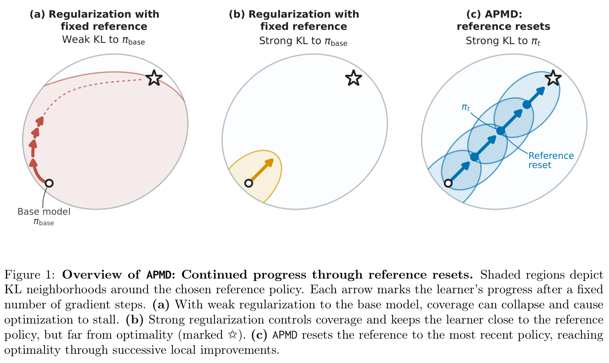
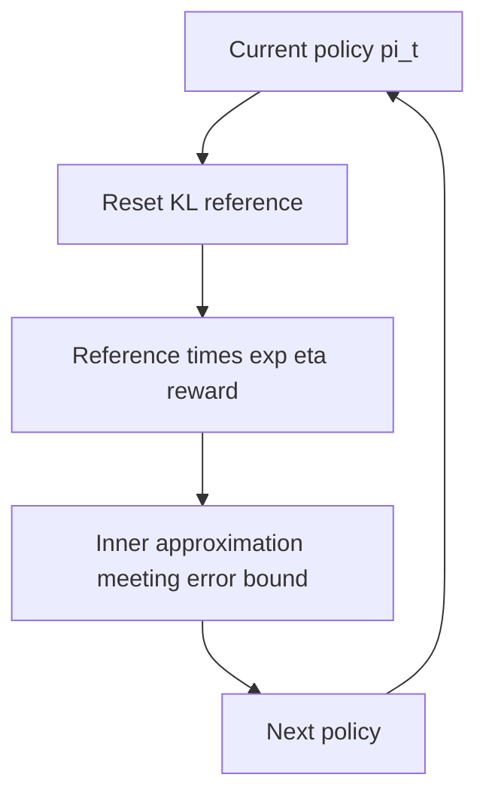

# A Theory of Policy Optimization in Post-Training: Coverage Collapse and Reference Resets

<!-- source-sha256: d59bdb8a539849abd079aad30ab38777eea5d387e48f498c2c2fb25ccfbc9087 -->

[简体中文](README.md)

> **L1 mechanism component, diagnostic only.** Large empirical reproduction is not applicable to this theory paper (review DONE); no cost is invented. This closes a previously discovered lead, not a November 12 first publication. No Evolve integration.

## Paper information

| Field | Value |
| --- | --- |
| Paper | [arXiv:2611.14467v1](https://arxiv.org/abs/2611.14467v1); [fixed v1 full text](https://arxiv.org/html/2611.14467v1) |
| First author and affiliation | **Audrey Huang**: **Kempner Institute at Harvard University / UIUC**, verified from PDF page 1 |
| Original publication | **2026-11-10 18:31:36 UTC**, official arXiv v1 submission, not announcement/review date |
| Author code | No verified author implementation repository was found in fixed v1. LaTeXML issue/wiki links concern HTML conversion, not the algorithms. |
| Local adapter / key | `apmd-reference-reset`; `adapter: null`, independent component |
| Local code | `src/auto_research/post_training/apmd_reference_reset.py` |
| Entry | `exact_reset_path`; `diagnostic(seed, device='cpu')` |

## Paper summary

### Motivation and main change

Increasing reward does not guarantee that optimal responses remain easy to sample. The paper constructs fixed-reference REINFORCE coverage collapse, then uses APMD to periodically reset the KL reference to the latest policy. Strong local regularization simplifies each inner problem while resets permit cumulative progress. This is not merely reducing KL or setting its loss to zero every step.

The global complexity results have assumptions: softmax linear policies, rewards realizable in the same features and sufficiently accurate inner solves. They do not automatically apply to every Transformer or practical PPO/GRPO implementation.

<!-- paper-figure:start -->
### Key original figure

[](https://arxiv.org/pdf/2611.14467v1#page=3)

Original Figure 1, PDF page 3, preserving all three panels and the caption. Copyright remains with the authors; [provenance](assets/provenance.json) records source and hashes. This is a method/theory illustration, not a local large-model training curve.

<!-- paper-figure:end -->



### Core equations

The exact finite-response mirror target is:

$$
\pi_{\eta,t}^{\star}(y\mid x)
\propto\pi_t(y\mid x)e^{\eta r(x,y)}.
$$

Exact solves give $\pi_t\propto\pi_{base}e^{t\eta r}$. Actual APMD only approximates these targets and must satisfy the source error conditions; resetting alone does not establish them.

For $h=(\log\pi-\log\pi_t)/\eta$, $\overline h=\mathbb E_{\pi_t}h$ and $\overline r=\mathbb E_{\pi_t}r$, Section 4 gives:

$$
MSE=\mathbb E_{\pi_t}[(h-\overline h-r+\overline r)^2],
$$
$$
L_{Kimi,mean}=MSE+\frac{D_{KL}(\pi_t\Vert\pi)^2}{\eta^2},
\qquad L_{Rebel-On}=2MSE.
$$

The Kimi mean baseline is not the exact log normalizer, so its loss can remain nonzero at the mirror target. Rebel's two responses must be **independent draws from the same current reference**, not reward-filtered winner/loser pairs or a second draw from the base.

### Paper evidence and limits

This is theoretical work with finite-bandit exact-gradient illustrations. No production A/B or large-language-model experimental matrix is reported. Local checks do not reproduce every exponential lower-bound construction, sampled PPO-NoClip/PPO-Lite inner loop or proof.

## Local implementation

### Protocol and code mapping

`mirror_step` computes strictly positive exact targets in log space; `exact_reset_path` updates the reference each round. `squared_losses` enumerates finite expectations and directly computes independent-pair squared loss. `empirical_kimipo_loss` receives baseline-reward groups separate from trained responses. CPU NumPy only; CUDA, invalid distributions and support-losing numerical underflow are rejected rather than hidden with epsilon.

```bash
PYTHONPATH=src python -c 'from auto_research.post_training.apmd_reference_reset import diagnostic; print(diagnostic(42, device="cpu"))'
PYTHONPATH=src python -m pytest -q tests/test_nov12_post_training_components.py
```

### Checks and boundaries

Three prompts/seven responses per seed 42/43/44 check the reset path against closed form, monotone exact-mirror reward/optimal mass, zero centered-MSE at the target, Rebel=2MSE and Kimi's squared-KL bias. Independent loops enumerate response pairs. A fixed-base negative control must differ from repeated resets. Rewards are explicit arrays, not language-task scores or evidence of sample complexity or universal nonlinear-model convergence.

### Theory and experimental scope

`full_experiment_status=not_applicable_theory_only`. The source supplies no large checkpoint/hardware protocol, so GPU hours are not invented and affordable arithmetic is not deferred as expensive. **Theory review DONE; finite numerical core implemented.** This does not prove the complete theory. Real LLMs, sampled online PPO/Kimi training and executable Evolve integration are absent.
