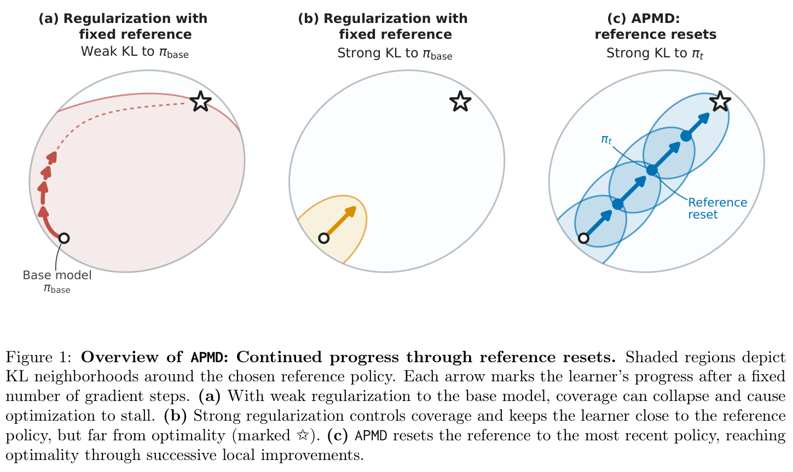
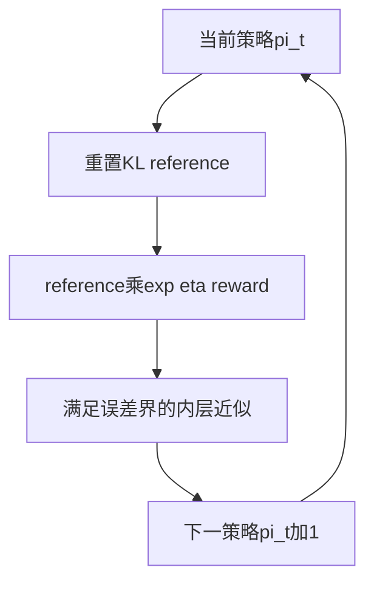

# APMD：参考重置、覆盖与平方损失的边界

[English](README-en.md)

> **L1 机制组件，diagnostic only。** 纯理论大型实证不适用（审查 DONE），不虚构高成本。 本轮补审上批线索，不计为 11 月 12 日首发；未接入 Evolve。

## 论文信息

| 字段 | 内容 |
| --- | --- |
| 论文链接 | [arXiv:2611.14467v1](https://arxiv.org/abs/2611.14467v1)；[固定 v1 全文](https://arxiv.org/html/2611.14467v1) |
| 公司 / 作者机构 | 一作 **Audrey Huang**：**Kempner Institute at Harvard University / UIUC**；已核对 PDF 首页作者栏 |
| 首次公开日期 | **2026-11-10 18:31:36 UTC**，官方 arXiv v1 提交时间，不用公告/本次审查日期替换 |
| 原作者开源代码 | 固定v1未提供已核实作者代码仓库；HTML中的LaTeXML issue/wiki链接属于转换工具，不是作者算法实现。 |
| 本地 adapter / key | `apmd-reference-reset`；`adapter: null`，独立组件 |
| 本地复现代码 | `src/auto_research/post_training/apmd_reference_reset.py` |
| 本地入口 | `exact_reset_path`；`diagnostic(seed, device='cpu')` |

## 原始论文总结

### 背景与主要改动

奖励上升不保证最优响应仍容易采到。本文给出固定 reference 下 REINFORCE 发生 coverage collapse 的构造，并用 APMD 将 KL reference 周期性重置到最新策略：每个内层子问题有较强局部约束，外层重置则允许持续前进。它不是单纯“少加 KL”或“每步把 reference loss 设成零”。

结论是受假设约束的理论：主要全局复杂度结果依赖 softmax 线性策略、同特征可实现的 reward 和足够准确的内层求解；不能直接宣称任意 Transformer、任意 PPO/GRPO 实现都有同样保证。

<!-- paper-figure:start -->
### 原论文关键图

[](https://arxiv.org/pdf/2611.14467v1#page=3)

图片来自[原论文](https://arxiv.org/pdf/2611.14467v1#page=3)第 3 页 Figure 1，版权归原作者所有；保留完整三联图和图注，来源与哈希见 [provenance](assets/provenance.json)。这是方法/理论示意，不是本地大模型训练曲线。



### 核心公式

固定有限响应的精确镜像目标为：

$$
\pi_{\eta,t}^{\star}(y\mid x)
\propto \pi_t(y\mid x)e^{\eta r(x,y)}.
$$

若每轮精确求解，$\pi_t\propto\pi_{base}e^{t\eta r}$。实际 APMD 只近似这个目标，误差需满足原文要求；“每轮重置”本身不保证内层达到条件。

令 $h=(\log\pi-\log\pi_t)/\eta$、$\overline h=\mathbb E_{\pi_t}h$、$\overline r=\mathbb E_{\pi_t}r$，正文 §4 的精确恒等式为：

$$
MSE=\mathbb E_{\pi_t}[(h-\overline h-r+\overline r)^2],
$$
$$
L_{Kimi,mean}=MSE+\frac{D_{KL}(\pi_t\Vert\pi)^2}{\eta^2},
\qquad L_{Rebel-On}=2MSE.
$$

Kimi 的均值 baseline 不是精确 log-normalizer，最优镜像目标上的 Kimi loss 一般仍非零。Rebel 的两个响应需从同一个当前 reference **独立抽样**，不等于奖励筛选后的 winner/loser，也不等于一个来自 base。

### 论文离线与线上效果

论文是理论研究，配有有限 bandit 的精确梯度图例；未报告生产线上 A/B，也未给出可供本库照跑的大型语言模型实证矩阵。本地只核对有限分布公式，不复现指数级下界的所有构造、PPO-NoClip/PPO-Lite 的采样内循环，或证明全部定理。

## 本地复现

### 数据协议与代码映射

`mirror_step` 用 log-space 计算严格正概率的精确目标；`exact_reset_path` 每轮读取最新 reference。`squared_losses` 枚举有限响应期望，并直接计算独立响应对的平方损失；`empirical_kimipo_loss` 接收与训练响应分开的 baseline reward 组。只支持 NumPy CPU，显式拒绝 CUDA、非归一分布和数值下溢导致的支持丢失，不靠加 epsilon 掩盖失效。

```bash
PYTHONPATH=src python -c 'from auto_research.post_training.apmd_reference_reset import diagnostic; print(diagnostic(42, device="cpu"))'
PYTHONPATH=src python -m pytest -q tests/test_nov12_post_training_components.py
```

### 结果、负控与边界

42/43/44 的三 prompt、七 response 数值例分别检查重置路径与闭式目标一致、精确镜像下 reward/最优响应质量非降、镜像目标 centered-MSE 为零、Rebel=2MSE、Kimi 的平方 KL 偏差。独立循环枚举所有响应对；负控固定 base reference 后不应得到连续重置结果。上述 reward 是显式数组，不是语言任务成绩，不能证明采样复杂度或非线性模型普适收敛。

### 理论与实验范围

`full_experiment_status=not_applicable_theory_only`。原文没有大型 checkpoint/实证硬件方案，不能编造 GPU 小时，也不应把廉价公式标作高成本延期。**理论审查 DONE，有限数值核已实现**；完整理论不等于本地证明完毕。未提供真实 LLM、online PPO/Kimi 采样训练或 Evolve 可晋级算子。
