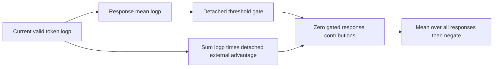
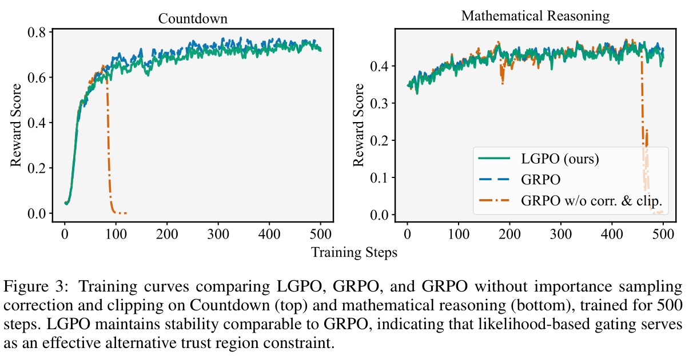

<!-- source-sha256: 2d29d733b860668c8b0f2c9630dda3de928b11414fcb5f60a50dbb20ce7907a1 -->
[简体中文](README.md)

# LGPO: current-policy likelihood gating without importance ratios

> **L1 exact gated-loss / gradient component, diagnostic only.** Full LLM RL training is too costly and is not reproduced (review DONE). Not eligible for Evolve promotion.

## Paper information

| Field | Value |
|---|---|
| Paper | [Is the Importance Ratio Necessary for Stable Reinforcement Learning in LLMs?](https://arxiv.org/abs/2611.15404v1); [fixed v1](https://arxiv.org/html/2611.15404v1) |
| Company / institution | First author **Shuibai Zhang, University of Wisconsin–Madison**; work during a KRAFTON internship, with KRAFTON coauthors. No verified Google/Meta affiliation |
| Original publication | **2026-11-11 12:31:55 UTC**, arXiv v1; not first published on this review's November 15 date |
| Authors' code | No verified method repository found in the fixed source or author entry points as of 2026-11-15; using verl does not establish an LGPO release |
| Code license / revision | No verified method code; not applicable |
| Local adapter / key | `lgpo`, standalone loss, not a complete training adapter |
| Local code | `src/auto_research/post_training/lgpo.py`: `loss`, `diagnostic(seed, device)` |
| Local evidence | [CPU seeds](metrics/component-cpu-seeds42-44.json), [CUDA seeds](metrics/component-cuda-seeds42-44.json), [real GPU receipt](../../gpu-validations/lgpo-a100-20261115.json); small-tensor mechanisms, not capability |

## Original paper summary

### Background and main changes

GRPO's importance ratio combines sampling-distribution correction and clipping. Removing correction while retaining a constraint need not destroy stability, whereas fully on-policy ratios equal one and cannot activate clipping. LGPO avoids old-policy probabilities and gates each response using its **current-policy mean token log probability**.

This is not token-level top-k or positive-advantage-only filtering. Both positive- and negative-advantage high-likelihood responses are gated; low-likelihood responses remain. The local minimum-KL perturbation analysis explains sensitivity near deterministic distributions, not a global trust-region guarantee for arbitrary finite updates.



<!-- paper-figure:start -->
### Key original figure



Original figure and caption from [fixed v1 PDF page 6, Figure 3](https://arxiv.org/pdf/2611.15404v1#page=6), rendered and cropped without redrawing. Copyright belongs to the authors. Coordinates and SHA256 are in `assets/provenance.json`. These are author results, not local training.
<!-- paper-figure:end -->

### Core equations

Fixed v1 Section 4 and Appendix D Algorithm 1:

$$
\bar\ell_i=\frac1{T_i}\sum_t\log\pi_\theta(y_{it}\mid x_i,y_{i,<t}),\qquad
c_i=\operatorname{sg}[\mathbf1(\bar\ell_i\le\tau)],
$$

$$
\mathcal L_{\rm local}=-\frac1B\sum_i c_i\sum_t
\operatorname{sg}[A_{it}]\log\pi_\theta(y_{it}\mid x_i,y_{i,<t}).
$$

The default threshold is -0.15, about 0.86 geometric-mean token probability. Gating uses mean log probability, but the loss **sums tokens** and divides by **all B responses**, not survivors. Padding contributes to neither. Advantages and gates are detached; no old-policy forward or importance ratio is used. Rewards, advantage estimation and rollouts are external.

### Offline and online results

Table 1 reports Qwen2.5-3B-Instruct MATH500 64.4→65.2 and OlympiadBench 29.2→30.7, but AIME24 5.0→4.2. Improvements are not universal. Section 5 reports one approximately 7.5K-example epoch on two H100s: 2.85 hours for LGPO versus 3.37 for GRPO. The comparator recomputes old-policy likelihoods; the approximately 18% claim is not a universal framework speedup. No production A/B is reported, and these scores/speeds are not reproduced locally.

## Local reproduction

### Data protocol and code mapping

Inputs are current-policy log probabilities, supplied token advantages and a Boolean response mask. Positive log probabilities, nonfinite values, empty responses and shape/device/dtype mismatches are rejected. There is no LM checkpoint, task dataset or verifier. This implements a loss, not the entire on-/off-policy sampling system.

```bash
PYTHONPATH=src python -m pytest tests/post_training/test_nov15_post_components.py -q
PYTHONPATH=src python -c 'from auto_research.post_training.lgpo import diagnostic; print(diagnostic(42, device="cpu"))'
```

### Results, negative controls and boundaries

Four independent tiny-logit responses cover high-likelihood gating for both advantage signs and retained positive/negative update directions, with real backward and one parameter update. Tests also check equality at the threshold, the all-response denominator, token sums, padding gradients, detached advantages and a differentiable all-gated zero. Seeds change fixture amplitudes, not LLM training. The CUDA path requires the linked real A100/A30 receipt. Mechanism checks imply neither reasoning improvement nor Evolve integration.

### High-cost full experiment

Section 5 / Appendix D.1 use 3B and 1.5B models, groups of 8, prompt batches 128/256, 300/500/800+ updates and multiple baselines, tasks and ablations. The authors' two-H100 epoch already takes hours. The full matrix is **too costly, not reproduced (review DONE)** on one A100/A30 or a Mac. No large weights/data, exploratory training or automatic retries are used.
