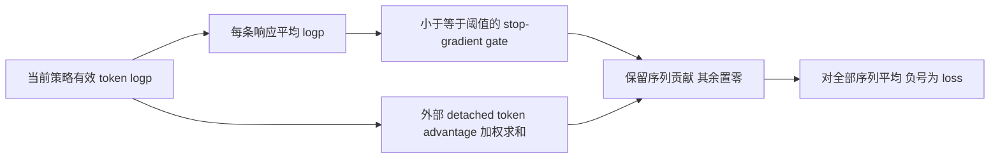
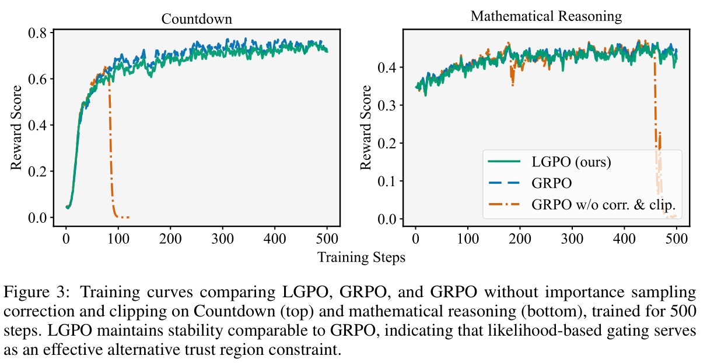

# LGPO：用当前策略似然门控替代重要性比率

> **L1 精确门控损失 / 梯度组件，diagnostic only**。完整 LLM RL 训练成本过高，不复现（审查 DONE）；不参与 evolve 晋级。

## 论文信息

| 字段 | 内容 |
|---|---|
| 论文链接 | [Is the Importance Ratio Necessary for Stable Reinforcement Learning in LLMs?](https://arxiv.org/abs/2611.15404v1)；[固定 v1 全文](https://arxiv.org/html/2611.15404v1) |
| 公司 / 作者机构 | 一作 **Shuibai Zhang，University of Wisconsin–Madison**；工作在 KRAFTON 实习期间完成，其他作者来自 KRAFTON；未核实 Google/Meta 参与 |
| 原始发布日期 | **2026-11-11 12:31:55 UTC**，arXiv v1；不是本轮 11 月 15 日首发 |
| 原作者代码 | 截至 2026-11-15，固定原文及作者入口未找到已核实的方法实现仓库；论文使用的 verl 不等于 LGPO 开源 |
| 原作者代码许可 / 版本 | 未找到方法源码，许可和固定代码版本不适用 |
| 本地 Adapter / key | `lgpo`；独立 loss，不是完整训练 adapter |
| 本地代码 | `src/auto_research/post_training/lgpo.py`：`loss`、`diagnostic(seed, device)` |
| 本地指标 / GPU 证据 | [CPU 三种子](metrics/component-cpu-seeds42-44.json)、[CUDA 三种子](metrics/component-cuda-seeds42-44.json)、[真实 GPU 收据](../../gpu-validations/lgpo-a100-20261115.json)；小张量机制证据，不是任务能力 |

## 原始论文总结

### 背景与主要改动

GRPO 的 importance ratio 同时承担采样分布校正与裁剪约束，二者未必对训练稳定性同样重要。作者发现去掉校正而保留约束时可以稳定；完全 on-policy 时比率恰为 1，ratio clipping 却无法及时限制过度确定的分布。LGPO 不计算旧策略概率，而对**当前策略每条响应的平均 token log probability**设置单侧门槛，屏蔽高似然响应的梯度。

这不是 token 级 top-k，也不是只屏蔽正优势。高似然正、负优势响应都被屏蔽；低似然响应默认保留。论文的局部最小 KL 扰动分析解释分布接近确定性时的敏感性，不构成任意有限步更新都有全局 trust-region 保证。



<!-- paper-figure:start -->
### 原论文关键图



图片来自[原论文](https://arxiv.org/pdf/2611.15404v1#page=6)固定 v1 PDF 第 6 页 Figure 3，保留原图与图注，未重绘。版权归原作者所有；来源、裁剪坐标和 SHA256 见 `assets/provenance.json`。这些曲线是作者结果，不是本地训练。
<!-- paper-figure:end -->

### 核心公式

固定 v1 §4、Appendix D Algorithm 1：

$$
\bar\ell_i=\frac{1}{T_i}\sum_{t=1}^{T_i}\log\pi_\theta(y_{it}\mid x_i,y_{i,<t}),\qquad
c_i=\operatorname{sg}\!\left[\mathbf 1(\bar\ell_i\le\tau)\right],
$$

$$
\mathcal L_{\rm local}=-\frac1B\sum_{i=1}^B c_i\sum_{t=1}^{T_i}
\operatorname{sg}[A_{it}]\log\pi_\theta(y_{it}\mid x_i,y_{i,<t}).
$$

默认 $\tau=-0.15$，对应几何平均 token 概率约 0.86。门槛在平均 logp 上，而损失在 token 上求和；分母是**全部 B 条响应**，不是仅幸存响应数。padding 不进入门槛和损失。外部 advantage、gate 均停止梯度，没有 old-policy 前向或 importance ratio。本地并未实现奖励、优势估计或 rollout。

### 论文离线与线上效果

Table 1 的 Qwen2.5-3B-Instruct：MATH500 64.4→65.2、OlympiadBench 29.2→30.7，但 AIME24 5.0→4.2；不能宣传所有任务都提升。§5 的一个约 7.5K 样本 epoch 使用两张 H100，LGPO 2.85 小时、GRPO 3.37 小时；相对的是会重算旧策略概率的标准实现，不是任何框架固定加速约 18%。未报告生产线上 A/B，本地不复现这些得分或速度。

## 本地复现

### 数据协议与代码映射

输入为调用方实际当前策略 logp、外部 token advantage 和 Boolean response mask。代码拒绝正 logp、非有限量、空有效响应、shape/device/dtype 不一致；未提供 LM checkpoint、题库或 verifier。当前训练代码的数学边界是 loss，而不是完整 on-policy/off-policy 采样系统。

```bash
PYTHONPATH=src python -m pytest tests/post_training/test_nov15_post_components.py -q
PYTHONPATH=src python -c 'from auto_research.post_training.lgpo import diagnostic; print(diagnostic(42, device="cpu"))'
```

### 结果、负控与边界

四条独立小 logits 响应覆盖高似然正/负优势门控、低似然正/负梯度方向；执行真实 backward 和一次参数更新。专测另检查门槛等号、全部序列分母、token 求和、padding 零梯度、advantage detach 和全门控时零梯度。三种子仅改变夹具幅度，不代表三次 LLM 训练。CUDA 路径必须以链接的真实 A100/A30 收据验收；机制通过不等于推理效果提高，不自动接入 evolve。

### 高成本完整实验

§5 / Appendix D.1 使用 3B 与 1.5B 模型、group 8、prompt batch 128/256、300/500/800+ 更新以及多个基线、任务和消融；已有两张 H100 单 epoch 数小时的作者依据。对单张 A100/A30 或本地 Mac，完整矩阵**成本过高，不复现（审查 DONE）**。不下载大权重或数据、不探跑、不自动重试。
