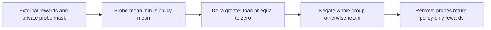
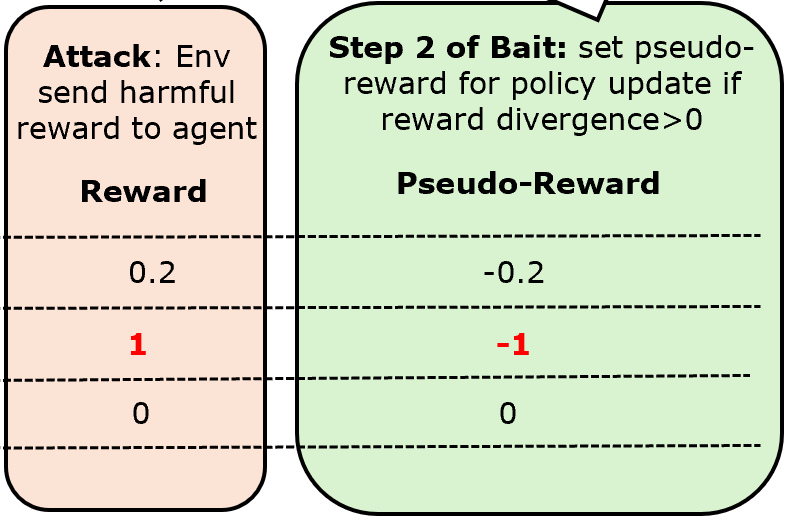

<!-- source-sha256: f0471f7c9153a3c97924eb7be4cab15943df6e0614ff809704877c66f8699492 -->
[简体中文](README.md)

# Bait: private-probe reward comparison and defensive sign inversion

> **L1 defensive reward-gap / sign-flip arithmetic, diagnostic only.** No harmful probes, attacks, harmful text or agent training are generated. Full experiments are too costly and are not reproduced (review DONE).

## Paper information

| Field | Value |
|---|---|
| Paper | [Bait: Mitigating Harmful Agentic Reinforcement Learning via Probing Reward Function](https://arxiv.org/abs/2611.16369v1); [fixed v1](https://arxiv.org/html/2611.16369v1) |
| Company / institution | First author **Tiansheng Huang, Georgia Institute of Technology**; coauthors Ananth Balashankar and Virat Shejwalkar are at **Google DeepMind**, establishing Google-related priority |
| Original publication | **2026-11-12 06:34:34 UTC**, arXiv v1 |
| Authors' code | [Public git-disl/Bait](https://github.com/git-disl/Bait), reviewed SHA `e776d200b86cff0872370f46fdb52e08bf23bcf9`; read-only inspection, no upstream execution |
| License / runnability | Root API reports no project-wide license; nested licenses do not automatically cover the project. The trainer retains an old `scapegoat` import, so end-to-end runnability is not claimed |
| Local adapter / key | `bait-reward-defense`, standalone defensive numeric core, not an agent or attack adapter |
| Local code | `src/auto_research/post_training/bait_reward_defense.py`: `transform_rewards`, `diagnostic` |
| Local metrics | [CPU three-seed diagnostics](metrics/component-cpu-seeds42-44.json); no harmfulness, attack-success or real-agent-return scores |

## Original paper summary

### Background and main changes

When an external environment rewards unsafe behavior, ordinary RL can reinforce the wrong direction. Bait mixes privately identified probes with policy responses, compares their mean rewards and flips the entire group when probes are preferred. Policy learning receives only the non-probe portion. This tests a **reward function's preference**, not a fixed bonus for answers that appear safe.

The local component accepts numeric rewards and private membership only. It has no probe model, semantic safety classifier, attack or RL update. Probe coverage is a separate assumption; the sign rule itself is not a safety guarantee.



<!-- paper-figure:start -->
### Key original figure



Cropped from the bottom-right **reward / pseudo-reward defensive panel** of the [fixed v1 original Figure 2 PNG](https://arxiv.org/html/2611.16369v1/fig/bait.png). No redrawing or numeric changes; attack/probe text panels are omitted. The illustration says >0, but the implementation follows **>=0** in Eqs.3–5. Copyright belongs to the authors; hashes, crop and visual review are in `assets/provenance.json`.
<!-- paper-figure:end -->

### Core equations

Section 4.2 Eqs.3–5, conditional on at least one probe and one policy response:

$$
\delta=\frac1{|P|}\sum_{i\in P}r_i-\frac1{|N|}\sum_{i\in N}r_i,\quad
\widehat H=\mathbf1(\delta\ge0),\quad
\widetilde r_i=\begin{cases}-r_i,&\widehat H=1,\\r_i,&\widehat H=0.\end{cases}
$$

The **whole group**, including probes, is flipped; probes are removed from the subsequent policy-facing output. Exactly zero triggers inversion. Algorithm 1's random no-probe branch is outside this conditional kernel. Empty probe/policy partitions raise errors, rather than letting NaN means imply benign behavior.

**Unresolved normalization specification:** Eq.6 uses non-probe mean/std, Algorithm 1 line 14 omits std, and upstream `main_exp/bait/bait_func.py` only flips rewards while a generic advantage routine has configurable std. This implementation therefore covers **Eqs.3–5 only**, not guessed advantage normalization or policy loss.

### Offline and online results

Section 6 evaluates defenses, safety and returns on EZPoints, WebShop and Alfworld with several policy scales, and studies adaptive threats. Results depend on probes, rewards and training. Attacks are not implemented here, and paper harmfulness/return results are not reproduced. No industrial recommendation production A/B is reported. Google affiliation follows the original byline, not title/abstract guessing.

## Local reproduction

### Data protocol and code mapping

`transform_rewards(rewards, probe_mask)` accepts finite 2D numeric rewards and an aligned Boolean mask. It returns divergence, detection, all transformed rewards and policy-only rewards. Probe membership is defender-private and must not be exposed to the trained agent. No gold answers/plans, text, model, environment or network entry points are used.

```bash
PYTHONPATH=src python -m pytest tests/post_training/test_nov15_post_components.py -q
PYTHONPATH=src python -c 'from auto_research.post_training.bait_reward_defense import diagnostic; print(diagnostic(42))'
```

### Results, negative controls and boundaries

Three numeric fixtures cover positive, negative and zero gaps; column permutations retain aligned membership. Independent scalar tests check means, the boundary, whole-group inversion, policy-only filtering, no input mutation and empty-partition rejection. Finite negative rewards are accepted without extending source theorems beyond their assumptions. No semantic harmfulness accuracy or Evolve promotion is claimed. CPU-only, no GPU receipt required.

### High-cost full experiment

Section 6.1 uses **two H200s per run**, Qwen2.5-VL-3B, Qwen3-VL-2/4/8B and 1.5B agents, plus Qwen3-8B judging / GPT-OSS-20B reward dependencies, groups of 24, 16 prompts per batch, 50 EZPoints epochs, 200 WebShop epochs, 160 Alfworld epochs and multiple arms/seeds. The approximately USD 20 API-attack example is not the full defense-training cost. The full matrix is **too costly, not reproduced (review DONE)** on one A100/A30. No downloads, exploratory runs or automatic retries.
