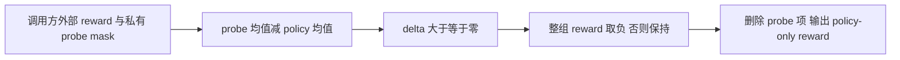
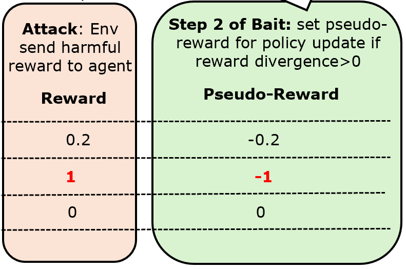

# Bait：用私有探针比较奖励，再做防御性符号翻转

> **L1 防御性 reward-gap / sign-flip 数值组件，diagnostic only**。不生成有害 probe、攻击或有害文本，不训练 Agent。完整实验成本过高，不复现（审查 DONE）。

## 论文信息

| 字段 | 内容 |
|---|---|
| 论文链接 | [Bait: Mitigating Harmful Agentic Reinforcement Learning via Probing Reward Function](https://arxiv.org/abs/2611.16369v1)；[固定 v1 全文](https://arxiv.org/html/2611.16369v1) |
| 公司 / 作者机构 | 一作 **Tiansheng Huang，Georgia Institute of Technology**；Ananth Balashankar、Virat Shejwalkar 来自 **Google DeepMind**，按 Google 相关优先核对 |
| 原始发布日期 | **2026-11-12 06:34:34 UTC**，arXiv v1 |
| 原作者代码 | [已公开 git-disl/Bait](https://github.com/git-disl/Bait)；固定核验 SHA `e776d200b86cff0872370f46fdb52e08bf23bcf9`；只读研究，未执行上游系统 |
| 原作者代码许可 / 可运行性 | 仓库根 API 未给项目级 license；子目录许可不自动覆盖全项目。训练器仍引用旧 `scapegoat` 路径，不宣称端到端即装即用 |
| 本地 Adapter / key | `bait-reward-defense`；独立防御数值核，不是 Agent 或攻击 adapter |
| 本地代码 | `src/auto_research/post_training/bait_reward_defense.py`：`transform_rewards`、`diagnostic` |
| 本地指标 | [CPU 三种子诊断](metrics/component-cpu-seeds42-44.json)；不含有害率、攻击成功率或真实 Agent 回报 |

## 原始论文总结

### 背景与主要改动

当外部环境给不安全行为更高奖励时，普通 RL 会沿错误方向更新。Bait 在防御者私有标识下混入 probe 回答，用其平均 reward 与真实 policy 回答比较；探针更受奖励时反转整组奖励，再只向策略学习暴露 policy 部分。核心是检测 **reward function 偏好**，不是根据“最终回答看起来安全”给固定加分。

本地只接受外部数值 reward 和 private probe mask，不实现 probe 生成模型、语义安全判断、攻击或 RL 更新。探针是否能覆盖真实不安全模式是额外假设，符号判定本身不保证安全。



<!-- paper-figure:start -->
### 原论文关键图



图片来自[原论文](https://arxiv.org/html/2611.16369v1/fig/bait.png)固定 v1 Figure 2 原始 PNG，仅裁取右下方 **reward / pseudo-reward 防御面板**，未重绘、未改变数值；省略攻击与 probe 文本部分。图中示意写“>0”，实际代码按正文 Eqs.3–5 的 **≥0** 边界。版权归原作者所有；源图哈希、裁剪与视觉核验见 `assets/provenance.json`。
<!-- paper-figure:end -->

### 核心公式

§4.2 Eqs.3–5，对至少包含一个 probe 和一个 policy 回答的组：

$$
\delta=\frac1{|P|}\sum_{i\in P}r_i-\frac1{|N|}\sum_{i\in N}r_i,\qquad
\widehat H=\mathbf1(\delta\ge0),\qquad
\widetilde r_i=\begin{cases}-r_i,&\widehat H=1,\\r_i,&\widehat H=0.\end{cases}
$$

翻转适用于**整组**，包括 probe；交给 policy 的输出随后去掉 probe。边界 $\delta=0$ 触发翻转，不偷偷改成严格正数。Algorithm 1 的随机无 probe 分支不属于此条件核；本地拒绝空 probe / policy 分区，不用 NaN 均值作良性结论。

**未猜测的规范冲突：** Eq.6 写 non-probe mean/std；Algorithm 1 第 14 行省略 std；上游 `main_exp/bait/bait_func.py`只做 reward sign flip，通用优势函数又可配置 std。因此这里**只实现 Eqs.3–5**，不含优势归一化或策略 loss；不把其中一种默认值包装成已经复现全文。

### 论文离线与线上效果

§6 在 EZPoints、WebShop、Alfworld 及多种策略规模比较防御与安全/回报，结论依赖 probe 质量、reward 与训练过程，也研究适应性威胁。本地不实现这些攻击实验，不复现原文有害率或回报。未报告搜广推生产线上 A/B；Google 关系来自原文作者机构，不由标题或摘要猜测。

## 本地复现

### 数据协议与代码映射

`transform_rewards(rewards, probe_mask)`接收有限二维 numeric reward 和同形 Boolean mask，返回每组 divergence、检测结果、全部变换 reward 和剔除 probe 的 policy-only reward。probe 身份是调用方的防御私有状态，不应传给被训练 Agent。函数不读取 gold 答案/计划，无文本、模型、环境或网络入口。

```bash
PYTHONPATH=src python -m pytest tests/post_training/test_nov15_post_components.py -q
PYTHONPATH=src python -c 'from auto_research.post_training.bait_reward_defense import diagnostic; print(diagnostic(42))'
```

### 结果、负控与边界

三组纯数值夹具分别覆盖正、负、零 gap，随机列置换保持 membership 对齐。独立标量均值测试检查边界、整组翻转、policy-only 过滤、无原地修改和空分区拒绝。允许有限负 reward，但没有把原文依赖 reward/probe 假设的定理推广到任意输入。输出不是语义 harmfulness 准确率；不参与 evolve 晋级，纯 CPU 不要求 GPU 回执。

### 高成本完整实验

§6.1 每次 run 使用 **2 张 H200**，涵盖 Qwen2.5-VL-3B、Qwen3-VL-2/4/8B 与 1.5B Agent，另需 Qwen3-8B judge / GPT-OSS-20B 奖励环节、group24、每批16 prompts，EZPoints50 epochs、WebShop200、Alfworld160，并做多臂三种子。论文某 API attack 的约20美元不是整套防御训练成本。完整矩阵对单A100/A30明显高成本，**成本过高，不复现（审查 DONE）**；不下载、不探跑、不自动重试。
