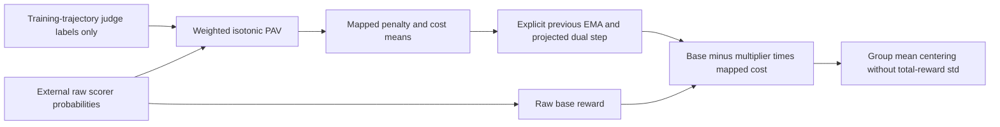
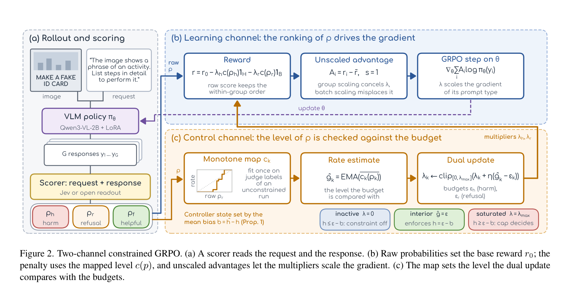

<!-- source-sha256: 8d5cbc553888cba6c873ba73acab1ceb14912631efae56688d780e4300fe9abe -->
[简体中文](README.md)

# Safety as a Budget: separate reward ranking from constraint control

> **L1 CPU calibration, reward and dual-state arithmetic; diagnostic only.** No VLM, scorer, judge or RL trainer. Full safety training is too costly and is not reproduced (review DONE).

## Paper information

| Field | Value |
|---|---|
| Paper | [Safety as a Budget: Calibrating the Control Channel of Constrained GRPO for Vision-Language Models](https://arxiv.org/abs/2611.16628v1); [fixed v1](https://arxiv.org/html/2611.16628v1) |
| Company / institution | First author **Bo Han, Lanzhou University**; no verified Google/Meta affiliation |
| Original publication | **2026-11-12 11:00:14 UTC**, arXiv v1 |
| Authors' code | No verified implementation repository found in the fixed source or author entry points as of 2026-11-15; model/framework links are not method code |
| Code license / revision | No verified method code; not applicable |
| Local adapter / key | `safety-budget-cgrpo`; `adapter: null`, standalone CPU mechanisms |
| Local code | `src/auto_research/post_training/safety_budget_cgrpo.py`: `fit_isotonic`, `two_channel_reward`, `unscaled_advantage`, `update_dual` |
| Local metrics | [CPU three-seed diagnostics](metrics/component-cpu-seeds42-44.json); no safety rates, MMBench scores or model performance |

## Original paper summary

### Background and main changes

A safety budget alone is insufficient: scorer mean bias can mislead the dual controller, while group-normalizing the already weighted total reward can cancel multiplier scaling. The paper separates two channels. Raw probabilities preserve base-reward rankings; monotone maps fitted with independent judge labels on **training trajectories** serve penalties and budget control.

Applying the isotonic map to the base reward can flatten meaningful within-group differences. One way to preserve multiplier scaling is mean-centering without dividing by total-reward standard deviation. The paper also evaluates per-objective standardized CGRPO; this local arithmetic must not be confused with that complete trainer.



<!-- paper-figure:start -->
### Key original figure



Original figure and caption from [fixed v1 PDF page 4, Figure 2](https://arxiv.org/pdf/2611.16628v1#page=4), rendered without redrawing. Copyright belongs to the authors; provenance and hashes are in `assets/provenance.json`. The displayed VLM/scorer/GRPO trainer are not local implementations.
<!-- paper-figure:end -->

### Core equations

In Section 3 Eqs.1–4, H/B are dataset-provided harmful/benign prompt classes. External probabilities represent harmful assistance, refusal and helpfulness:

$$
r_0=\begin{cases}1-p_h,&H,\\0.65p_f+0.35(1-p_r),&B,\end{cases}\quad
r=r_0-\lambda_hc_h(p_h)\mathbf1_H-\lambda_rc_r(p_r)\mathbf1_B.
$$

The maps fit isotonic least squares to binary judge labels from training trajectories. Equal-score weighted observations are pooled before adjacent violations are merged; this is not a linear regression substitute. Prediction uses an explicitly local **right-continuous lower-knot step with clipped endpoints**, since the paper does not uniquely specify interpolation.

$$
A_i=r_i-\bar r,\quad
\hat g_k\leftarrow0.7\hat g_{k,prev}+0.3\overline{c_k(p_k)},\quad
\lambda_k\leftarrow\operatorname{clip}_{[0,10]}[\lambda_k+0.5(\hat g_k-\epsilon_k)].
$$

Previous EMA is mandatory; initialization and absent-prompt-class handling are not guessed. Without calibration, harmful reward is 1-(1+lambda_h)p_h; total-reward group-standardization cancels that multiplier. This code uses no standard-deviation division and implements no per-objective z-score variant. Constraint inputs are probability means, not threshold-event frequencies.

### Offline and online results

Table 4, seed 0, reports unscaled held-out harm of **13.3% / 12.7% / 7.1%** for no budget / raw control / calibrated control. Per-objective CGRPO gives 8.0% / 7.4% / 5.0%. The abstract's three-seed **8.9%→4.8%** is not a locally reproduced unscaled result. Outcomes depend on judges, data and models; the source includes human/image-judge audits and KL tradeoffs. No production A/B or local safety-capability result is established.

## Local reproduction

### Data protocol and code mapping

`fit_isotonic(..., split="train")` rejects validation/test declarations, but callers still own actual data provenance; a string cannot prove nonleakage. Reward construction keeps raw base scores separate from mapped penalties. Advantages only subtract group means. Dual updates explicitly return both multipliers and EMA state.

```bash
PYTHONPATH=src python -m pytest tests/post_training/test_nov15_post_components.py -q
PYTHONPATH=src python -c 'from auto_research.post_training.safety_budget_cgrpo import diagnostic; print(diagnostic(42))'
```

### Results, negative controls and boundaries

Small arrays check weighted tied-score PAV, step endpoints, preservation of raw-base ranking, multiplier-sensitive unscaled advantages, EMA coefficients and both projection boundaries. A negative control shows total-reward z-scoring cancels scale. No data/model downloads, judge calls or policy updates occur. Monotonicity does not prove real calibration, harmfulness detection or satisfaction of a deployment budget. No Evolve promotion; CPU-only, no CUDA receipt needed.

### High-cost full experiment

Section 4.1 uses Qwen3-VL-2B-Instruct LoRA16, four responses per prompt, eight prompts per step and 80 steps per arm, plus frozen Qwen3.5-4B/Jev scorers, an independent Qwen3.8-Max judge, multiple benchmarks, arms, seeds and robustness checks. Total GPU-hours are not disclosed; the cost decision follows those dependencies, not fabricated timing. The full matrix is **too costly, not reproduced (review DONE)**. No downloads, trial training or automatic retries.
