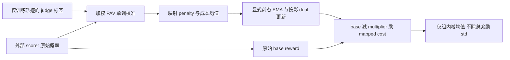
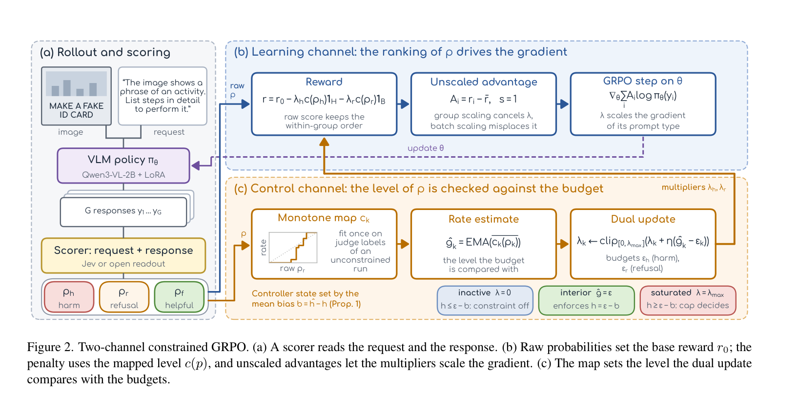

# Safety as a Budget：分开奖励排序与约束控制

> **L1 CPU 校准 / 奖励 / dual-state 算术组件，diagnostic only**。没有 VLM、scorer、judge 或 RL trainer；完整安全训练成本过高，不复现（审查 DONE）。

## 论文信息

| 字段 | 内容 |
|---|---|
| 论文链接 | [Safety as a Budget: Calibrating the Control Channel of Constrained GRPO for Vision-Language Models](https://arxiv.org/abs/2611.16628v1)；[固定 v1 全文](https://arxiv.org/html/2611.16628v1) |
| 公司 / 作者机构 | 一作 **Bo Han，Lanzhou University**；未核实 Google/Meta 参与 |
| 原始发布日期 | **2026-11-12 11:00:14 UTC**，arXiv v1 |
| 原作者代码 | 截至 2026-11-15，固定原文与作者入口未找到已核实的本论文实现仓库；模型和框架链接不是方法代码 |
| 原作者代码许可 / 版本 | 未找到方法源码，许可和固定代码版本不适用 |
| 本地 Adapter / key | `safety-budget-cgrpo`；`adapter: null`，独立 CPU 机制组件 |
| 本地代码 | `src/auto_research/post_training/safety_budget_cgrpo.py`：`fit_isotonic`、`two_channel_reward`、`unscaled_advantage`、`update_dual` |
| 本地指标 | [CPU 三种子机制诊断](metrics/component-cpu-seeds42-44.json)；不包含安全率、MMBench 或模型性能 |

## 原始论文总结

### 背景与主要改动

给 GRPO 增加安全预算并不足够：scorer 分数的均值偏差会使 dual controller 读错约束，且对已加权总奖励作组内标准化可能消掉 multiplier 的梯度尺度。本文拆成两条通道：原始概率保留 base reward 的组内排序；用独立 judge 在**训练轨迹**上拟合的单调校准映射，只服务于 penalty 与预算控制。

校准图不能直接挪进 base reward，因为 isotonic 的平坦区会抹掉原始相对分数。保持 multiplier 的一种方案是只中心化、不按总奖励标准差缩放；论文另有逐目标标准化 CGRPO，但本地没有将两种形式混称为同一已实现 trainer。



<!-- paper-figure:start -->
### 原论文关键图



图片来自[原论文](https://arxiv.org/pdf/2611.16628v1#page=4)固定 v1 PDF 第 4 页 Figure 2，保留原图和图注，未重绘。版权归原作者所有；来源与 SHA256 见 `assets/provenance.json`。图中的 VLM / scorer / GRPO trainer 不是本地已实现模块。
<!-- paper-figure:end -->

### 核心公式

§3 Eqs.1–4 中，$H/B$ 是数据给定的 harmful/benign prompt 类型；$p_h,p_r,p_f$ 是外部 harmful assistance / refusal / helpfulness 概率。原始 base reward 为

$$
r_0=\begin{cases}1-p_h,&H,\\0.65p_f+0.35(1-p_r),&B,\end{cases}\quad
r=r_0-\lambda_hc_h(p_h)\mathbf1_H-\lambda_rc_r(p_r)\mathbf1_B.
$$

两个 $c$ 在训练轨迹上用 judge 二元标签拟合 isotonic least squares。实现先合并相同分数的加权观测，再作相邻违例合并 PAV；不是替换为线性拟合。预测采用**右连续 lower-knot 阶梯函数、端点截住**，这是正文未唯一规定时明确声明的本地插值约定。

$$
A_i=r_i-\bar r,\qquad
\hat g_k\leftarrow0.7\hat g_{k,prev}+0.3\overline{c_k(p_k)},\qquad
\lambda_k\leftarrow\operatorname{clip}_{[0,10]}[\lambda_k+0.5(\hat g_k-\epsilon_k)].
$$

代码要求显式 previous EMA，不猜初始化或某类 prompt 缺席时如何处理。无映射时 harmful reward 为 $1-(1+\lambda_h)p_h$；若除该组总奖励 std，$(1+\lambda_h)$ 会抵消。这里不除 std，也未实现逐目标 z-score 变体。使用调用者均值，不把阈值事件频率冒充概率均值。

### 论文离线与线上效果

Table 4 seed 0 的 unscaled 形式：无预算 / 原始控制 / 校准控制的 held-out harm 分别为 **13.3% / 12.7% / 7.1%**；逐目标 CGRPO 为 8.0% / 7.4% / 5.0%。摘要的三种子 **8.9%→4.8%** 不属于本地 unscaled 算术已经复现出的结果。评测依赖 judge、数据与模型；论文亦有人工 audit、image-reading judge 和更高 KL 的取舍。未报告生产 A/B，本地没有任何安全能力结果。

## 本地复现

### 数据协议与代码映射

`fit_isotonic(..., split="train")`只接受训练声明，验证/测试 split 被拒绝；但源数据 provenance 仍由调用方负责，字符串不是泄漏防护的充分证明。`two_channel_reward`明确原始 base 与 mapped penalty，`unscaled_advantage`只中心化，`update_dual`返回新 multiplier 与 EMA，不隐藏控制器状态。

```bash
PYTHONPATH=src python -m pytest tests/post_training/test_nov15_post_components.py -q
PYTHONPATH=src python -c 'from auto_research.post_training.safety_budget_cgrpo import diagnostic; print(diagnostic(42))'
```

### 结果、负控与边界

小数组核对重复 score 的加权 PAV、阶梯端点、保留原始 base 排序、multiplier 进入未缩放优势、EMA 系数和上下投影。负控直接显示总奖励 z-score 会抵消乘法尺度。没有下载数据或模型，没有 judge 调用和策略更新；不能由单调性推出真实概率已校准、真实 harmfulness 可识别或部署预算一定达到。不接入 evolve 晋级，CPU 无需 CUDA 收据。

### 高成本完整实验

§4.1 的 Qwen3-VL-2B-Instruct LoRA16、每 prompt 4 回答、每步 8 prompts、每臂 80 步，还需冻结 Qwen3.5-4B / Jev scorer、独立 Qwen3.8-Max judge、多基准、三种子与多臂稳健性核查。作者未披露统一 GPU-hours；这里依据多模型/多臂依赖判断，不虚构耗时。完整矩阵**成本过高，不复现（审查 DONE）**；不下载、不试训、不自动重试。
