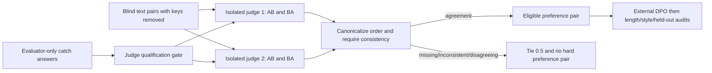
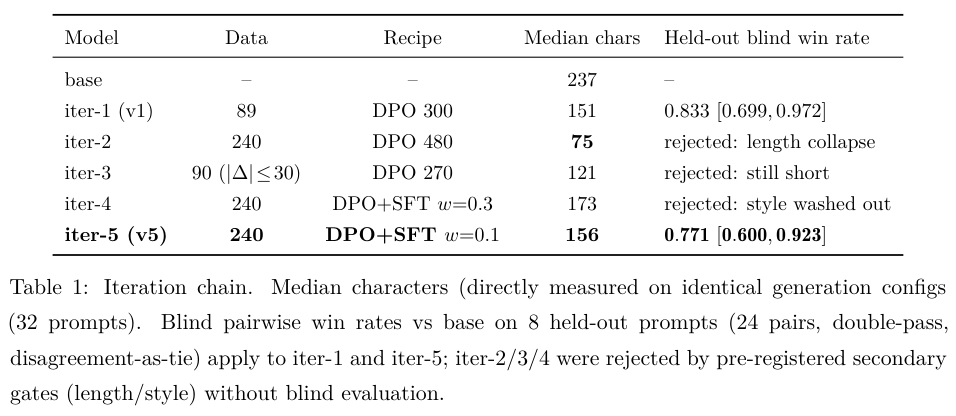

# RA-Eval: qualify judges, swap orders, and audit bias transduction

<!-- source-sha256: f2a3c82fd499c39d4a7d27d43cf996a9e98db6f4f2001ba5995f0a5a803aa340 -->

[简体中文](README.md)

> **CPU L1 annotation protocol; diagnostic only.** It processes externally supplied verdicts. No LLM is called, no capability scores are fabricated and no 0.6B model is trained. The full speech/preference-training and judge campaign is **not reproduced due to cost (review DONE)**.

## Paper information

| Field | Value |
| --- | --- |
| Paper | [arXiv:2611.19840v1](https://arxiv.org/abs/2611.19840v1); [fixed text](https://arxiv.org/html/2611.19840v1) |
| Original title | Grounding Language Models in Speech Does Not Fix "AI Flavor": Calibrated LLM Judges, Goodhart Traps, and a Preference-Tuning Fix |
| Institution/company | First/sole author Dongwu Qian: **Independent Researcher** |
| Original publication | **November 15, 2026, 06:42:48 UTC**, arXiv v1 |
| Authors' code | Released [RA-Eval v0.1, Zenodo DOI 10.5281/zenodo.24237533](https://doi.org/10.5281/zenodo.24237533). The small `ra-eval-v0.1-code-data.zip` was inspected for benchmark/blind/join/judge scripts and calibration files; this is not a GitHub repository |
| License | MIT code; CC BY 4.0 annotations; human reference texts have separate noncommercial/takedown restrictions, not a blanket MIT license. Only the small code archive was inspected; no model weights downloaded |
| Fixed upstream version | RA-Eval v0.1; archive SHA256 `6e2777051b06a90a73edbf4fb21555448ce82c5bc3bf243e5ef13602259f32c0` |
| Local adapter/key | `calibrated-judges-protocol`; `adapter=null`, `promotion_eligible=false`, `evolve_integrated=false` |
| Local code | `src/auto_research/post_training/calibrated_judges_protocol.py`: `qualify`, `join_swapped_judgments`, `check_split_isolation` |

## Original paper

### Motivation and changes

Three negative results precede the judge protocol: phoneme-interleaved pretraining does not improve perceived spoken style and increases repetition; prosody-plan adherence falls below its gate; rule-based prosody reward is near chance under human and judge blind evaluations. RA-Eval therefore combines objective features, power-limited human judgments and calibrated LLM judges. Objective feature gains alone do not establish perceptual improvement.

Layer 3 first requires sensitivity of at least 0.75 on known-answer catch trials. **Two isolated judges with A/B order swapping** then annotate ordinary pairs, with disagreements scored 0.5. Judge-agree labels directly supply preference pairs, **without an additional reward model**. Each training round must check whether annotation bias became a length shortcut. Independent judges here mean isolated processes/contexts, not independently validated model families.

### Architecture and protocol



### Core equations

Qualification uses $\mathrm{sensitivity}=\mathrm{correct}/N\ge0.75$. Catch answers belong only to the evaluator; they must not enter evaluated-policy or annotator prompts. BA verdicts are mapped to canonical A/B. The local combination rule emits a hard preference only when all four verdicts from two qualified judges agree; otherwise $p_A=0.5$. This is an explicitly stricter local composition than joining two raw passes, enforcing Section 3.3's isolated-judge and swapped-order requirements. Different identity strings alone cannot prove runtime isolation.

Section 5.4 uses a chosen-CE anchor:

$$
L=L_{DPO}-w\frac{1}{|y^+|}\log p(y^+\mid x).
$$

That 0.6B training is not implemented here, nor is `w=0.1` claimed universally optimal. Calibration/training/held-out IDs must be pairwise disjoint. ID checks are a minimum interface guard, not a substitute for near-duplicate or same-prompt leakage audits.

### Reported results and limits

The paper reports 16/16 catches, 22/24 pilot single-text detections and 24/24 same-topic pairs, not local measurements. DPO with 89 pairs achieves held-out blind win 0.833 [0.699,0.972]; scaling to 240 pairs causes a median-75-character collapse. An SFT anchor partly repairs the problem; final win is 0.771 [0.600,0.923]. These are not production A/B results.

Section 5.4 reports a length statistic of 213, whereas Table 1 gives final median 156 on 32 prompts under identical generation settings; the different summaries must not be collapsed into a single guarantee. The paper covers one Chinese short-essay genre, a 0.6B model and one judge model, with residual length bias and power-limited final human confirmation. Local fixtures validate none of these capability claims.

<!-- paper-figure:start -->
### Key original table

[](https://arxiv.org/pdf/2611.19840v1#page=8)

Fixed v1, page 8, original Table 1 and caption, without rearranged data or redrawing. Rejected iterations are not presented as completed blind evaluations. Copyright remains with the author; CC BY 4.0. [Source and SHA256](assets/provenance.json).

Image from the [original paper](https://arxiv.org/html/2611.19840v1); copyright belongs to the original authors.
<!-- paper-figure:end -->

## Local implementation

### Data contract and mapping

`qualify` takes evaluator-only catch verdicts plus canonical expected sides. `join_swapped_judgments` takes ordinary verdicts and qualification records, never gold answers. Catch IDs cannot be reused for training annotations. Missing orders, order inconsistency, judge disagreement or unqualified judges fail closed to ties; duplicate judge/order combinations and mixed pair IDs raise errors. It processes verdicts; it is not an AI-style detector.

```bash
PYTHONPATH=src python -c 'from auto_research.post_training.calibrated_judges_protocol import diagnostic; print(diagnostic(42, device="cpu"))'
PYTHONPATH=src python -m pytest tests/test_nov18_eval_protocols.py -q
```

### Checks and evidence boundary

Explicitly named fixture judges test order restoration, the 0.75 gate, disagreement/missing-order ties, duplicate rejection and split overlap. Values 1 and 0.5 are protocol mappings, not LLM capability scores. Component diagnostic artifacts record actual execution; no blind-win, calibration or GPU result is fabricated. `REQUIRES_GPU_VALIDATION=False`; CPU dictionary arithmetic requires no CUDA validation.

### High-cost full experiment

The full study includes multiple 0.6B CPT/DPO/SFT rounds, speech/TTS features, repeated judge annotations and restricted human texts. That complete training/call matrix is expensive relative to the short single-device/local budget and is **not reproduced due to cost (review DONE)**. Low-cost qualification/join interfaces are implemented, but no paid judge is called or approximately 2.3GB model archive downloaded. Review DONE does not mean an experiment succeeded.
