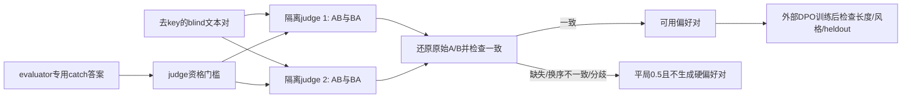
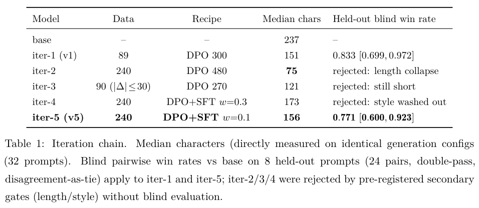

# RA-Eval：先校准裁判，再做双裁判换序与偏差转导检查

[English](README-en.md)

> 状态：CPU **L1 标注协议组件，diagnostic only**。只处理外部提供的 verdict；不调用 LLM、不生成模拟能力评分、不训练 0.6B 模型。完整语音/偏好训练与裁判实验：**高成本，不复现（审查 DONE）**。

## 论文信息

| 字段 | 内容 |
| --- | --- |
| 论文链接 | [arXiv 2611.19840v1](https://arxiv.org/abs/2611.19840v1)；[固定 v1 全文](https://arxiv.org/html/2611.19840v1) |
| 原文标题 | Grounding Language Models in Speech Does Not Fix "AI Flavor": Calibrated LLM Judges, Goodhart Traps, and a Preference-Tuning Fix |
| 公司 / 作者机构 | 一作/单作者 Dongwu Qian；**Independent Researcher（独立研究者）** |
| 首次公开日期 | **2026-11-15 06:42:48 UTC**，arXiv v1 |
| 原作者开源代码 | 已发布 [RA-Eval v0.1，Zenodo DOI 10.5281/zenodo.24237533](https://doi.org/10.5281/zenodo.24237533)；核验 `ra-eval-v0.1-code-data.zip` 的 benchmark、blind/join/judge 脚本和 calibration 文件清单；不是 GitHub 仓库 |
| 原作者代码许可 | 代码 MIT；annotations CC BY 4.0；人类参照语料另有非商业/下架限制，不能一律标 MIT。只核验小型公开代码归档，不下载模型权重 |
| 上游固定版本 | RA-Eval v0.1；代码归档 SHA256 `6e2777051b06a90a73edbf4fb21555448ce82c5bc3bf243e5ef13602259f32c0` |
| 本地 Adapter / key | `calibrated-judges-protocol`；`adapter=null`，`promotion_eligible=false`，`evolve_integrated=false` |
| 本地复现代码 | `src/auto_research/post_training/calibrated_judges_protocol.py`；`qualify`、`join_swapped_judgments`、`check_split_isolation` |

## 原始论文总结

### 背景与主要改动

论文先报告三个负结果：音素交织继续预训练没有改善可感知口语风格且增加重复；prosody plan 遵从低于门槛；规则韵律 reward 的人类与裁判盲评近似随机。作者因此把重点转向评测：自动特征、功效受限的人类盲评、经过 catch trials 校准的 LLM judge，三层互补，不能用单一客观特征代替感知质量。

Layer 3 先在已知答案的 catch trials 检查灵敏度（门槛 0.75），再由**两个隔离 judge、A/B 换序**标注，分歧计 0.5。训练采用 judge-agree preference pairs，**不额外训练 reward model**；每次训练后还需检查标注偏差是否转导成长度捷径。两个 judge 是独立进程/上下文，不是已证明彼此独立的两个模型家族。

### 架构与流程



### 核心公式

本地 qualification 为 $\mathrm{sensitivity}=\mathrm{correct}/N\ge0.75$；catch 真值只存在 evaluator 接口，不能进入被评模型或 annotator 的 prompt。将 BA verdict 映射回 canonical A/B 后，两个合格 judge 的四条判断全部同向才输出硬偏好，否则为 tie、$p_A=0.5$。这是比原始两份 pass join 更严格的本地组合约定，明确实现论文 §3.3 的双隔离 judge 与换序要求；字符串不同不能证明实际进程隔离。

原文 §5.4 的 chosen-CE 锚为：

$$
L=L_{DPO}-w\frac{1}{|y^+|}\log p(y^+\mid x).
$$

本地协议不实现其 0.6B 训练，不声称 `w=0.1` 普适最优。训练/校准/heldout 的 ID 必须两两不交；ID 检查是接口底线，不替代文本近重复和同 prompt 泄漏审计。

### 论文离线与线上效果

catch 实测 16/16；pilot 单文本 22/24、同主题 pairs 24/24。这些是原文特定 judge 的结果，不是本地获得。作者报告 DPO 89 对的 heldout blind win 0.833 [0.699,0.972]，扩到 240 对出现 median 75 字的塌缩；SFT anchor 修复部分问题，最终 win 0.771 [0.600,0.923]，不是线上 A/B。

原文 §5.4 的特征报告长度 213，而 Table 1 在同一 generation config 的 32 prompts 上列最终 median 156；两者统计口径不能合并成单个保证值。原论文仅单类中文短文、0.6B 和一个 judge 模型，长度偏好残留；人类最终确认仍受功效限制。所有正负结果均不由本地 fixture 背书。

<!-- paper-figure:start -->
### 原论文关键图

[](https://arxiv.org/pdf/2611.19840v1#page=8)

固定 v1 第 8 页 Table 1 原表与表注，未重排数据或重绘；拒绝轮次没有被伪装成完成 blind evaluation。版权归原作者，CC BY 4.0。[来源与 SHA256](assets/provenance.json)。
图片来自[原论文](https://arxiv.org/html/2611.19840v1)，版权归原作者所有。
<!-- paper-figure:end -->

## 本地复现

### 数据协议与代码映射

`qualify` 接收 evaluator-only catch verdict+canonical expected side；`join_swapped_judgments` 只接收普通文本对的 verdict 与资格记录，不接收 gold；已知 catch IDs 禁止复用为训练标注。缺少一个 order、换序不一致、judge 分歧或不合格都 fail closed 为 tie，重复 judge/order 与混入其他 pair 直接报错。它是 verdict 加工协议，不是能判断文章“AI 味”的模型。

```bash
PYTHONPATH=src python -c 'from auto_research.post_training.calibrated_judges_protocol import diagnostic; print(diagnostic(42, device="cpu"))'
PYTHONPATH=src python -m pytest tests/test_nov18_eval_protocols.py -q
```

### 结果、负控与边界

fixture 明确命名为 fixture-judge，用于检查换序还原、0.75 门槛、分歧/缺项 tie、重复拒绝和 split overlap。1 或 0.5 是协议映射，不是 LLM 能力分数。实际执行由组件诊断产物记录；不虚构新的 blind win、校准率或 GPU 结果。`REQUIRES_GPU_VALIDATION=False`；CPU 字典算术无需 CUDA。

### 高成本完整实验

原文包括 0.6B 多轮 CPT/DPO/SFT、语音/TTS 特征实验和重复 judge 标注，还涉及带限制的人类语料。完整训练/调用矩阵相对短时单卡或本地预算成本高，**完整实验不复现（审查 DONE）**。低成本校准/合并接口已实现，不运行付费 judge，不下载约 2.3GB 模型归档，不把 review DONE 当作实验成功。
