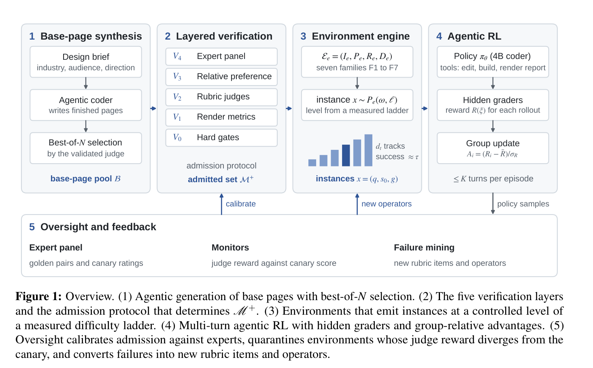

# Learning Design Taste through Verifiable Synthetic Environments and Agentic Reinforcement Learning

[简体中文](README.md)

<!-- source-sha256: 3cf7bdff41d6d7cba1e0ecc0f68b8002e8eb7ef83cd0b7e47c21aa482d9c5e2d -->

> **l0_interface standalone component; diagnostic only.** Full experiments are not reproduced due to high cost (review DONE). No automatic retries or Evolve promotion.

## Paper information

| Field | Value |
| --- | --- |
| Paper | [arXiv 2611.20612v1](https://arxiv.org/abs/2611.20612v1); [fixed v1](https://arxiv.org/html/2611.20612v1) |
| First author / institution | Sujay Choubey; The fixed v1 does not state the first author affiliation; not inferred from another author email. |
| Original publication | 2026-11-16 06:37:24 UTC; original submission, not announcement/review date |
| Original source code | [Author repository](https://github.com/mr-siddy/Tasteful-Designs); verified revision `a3f98e4375df17d3631df9ee9b68762980e30a71`; no project-level licence verified; upstream source not copied. Release evidence only; upstream training not executed. |
| Local adapter / key | `design-taste-admission`; `adapter: null` |
| Local code | `src/auto_research/post_training/design_taste_admission.py` |

## Original paper summary

### Background and defining changes

Even spacing metrics can be gamed. Admission requires expert agreement, causal perturbation/repair sensitivity, hack-trap resistance and stability. Failed signals remain evaluation-only.

No. Experts determine signal admission and score blinded canaries. Reward aggregates only function/design/rubric/preference channels, while build/render/anticheat and other V0 gates multiply it.

<!-- paper-figure:start -->
### Original paper figure

[](https://arxiv.org/pdf/2611.20612v1#page=3)

From [fixed v1](https://arxiv.org/pdf/2611.20612v1#page=3), PDF page 3. Copyright belongs to the original authors. The original panel and caption are preserved without scientific edits; source/crop/SHA are in [provenance](assets/provenance.json). Author results are not local measurements.

<!-- paper-figure:end -->

### Core equations

Read source locations: §4 Eq.3–4；§5–8 training/evaluation.

$$
A_m\ge.85,\quad C_m\ge.90,\quad H_m\le.20,\quad S_m\ge.90;\qquad R=\prod_jG_j\max(0,\sum_kw_kS_k-\lambda_{len}P_{len}-\lambda_{turn}P_{turn}).
$$

### Paper results and production evidence

Only seven of sixteen render signals and six of ten rubric dimensions are admitted; distinctiveness fails its criterion, and much of the gain depends on the multi-turn inference loop. Experts do not enter the reward, so failed dimensions cannot be dropped to claim all design taste is verifiable. No production A/B is reported.

## Local component

### Data contract and code mapping

Four admission tests for expert agreement, causal sensitivity, hack resistance and stability; multiplicative V0 hard gates and admitted-score composite reward, not a browser or design judge.

No. It consumes external observation rates/admitted scores and executes four gates and reward algebra. There is no Chromium, expert panel, judge ensemble or 4B model. The starting-state <=.4 rule admits tasks; it does not clip final rewards.

```bash
PYTHONPATH=src python -c 'from auto_research.post_training.design_taste_admission import diagnostic; print(diagnostic(42, device="cpu"))'
PYTHONPATH=src python -m pytest -q tests/post_training/test_nov18_latest_post_components.py
```

### Results, negative controls and limits

CPU seeds 42/43/44 were executed. [Metrics](metrics/component-cpu-seeds42-44.json) contain operator/control results, not task-success rates. CPU-only protocol; no CUDA path is advertised.

all_four_boundaries_are_inclusive, high_agreement_does_not_override_hack_trap, integrity_is_multiplicative, starting_state_floor_is_separate.

### High-cost full experiment

The original configuration is recorded verbatim with source locations in the cost assessment. It involves a 4B multi-turn editing policy, real Chromium builds/renders, independent judge ensembles and about 385 expert pairs per dimension.

**The high-cost full experiment is not reproduced (review DONE).** This is a source-configuration assessment, not a local timing claim. Only declared tiny-operator checks are allowed; no large-model probe is run to prove cost. No capability comparison or Evolve integration is claimed.
