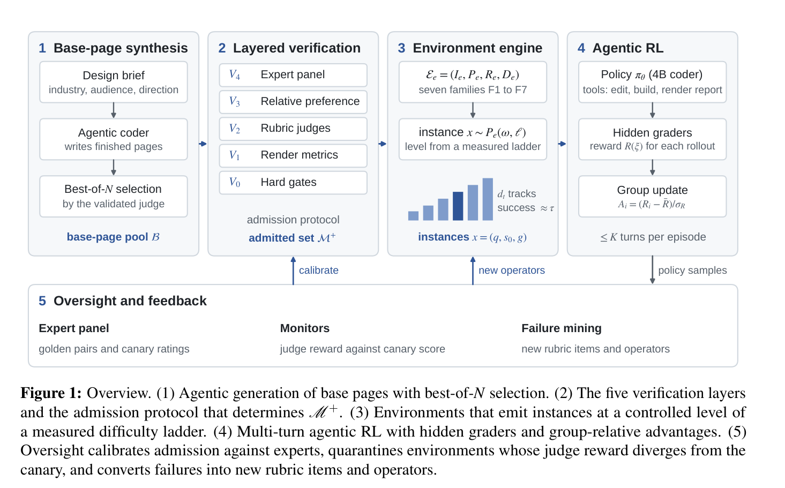
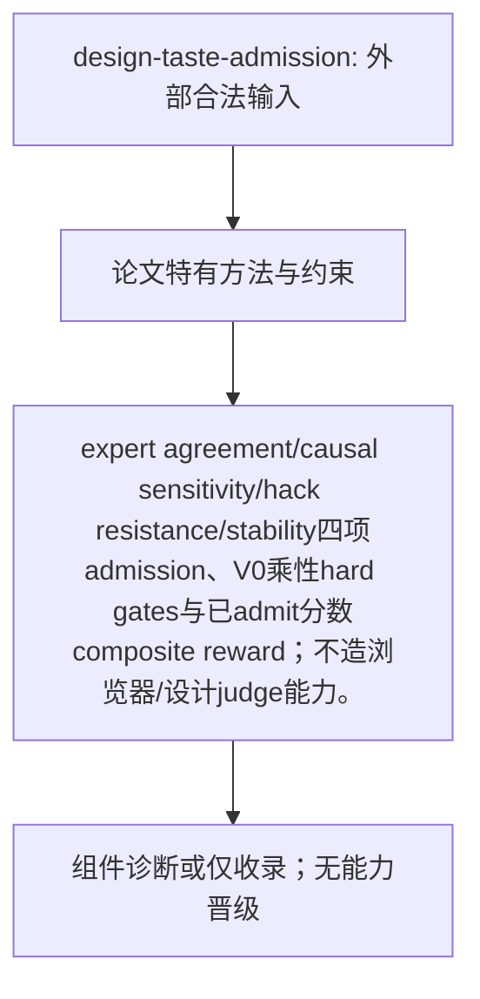

# Learning Design Taste through Verifiable Synthetic Environments and Agentic Reinforcement Learning

[English](README-en.md)

> **l0_interface 独立组件，diagnostic only。** 完整实验成本过高，不复现（审查 DONE）；不自动重试、不进入Evolve晋级。

## 论文信息

| 字段 | 内容 |
| --- | --- |
| 论文链接 | [arXiv 2611.20612v1](https://arxiv.org/abs/2611.20612v1)；[固定v1原文](https://arxiv.org/html/2611.20612v1) |
| 公司 / 作者机构 | 一作 **Sujay Choubey**：**固定v1未列一作机构（不由其他作者邮箱推断）**；不把所用Google/Meta模型当作者机构 |
| 首次公开日期 | **2026-11-16 06:37:24 UTC**，原始arXiv提交，不替换成公告或本次审查日期 |
| 原作者开源代码 | [作者仓库](https://github.com/mr-siddy/Tasteful-Designs)；固定SHA `a3f98e4375df17d3631df9ee9b68762980e30a71`；未找到项目级许可，不复制上游源码。仅核对发布证据，未执行上游训练。 |
| 本地 adapter / key | `design-taste-admission`；`adapter: null` |
| 本地复现代码 | `src/auto_research/post_training/design_taste_admission.py` |

## 原始论文总结

### 背景与主要改动

spacing等指标也可被刷分；必须同时通过expert agreement、单原则扰动/修复因果敏感性、hack trap和重复稳定性。未通过的项只作evaluation，不进reward。

不能。专家选择哪些低层信号可被准入并做盲评canary，reward只聚合func/design/rubric/pref；build/render/anticheat等是乘性V0门。

<!-- paper-figure:start -->
### 原论文关键图

[](https://arxiv.org/pdf/2611.20612v1#page=3)

图片来自[原论文](https://arxiv.org/pdf/2611.20612v1#page=3)第3页，版权归原作者所有；完整保留图与原图注，未重绘/改数值。来源、裁剪与SHA见[provenance](assets/provenance.json)。图表中的结果属于作者，不是本地实验。

<!-- paper-figure:end -->



### 核心公式

固定v1位置：§4 Eq.3–4；§5–8 training/evaluation。

$$
A_m\ge.85,\quad C_m\ge.90,\quad H_m\le.20,\quad S_m\ge.90;\qquad R=\prod_jG_j\max(0,\sum_kw_kS_k-\lambda_{len}P_{len}-\lambda_{turn}P_{turn}).
$$

### 论文离线与线上效果

作者只准入7/16 render信号和6/10 rubric维度，distinctiveness标准未通过；大部分收益还依赖多轮推理loop。专家层不进入reward，不能删掉失败维度并宣称所有设计品味已可验证。未报告生产线上A/B。

## 本地复现

### 数据协议与代码映射

expert agreement/causal sensitivity/hack resistance/stability四项admission、V0乘性hard gates与已admit分数composite reward；不造浏览器/设计judge能力。

没有。只接受外部观测率和已admit分数，执行四门槛及奖励代数；无Chromium、真实专家、judge ensemble或4B模型。起始状态≤.4是训练题准入，不应强行裁剪最终reward。

```bash
PYTHONPATH=src python -c 'from auto_research.post_training.design_taste_admission import diagnostic; print(diagnostic(42, device="cpu"))'
PYTHONPATH=src python -m pytest -q tests/post_training/test_nov18_latest_post_components.py
```

### 结果、负控与边界

已实际执行CPU seeds42/43/44；[指标](metrics/component-cpu-seeds42-44.json)仅记录算子与负控，不含任务成功率。此协议仅支持CPU，不宣称CUDA路径。

all_four_boundaries_are_inclusive、high_agreement_does_not_override_hack_trap、integrity_is_multiplicative、starting_state_floor_is_separate。

### 高成本完整实验

§4–8需Qwen3.5-4B多轮repo编辑/build/Chromium渲染、独立judge ensemble、每维约385专家对和完整RL/消融；人类专家与多模型loop无法以算子单测替代。

**完整实验成本过高，不复现（审查 DONE）**。成本依据来自原文配置而非本地测速；只在明确小算子预算内工作，不为证明高成本探跑大模型。单卡A100/A30或Mac不能替代论文完整多模型/多任务/专家与系统对照。
