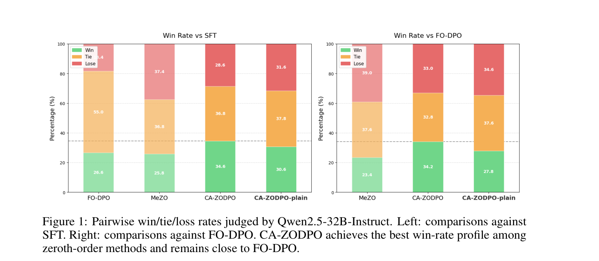

# Contrastive Activation-Guided Zeroth-Order Preference Optimisation for Memory-Efficient LLM Alignment

[简体中文](README.md)

<!-- source-sha256: 587f021aebada884eb03e5ea45111edf4d7737efcbaef690486f0080de0d5210 -->

> **l1_mechanism standalone component; diagnostic only.** Full experiments are not reproduced due to high cost (review DONE). No automatic retries or Evolve promotion.

## Paper information

| Field | Value |
| --- | --- |
| Paper | [arXiv 2611.20635v1](https://arxiv.org/abs/2611.20635v1); [fixed v1](https://arxiv.org/html/2611.20635v1) |
| First author / institution | Weiyun Huang; Uppsala University |
| Original publication | 2026-11-16 06:55:27 UTC; original submission, not announcement/review date |
| Original source code | No verifiable method-source release found in fixed v1 or the bounded author entry points checked. Referenced trainers, models and libraries are not this paper's source release. |
| Local adapter / key | `ca-zodpo`; `adapter: null` |
| Local code | `src/auto_research/post_training/ca_zodpo.py` |

## Original paper summary

### Background and defining changes

The loss remains the chosen–rejected policy/reference margin. The update uses forward-only search directions from contrastive input activations instead of isotropic full-parameter perturbations.

The factor keeps perturbation scale comparable across ranks. Removing it conflates a larger subspace with a larger search step and changes the source's comparison.

<!-- paper-figure:start -->
### Original paper figure

[](https://arxiv.org/pdf/2611.20635v1#page=4)

From [fixed v1](https://arxiv.org/pdf/2611.20635v1#page=4), PDF page 4. Copyright belongs to the original authors. The original panel and caption are preserved without scientific edits; source/crop/SHA are in [provenance](assets/provenance.json). Author results are not local measurements.

<!-- paper-figure:end -->

### Core equations

Read source locations: §2 Eq.1–5；§3 HH-RLHF setup.

$$
H_\Delta=[\operatorname{Mean}(H_{ch})-\operatorname{Mean}(H_{rej}),H_{ch}-H_{rej}],\quad\Delta=RA^\top/\sqrt r,\quad g=[L(W+\varepsilon\Delta)-L(W-\varepsilon\Delta)]/(2\varepsilon),\quad N_t=\mu N_{t-1}(A_{t-1}^\top A_t)+(1-\mu)gR.
$$

### Paper results and production evidence

On Qwen2.5-1.5B and HH-RLHF the authors compare ZO variants with first-order DPO; contrastive activations outperform a preference-agnostic subspace and memory scales more weakly with sequence length. Fewer low-rank state elements alone prove neither alignment quality nor measured peak-memory reduction. No production A/B is reported.

## Local component

### Data contract and code mapping

Power-iteration subspace of chosen/rejected activation differences, rank-normalized two-point finite differences and basis-transported low-rank momentum.

No. Coordinates change with the basis, so the old buffer is transported through A_old-transpose A_new before accumulation. The same coefficients otherwise represent a different full-weight direction.

```bash
PYTHONPATH=src python -c 'from auto_research.post_training.ca_zodpo import diagnostic; print(diagnostic(42, device="cpu"))'
PYTHONPATH=src python -m pytest -q tests/post_training/test_nov18_latest_post_components.py
```

### Results, negative controls and limits

CPU seeds 42/43/44 were executed. [Metrics](metrics/component-cpu-seeds42-44.json) contain operator/control results, not task-success rates. A real A100/A30 receipt must pass the batch GPU gate before CUDA validation is claimed.

orthonormal_contrastive_basis, two_point_slope_matches_oracle, basis_transport_preserves_reconstructed_momentum, low_rank_update_executes.

### High-cost full experiment

The original configuration is recorded verbatim with source locations in the cost assessment. It involves Qwen2.5-1.5B HH-RLHF SFT and several ZO/first-order DPO comparisons, with basis extraction and two perturbed forwards each update.

**The high-cost full experiment is not reproduced (review DONE).** This is a source-configuration assessment, not a local timing claim. Only declared tiny-operator checks are allowed; no large-model probe is run to prove cost. No capability comparison or Evolve integration is claimed.
