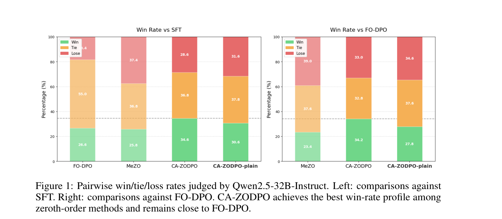
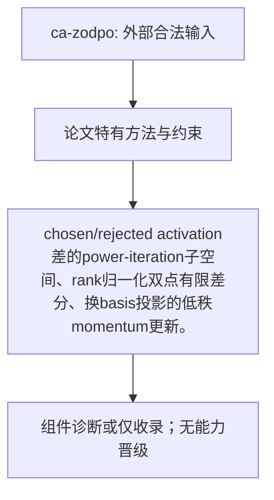

# Contrastive Activation-Guided Zeroth-Order Preference Optimisation for Memory-Efficient LLM Alignment

[English](README-en.md)

> **l1_mechanism 独立组件，diagnostic only。** 完整实验成本过高，不复现（审查 DONE）；不自动重试、不进入Evolve晋级。

## 论文信息

| 字段 | 内容 |
| --- | --- |
| 论文链接 | [arXiv 2611.20635v1](https://arxiv.org/abs/2611.20635v1)；[固定v1原文](https://arxiv.org/html/2611.20635v1) |
| 公司 / 作者机构 | 一作 **Weiyun Huang**：**Uppsala University**；不把所用Google/Meta模型当作者机构 |
| 首次公开日期 | **2026-11-16 06:55:27 UTC**，原始arXiv提交，不替换成公告或本次审查日期 |
| 原作者开源代码 | 固定v1及所核作者入口未找到可验证的本篇方法源码发布；引用的训练器、模型或库不算本篇开源。 |
| 本地 adapter / key | `ca-zodpo`；`adapter: null` |
| 本地复现代码 | `src/auto_research/post_training/ca_zodpo.py` |

## 原始论文总结

### 背景与主要改动

偏好loss仍是policy/reference的chosen-rejected margin；改变的是无需反传的搜索方向，用chosen与rejected输入activation差提取低秩空间，而非全参数各向同性扰动。

原式用该因子使不同rank的扰动规模可比。删掉会把增大rank与增大搜索步长混在一起，使算子和成本/质量对照失去原口径。

<!-- paper-figure:start -->
### 原论文关键图

[](https://arxiv.org/pdf/2611.20635v1#page=4)

图片来自[原论文](https://arxiv.org/pdf/2611.20635v1#page=4)第4页，版权归原作者所有；完整保留图与原图注，未重绘/改数值。来源、裁剪与SHA见[provenance](assets/provenance.json)。图表中的结果属于作者，不是本地实验。

<!-- paper-figure:end -->



### 核心公式

固定v1位置：§2 Eq.1–5；§3 HH-RLHF setup。

$$
H_\Delta=[\operatorname{Mean}(H_{ch})-\operatorname{Mean}(H_{rej}),H_{ch}-H_{rej}],\quad\Delta=RA^\top/\sqrt r,\quad g=[L(W+\varepsilon\Delta)-L(W-\varepsilon\Delta)]/(2\varepsilon),\quad N_t=\mu N_{t-1}(A_{t-1}^\top A_t)+(1-\mu)gR.
$$

### 论文离线与线上效果

作者在Qwen2.5-1.5B/HH-RLHF比较各ZO与FO-DPO，激活差引导优于偏好无关subspace，显存随序列长度的增长较弱。不能从低秩状态元素减少直接推断同等对齐质量或实际峰值显存减少。未报告生产线上A/B。

## 本地复现

### 数据协议与代码映射

chosen/rejected activation差的power-iteration子空间、rank归一化双点有限差分、换basis投影的低秩momentum更新。

不能。系数坐标随basis变化，需用A_oldᵀA_new投影旧buffer再累积；否则相同数字代表不同全权重方向。

```bash
PYTHONPATH=src python -c 'from auto_research.post_training.ca_zodpo import diagnostic; print(diagnostic(42, device="cpu"))'
PYTHONPATH=src python -m pytest -q tests/post_training/test_nov18_latest_post_components.py
```

### 结果、负控与边界

已实际执行CPU seeds42/43/44；[指标](metrics/component-cpu-seeds42-44.json)仅记录算子与负控，不含任务成功率。CUDA验证由统一批次真实A100/A30回执验收，未完成前不得称GPU已通过。

orthonormal_contrastive_basis、two_point_slope_matches_oracle、basis_transport_preserves_reconstructed_momentum、low_rank_update_executes。

### 高成本完整实验

§3 Qwen2.5-1.5B在HH-RLHF先SFT再多种ZO/FO-DPO对照，seq2048；每更新提取basis前向+两次损失前向，完整campaign需真实模型训练/评判。

**完整实验成本过高，不复现（审查 DONE）**。成本依据来自原文配置而非本地测速；只在明确小算子预算内工作，不为证明高成本探跑大模型。单卡A100/A30或Mac不能替代论文完整多模型/多任务/专家与系统对照。
